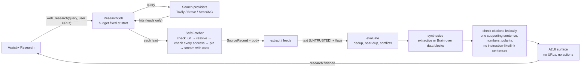

# Permission model and data flows (W1 / A0)

## 1. Five separate permissions

| Permission | Meaning | A0 | Who can grant | Bound to |
|---|---|---|---|---|
| Observe | read the one shared scope when the user asks | grantable | user, in the Assist picker (screen: second confirmation) | grant id + generation + target |
| Suggest | show findings derived from an observation | grantable, separate checkbox (off by default) | user | same grant |
| Remember | keep anything derived after the answer | **refused** (`NOT_AVAILABLE_IN_A0`); nothing is stored | — (A1: per-workflow, explicit save) | — |
| Insert | put a user-selected value into a field | **refused** (`NOT_AVAILABLE_IN_A0`) | — (A1: single-use, digest-bound) | — |
| Act | perform a consequential action | **never** granted by Assist (`NEVER_GRANTED_BY_ASSIST`) | Core's approval gate only, per action | Core approval digest |

None implies another (tested: `test_observe_does_not_imply_suggest`, the parametrised refusal test).

## 2. Assist data flow (A0)

```mermaid
flowchart LR
  U[User] -- picks scope, confirms --> UI[Flutter Assist view]
  UI -- assist_grant(kind, listed target, perms) --> AC[uri_assist.access\nAccessController]
  UI -- assist_check / assist_ask --> BR[uri_assist.bridge]
  BR -- require(OBSERVE/SUGGEST) --> AC
  BR -- stamp --> AC
  BR -- capture(target) --> AD[Adapter\nextension / UIA / screen]
  AD -- snapshot (in-page redacted)\n+ text pieces with rects --> PE[perception.normalise\nsecond redaction, bounds, digest]
  AD -- ask only: in-memory screenshot\n(same grant, never sent) --> OS[onscreen.py pixel check\nkeeps drawn pieces only]
  OS --> PE
  PE --> CHK{check_fresh\nsame grant+generation+target, age}
  CHK -- ok --> F[checks.findings\n(read-only)]
  CHK -- ok --> Q[Ask: untrusted data block\n+ question]
  Q -- loopback only, Brain idle --> B[(Runtime v1\n127.0.0.1:18470)]
  CHK -- stale/revoked --> X[refused, nothing sent]
  B --> UI
  F --> UI
```

Rules on this path:
- Nothing runs before a grant; opening the view calls only `assist_status`.
- The grant can only name a target the adapter just listed (no free-form id from the UI or a page).
- The access check runs before the capture and again after it; a Stop during capture discards the result.
- Page text, selection and headings (D10): an ask also takes an in-memory screenshot of the target under the same
  Observe grant (stamp kind `screenshot`, fresh ≤ 10 s); only text pieces it shows drawn are kept, nothing when it
  is missing. It is used only for that check and never sent. Live Assist checks (`assist_check`) take no screenshot
  and keep no page text.
- Screenshots (when enabled): fresh stamp ≤ 10 s; sensitive rectangles blacked out or the screenshot is refused;
  downscaled to ≤ 1024 px; debounced; loopback Brain only; refused while a user turn holds the single slot.
- Captured content never leaves the PC: the only model endpoint accepted is loopback.
- Nothing is persisted. A worker restart starts OFF.

## 3. Research data flow (W1)



Rules on this path:
- Pages fetched come only from the user's URLs and provider hits; links inside pages are never followed; feed items are
  reported, not fetched.
- Instruction-like sentences are removed from the evidence before synthesis; flagged sources are labelled.
- The Brain sees sources only inside delimited blocks the source cannot close; every sentence of its output must be
  supported by ONE sentence of a cited source with the same numbers and polarity (a lexical check, not proof of
  meaning); otherwise it is dropped, and if nothing survives the extractive answer is used and the fallback recorded.
- Assist answers run off the command thread and are cancelled by Stop, Pause, a new grant or a user turn; an answer
  whose grant changed during generation is discarded.
- Research never captures the screen and never uses an Assist grant.

## 4. Threats addressed (from the M1 threat list, re-scoped)

| Threat | Control | Test |
|---|---|---|
| SSRF to loopback/LAN/tailnet/metadata (T-9) | netpolicy + pinned SafeFetcher; redirects re-checked; rebinding refused | `test_w1_netpolicy_safe_fetch.py` (87 cases) |
| Prompt injection from pages/feeds/social (T-10) | untrusted blocks, evidence filtering, verifier, no derived URLs | `test_malicious_page_cannot_redirect_the_pipeline` and others |
| Injection from a shared screen/page in Assist | **Pixel-checked on-screen text, fail closed (owner decision D10, 2026-10-11).** Page text, selected text and headings reach the Brain only as pieces (about one line each) that an in-memory screenshot of the tab, taken at observation time when the user asks under the same Observe grant, shows drawn inside the piece's own viewport rectangles (`uri_assist/onscreen.py`: glyph edges per pixel and per character above named thresholds). Dropped, and counted in the observation's redactions (`no_ink`, `offscreen_or_unverified`, `pixel_check_unavailable`): text with no drawn ink, text scrolled out of or straddling the viewport, pieces with missing/truncated rectangles, and everything when no screenshot is available or it does not match the viewport. The Brain prompt labels it "On-screen text (pixel-checked)", "Selected text (pixel-checked)" and "Headings (pixel-checked)". The verification screenshot is never sent; only the separate, user-chosen screenshot path (vision) sends an image. The in-page rules (hidden/aria-hidden/display/visibility, script/style, size, clipping, occlusion, opacity/filter, fill colour, clip-path, masks, closed `<details>`) remain as a cheap first filter, no longer the boundary; for text inside the current selection, the page also drops text coloured like the opaque background behind it, because the browser repaints selected text in its own highlight colours. Form fields are unchanged (D8). **Residual limits:** hidden text whose rectangle overlaps other drawn ink (visible text, borders, a busy image or pattern) passes; text on busy images can pass when hidden; selected text that is coloured like a background image or gradient passes (the highlight draws it); a piece is all or nothing, so partly clipped text is dropped and one drawn glyph can vouch for a few undrawn characters; the DOM snapshot and the screenshot are taken one after the other, so a page that changes in between can mismatch them; very low-contrast or very thin text may be dropped (fail closed). Content stays inside data blocks; no actions exist in A0. **Correction (diagnosis D6 of `d029f60`):** the earlier row claimed hidden text was "dropped in page" by a technique list; reviews R10-R13 bypassed that list four times (R13: negative z-index under the ancestor's background, SVG `fill` none/transparent or `fill-opacity:0`, `-webkit-mask-box-image`), and the leaked text reached the Brain labelled "Visible text" / "Selected text". | `test_a0_d10_pixel_checked_text.py` (real Chromium with the R11/R12/R13 payloads and extra variants, with and without Ctrl+A; synthetic-screenshot unit tests; no-screenshot fail closed); Chromium tests `test_a0_r10/r11/r12_review_regressions.py`; `test_bridge_ask_structured_keeps_content_in_untrusted_block…` |
| Credential/secret capture | two-layer redaction; screenshot black-out or refusal | Chromium test; redaction tests |
| Silent observation | OFF by default; one scope; status-only on open; pause/stop; no persistence | Python + Flutter tests |
| External transfer of captured content | loopback-only model endpoint | `BRAIN_ENDPOINT_NOT_LOOPBACK` tests |
| Unapproved submission/action (T-13) | nothing in A0 can act; Insert/Act refused | access tests |
| Resource exhaustion | byte/time/page caps, one research job, debounce, image size checks before decode | pipeline/bridge/vision tests |
