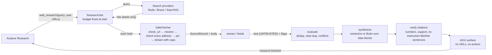

# Permission model and data flows (W1 / A0)

## 1. Five separate permissions

| Permission | Meaning | A0 | Who can grant | Bound to |
|---|---|---|---|---|
| Observe | read the one shared scope when the user asks | grantable | user, in the Assist picker (screen: second confirmation) | grant id + generation + target |
| Suggest | show findings derived from an observation | grantable, separate checkbox (off by default) | user | same grant |
| Remember | keep anything derived after the answer | **refused** (`NOT_AVAILABLE_IN_A0`); nothing is stored | — (A1: per-workflow, explicit save) | — |
| Insert | put a user-selected value into a field | **refused** (`NOT_AVAILABLE_IN_A0`) | — (A1: single-use, digest-bound) | — |
| Act | perform a consequential action | **never** granted by Assist (`NEVER_GRANTED_BY_ASSIST`) | Core's approval gate only, per action | Core approval digest |

None implies another (tested: `test_observe_does_not_imply_suggest`, the parametrised refusal test).

## 2. Assist data flow (A0)

```mermaid
flowchart LR
  U[User] -- picks scope, confirms --> UI[Flutter Assist view]
  UI -- assist_grant(kind, listed target, perms) --> AC[uri_assist.access\nAccessController]
  UI -- assist_check / assist_ask --> BR[uri_assist.bridge]
  BR -- require(OBSERVE/SUGGEST) --> AC
  BR -- stamp --> AC
  BR -- capture(target) --> AD[Adapter\nextension / UIA / screen]
  AD -- snapshot (in-page redacted) --> PE[perception.normalise\nsecond redaction, bounds, digest]
  PE --> CHK{check_fresh\nsame grant+generation+target, age}
  CHK -- ok --> F[checks.findings\n(read-only)]
  CHK -- ok --> Q[Ask: untrusted data block\n+ question]
  Q -- loopback only, Brain idle --> B[(Runtime v1\n127.0.0.1:18470)]
  CHK -- stale/revoked --> X[refused, nothing sent]
  B --> UI
  F --> UI
```

Rules on this path:
- Nothing runs before a grant; opening the view calls only `assist_status`.
- The grant can only name a target the adapter just listed (no free-form id from the UI or a page).
- The access check runs before the capture and again after it; a Stop during capture discards the result.
- Screenshots (when enabled): fresh stamp ≤ 10 s; sensitive rectangles blacked out or the screenshot is refused;
  downscaled to ≤ 1024 px; debounced; loopback Brain only; refused while a user turn holds the single slot.
- Captured content never leaves the PC: the only model endpoint accepted is loopback.
- Nothing is persisted. A worker restart starts OFF.

## 3. Research data flow (W1)



Rules on this path:
- Pages fetched come only from the user's URLs and provider hits; links inside pages are never followed; feed items are
  reported, not fetched.
- Instruction-like sentences are removed from the evidence before synthesis; flagged sources are labelled.
- The Brain sees sources only inside delimited blocks the source cannot close; its output is verified; on failure the
  extractive answer is used and the fallback is recorded.
- Research never captures the screen and never uses an Assist grant.

## 4. Threats addressed (from the M1 threat list, re-scoped)

| Threat | Control | Test |
|---|---|---|
| SSRF to loopback/LAN/tailnet/metadata (T-9) | netpolicy + pinned SafeFetcher; redirects re-checked; rebinding refused | `test_w1_netpolicy_safe_fetch.py` (87 cases) |
| Prompt injection from pages/feeds/social (T-10) | untrusted blocks, evidence filtering, verifier, no derived URLs | `test_malicious_page_cannot_redirect_the_pipeline` and others |
| Injection from a shared screen/page in Assist | hidden text dropped in page; content only in data blocks; no actions exist in A0 | Chromium test; `test_bridge_ask_structured_keeps_content_in_untrusted_block…` |
| Credential/secret capture | two-layer redaction; screenshot black-out or refusal | Chromium test; redaction tests |
| Silent observation | OFF by default; one scope; status-only on open; pause/stop; no persistence | Python + Flutter tests |
| External transfer of captured content | loopback-only model endpoint | `BRAIN_ENDPOINT_NOT_LOOPBACK` tests |
| Unapproved submission/action (T-13) | nothing in A0 can act; Insert/Act refused | access tests |
| Resource exhaustion | byte/time/page caps, one research job, debounce, image size checks before decode | pipeline/bridge/vision tests |
