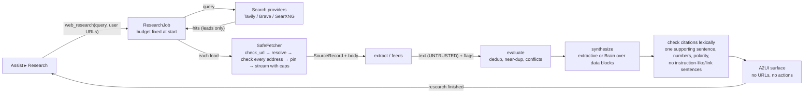

# Permission model and data flows (W1 / A0)

## 1. Five separate permissions

| Permission | Meaning | A0 | Who can grant | Bound to |
|---|---|---|---|---|
| Observe | read the one shared scope when the user asks | grantable | user, in the Assist picker (screen: second confirmation) | grant id + generation + target |
| Suggest | show findings derived from an observation | grantable, separate checkbox (off by default) | user | same grant |
| Remember | keep anything derived after the answer | **refused** (`NOT_AVAILABLE_IN_A0`); nothing is stored | — (A1: per-workflow, explicit save) | — |
| Insert | put a user-selected value into a field | **refused** (`NOT_AVAILABLE_IN_A0`) | — (A1: single-use, digest-bound) | — |
| Act | perform a consequential action | **never** granted by Assist (`NEVER_GRANTED_BY_ASSIST`) | Core's approval gate only, per action | Core approval digest |

None implies another (tested: `test_observe_does_not_imply_suggest`, the parametrised refusal test).

## 2. Assist data flow (A0)

```mermaid
flowchart LR
  U[User] -- picks scope, confirms --> UI[Flutter Assist view]
  UI -- assist_grant(kind, listed target, perms) --> AC[uri_assist.access\nAccessController]
  UI -- assist_check / assist_ask --> BR[uri_assist.bridge]
  BR -- require(OBSERVE/SUGGEST) --> AC
  BR -- stamp --> AC
  BR -- capture(target) --> AD[Adapter\nextension / UIA / screen]
  AD -- snapshot (in-page redacted)\n+ text pieces and their text units --> PE[perception.normalise\nsecond redaction, bounds, digest]
  AD -- ask only: render probe (probe.js)\nin-memory screenshots, same grant, never sent --> OS[onscreen.py render check\nkeeps pieces whose own glyphs are drawn]
  OS --> PE
  PE --> CHK{check_fresh\nsame grant+generation+target, age}
  CHK -- ok --> F[checks.findings\n(read-only)]
  CHK -- ok --> Q[Ask: untrusted data block\n+ question]
  Q -- loopback only, Brain idle --> B[(Runtime v1\n127.0.0.1:18470)]
  CHK -- stale/revoked --> X[refused, nothing sent]
  B --> UI
  F --> UI
```

Rules on this path:
- Nothing runs before a grant; opening the view calls only `assist_status`.
- The grant can only name a target the adapter just listed (no free-form id from the UI or a page).
- The access check runs before the capture and again after it; a Stop during capture discards the result.
- Page text, selection and headings (D10, R13-01): an ask also has the adapter render-probe the target under the
  same Observe grant (stamp kind `screenshot`, fresh ≤ 10 s; `adapter.probe(target)`, schema
  `uri.assist.probe.v1`): in-memory screenshots of the page as it is and with only some text units' own glyphs
  repainted (transparent, then in two random probe palettes) by a CSS Custom Highlight. Only text pieces whose own
  glyphs are drawn, visibly, in their own boxes are kept; nothing when the probe is missing or invalid. The
  screenshots are used only for that check and never sent. Live Assist checks (`assist_check`) take no screenshot
  and keep no page text.
- Screenshots (when enabled): fresh stamp ≤ 10 s; sensitive rectangles blacked out or the screenshot is refused;
  downscaled to ≤ 1024 px; debounced; loopback Brain only; refused while a user turn holds the single slot.
- Captured content never leaves the PC: the only model endpoint accepted is loopback.
- Nothing is persisted. A worker restart starts OFF.

## 3. Research data flow (W1)



Rules on this path:
- Pages fetched come only from the user's URLs and provider hits; links inside pages are never followed; feed items are
  reported, not fetched.
- Instruction-like sentences are removed from the evidence before synthesis; flagged sources are labelled.
- The Brain sees sources only inside delimited blocks the source cannot close; every sentence of its output must be
  supported by ONE sentence of a cited source with the same numbers and polarity (a lexical check, not proof of
  meaning); otherwise it is dropped, and if nothing survives the extractive answer is used and the fallback recorded.
- Assist answers run off the command thread and are cancelled by Stop, Pause, a new grant or a user turn; an answer
  whose grant changed during generation is discarded.
- Research never captures the screen and never uses an Assist grant.

## 4. Threats addressed (from the M1 threat list, re-scoped)

| Threat | Control | Test |
|---|---|---|
| SSRF to loopback/LAN/tailnet/metadata (T-9) | netpolicy + pinned SafeFetcher; redirects re-checked; rebinding refused | `test_w1_netpolicy_safe_fetch.py` (87 cases) |
| Prompt injection from pages/feeds/social (T-10) | untrusted blocks, evidence filtering, verifier, no derived URLs | `test_malicious_page_cannot_redirect_the_pipeline` and others |
| Injection from a shared screen/page in Assist | **Render-checked on-screen text, fail closed (owner decision D10, 2026-10-11; differential render since R13-01).** Page text, selected text and headings reach the Brain only as pieces (about one line each) whose own glyphs are drawn, visibly, in their own boxes. Each piece names the text units it was built from (one range of one text node, `browser_extension/snapshot.js`). When the user asks, under the same Observe grant, the adapter runs `browser_extension/probe.js` and takes in-memory screenshots: the page as it is (`base`, with the user's selection removed for the probe and restored afterwards), and for each probe group only that group's units repainted transparent (`clear`) and in two independent random probe palettes (`tint`, `tint2`) with a CSS Custom Highlight, then the page as it is again (`base2`). `uri_assist/onscreen.py` keeps a unit only where its pixels take its own probe colour in both tints with the same coverage (so only glyphs actually composited onto the screen count: clipped, covered, below-background, masked, filtered, transparent or SVG text does not repaint, and decoy text, borders, patterns, images and animations under or over it do not change that way), where its own colour differs from what is behind it (`base` vs `clear`: white-on-white and transparent fills do not), with enough such pixels per character, in every part of each of its boxes, and with the page stable during the probe (`base` vs `base2`). Touching units are probed in different groups and near units in different colours. Dropped, and counted in the observation's redactions (`no_ink`, `offscreen_or_unverified`, `pixel_check_unavailable`): undrawn text, text scrolled out of or straddling the viewport, units whose rectangles or node length changed between snapshot and probe, invalid plans or palettes, and everything when no valid probe is available (no highlight API, failed capture, wrong viewport). The DOM, `page.content()` and the selection are unchanged afterwards. The Brain prompt labels it "On-screen text (pixel-checked)", "Selected text (pixel-checked)" and "Headings (pixel-checked)". The probe screenshots are never sent; only the separate, user-chosen screenshot path (vision) sends an image. The in-page rules remain as a cheap first filter, not the boundary. Text drawn with `-webkit-text-security` (discs or squares instead of glyphs) is hidden in page and, when probe.js reports it, dropped by URI (`masked_glyphs`; R14-02). Form-field values: D8 decides which values may be shared at all; since R15-01 a shared value reaches the Brain only when it is render-checked (below). **Field labels and title (R14-01):** a field is named to the Brain only by its `shown_label`, built from the label's own visible text nodes (`<label for>`, a wrapping `<label>`, `aria-labelledby` targets) sent as pieces and render-checked like page text; `aria-label`, hidden label elements and the `label` string the page script computes are used only to decide whether a field is private and are never sent; without a drawn label the field is listed as "(unlabelled <kind> field)" with its kind from a fixed list (never the page's `type`, `name`, `id` or placeholder); fields the in-page rules find not on screen (hidden inputs, invisible private fields) are not listed; that listing decision is the in-page first filter only, so a listed field may still be invisible, which is why a listed field carries no page text except a render-checked label and value; **Field values (R15-01):** a contenteditable's value is sent only as `shown_value`, built from its own visible text nodes (not `innerText`, which includes `opacity:0` and off-screen descendants) sent as `value_pieces` and render-checked like page text; checkbox/radio state is sent as the fixed word checked/unchecked; the value of an input, textarea or select (including a search box or a comment field D8 shares) is drawn by the browser's own editor, not as text nodes the probe can repaint, so it cannot be bound to its pixels and is never sent to the Brain (fail closed): the field is listed as "(value not shown: it could not be checked as drawn on screen)", or "(empty)"; the in-page `value` is kept only for D8 and the Live Assist checks shown in the UI; the page or window title is never sent (the data block is titled "shared browser tab" / "shared window"). **Residual limits:** the page's own scripts keep running during the probe; a script that detects it (the selection change, the highlight registry, in this test harness also the adopted style sheet) can change what it draws while the probe runs, and text it shows only then can be kept (closing this needs page scripts paused during the probe, e.g. CDP `Emulation.setScriptExecutionDisabled`, which was seen to stop a page's `requestAnimationFrame` loop for good: owner decision); in the extension the probe rules must be injected with `chrome.scripting.insertCSS` (user origin, unreadable by the page) and probe.js run in the isolated world, which is NOT IMPLEMENTED (no extension channel in A0); glyphs a font draws more than three line heights outside their own box could be credited to a same-colour unit of the same group; SVG `<text>` is not repainted by the highlight and is never kept, even when visible; a piece is all or nothing, so partly clipped text is dropped; a web font that draws other glyphs than the characters it is given (glyph substitution, e.g. a font mapping letters to dots or to other letters) passes the check, because the check binds pixels to a unit, not to its reading (detecting non-system `@font-face` on text units: owner decision); input, textarea and select values are therefore never available to the structured Ask path (the user can use the screenshot path), and the page URL is sent as shown in the address bar; very low-contrast, very thin, widely letter-spaced, animated or very small (below about 5 px) text is dropped (fail closed). Content stays inside data blocks; no actions exist in A0. **Correction (diagnosis D6 of `d029f60`):** the earlier row claimed hidden text was "dropped in page" by a technique list; reviews R10-R13 bypassed that list four times (R13: negative z-index under the ancestor's background, SVG `fill` none/transparent or `fill-opacity:0`, `-webkit-mask-box-image`), and the leaked text reached the Brain labelled "Visible text" / "Selected text". **Correction (diagnosis D8 of `fcfb465`):** the D10 version of this row listed "hidden text whose rectangle overlaps other drawn ink passes" as a residual limit; that was an open bypass, not a limit: its check (glyph edges inside the piece's rectangles, whatever painted them) let hidden text placed over visible text, borders or a pattern reach the Brain (ZNEG, SVGNONE, MASKBOX, PEN, STRIPE), with and without Ctrl+A. It was replaced by the differential render above. **Correction (review R14 of `5629c04`):** this row said "Form fields are unchanged (D8)" without saying that field labels (from `aria-label`, a `display:none` `<label>`, `aria-labelledby` to a hidden element, labels of invisible private fields) and the page title reached the Brain with no render check, and text drawn with `-webkit-text-security` passed the render check as "On-screen text (pixel-checked)" although the user sees only dots; both were open bypasses, repaired as described above. **Correction (review R15 of `6ab76bd`):** this row said fields not on screen "are not listed" and that a shared field value "is not render-checked (input values are not text nodes the highlight can repaint)"; the listing used only the in-page rules, and a contenteditable's value (`innerText`) is made of text nodes and included `opacity:0` and off-screen spans: a masked or negative-z-index textarea, a transparent or covered input and hidden spans inside a contenteditable reached the Brain as "Form fields" values (MASKTA, ZNEGTA, TRANSPINPUT, COVEREDINPUT, CEOPAC, CEOFF), with and without Ctrl+A. Repaired as described under Field values above. | `test_a0_r15_review_regressions.py` (real Chromium: masked, negative-z-index, transparent and covered field values and hidden spans inside a contenteditable, with and without Ctrl+A; a drawn contenteditable value and checkbox state kept; unit test: input/textarea/search values and unchecked contenteditable values never sent); `test_a0_r14_review_regressions.py` (real Chromium: unrendered labels, hidden and invisible fields, title, `-webkit-text-security` disc/square/circle, with and without Ctrl+A; drawn labels kept; probe-reported text security dropped); `test_a0_r13_differential_render.py` (real Chromium: the five D8 overlap payloads, the R13 payloads, overlap variants, a flickering background, R11/R12 payloads and visible controls right under them, with and without Ctrl+A; page and selection unchanged; synthetic-probe unit tests; no-probe fail closed); `test_a0_d10_pixel_checked_text.py`; Chromium tests `test_a0_r10/r11/r12_review_regressions.py`; `test_bridge_ask_structured_keeps_content_in_untrusted_block…` |
| Credential/secret capture | two-layer redaction; screenshot black-out or refusal | Chromium test; redaction tests |
| Silent observation | OFF by default; one scope; status-only on open; pause/stop; no persistence | Python + Flutter tests |
| External transfer of captured content | loopback-only model endpoint | `BRAIN_ENDPOINT_NOT_LOOPBACK` tests |
| Unapproved submission/action (T-13) | nothing in A0 can act; Insert/Act refused | access tests |
| Resource exhaustion | byte/time/page caps, one research job, debounce, image size checks before decode | pipeline/bridge/vision tests |
