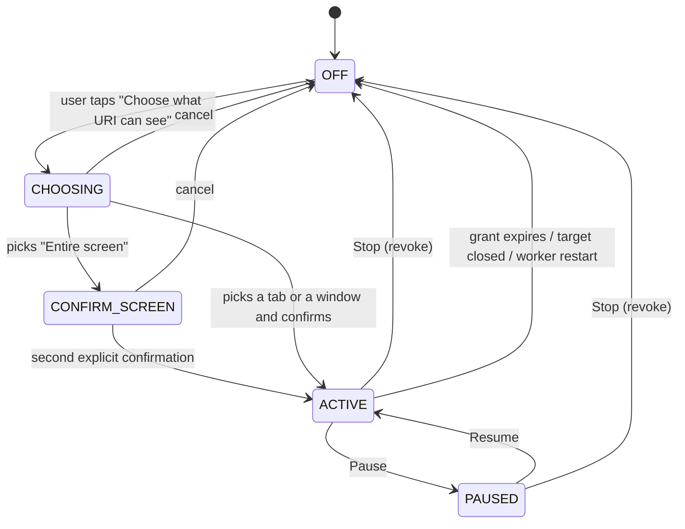

# URI Assist: UI interaction contract (A0)

Status: written before the A0 code; governs `uri_ui/lib/living/assist/` and `uri_assist/`. Write-capable controls
(inserting values, applying a workflow) are **not** part of A0; their contract is in `A1_DESIGN.md` and needs owner
review before any of them is connected.

## 1. Principles

1. Opening Assist observes nothing. Observation starts only after the user picks one scope and confirms it.
2. One scope at a time. It is always visible (scope chip in the Companion and the Assist view) and revocable in one
   tap (Stop) or paused (Pause) without losing the choice.
3. Five permissions are separate and shown separately: **Observe**, **Suggest**, **Remember**, **Insert**, **Act**.
   A0 can grant Observe and Suggest. Remember, Insert and Act are shown as "not available yet" (A1 or later). None
   implies another.
4. URI explains and suggests; it never changes the page or the window in A0.
5. Page and screen content is untrusted. Text on a page cannot change what Assist is allowed to do.
6. No background capture: Research never captures the screen; a screenshot is taken only when the user asks a question
   that needs it, and only within the active scope.
7. The orb, its selected appearance and theme colours are unchanged. Assist reuses `UriColors` / `UriGlass`.

## 2. Navigation

The Companion's mode chips become **Workspace | Dashboard | Assist** (`UiPresentationMode.assist`). Keyboard: Ctrl+4.
The local command `uri assist` opens it. The orb docks at the top-left of the Assist view (same size and light angle
family as Dashboard), so the single orb element travels as it does between the other forms.

## 3. Assist states (authoritative in `uri_assist.access`, mirrored by the UI)



| State | Observation | Visible UI |
|---|---|---|
| OFF | none; adapters are not called | "URI can't see anything" + "Choose what URI can see" |
| CHOOSING | the target list is read once on request (tab titles / window titles) | scope picker |
| CONFIRM_SCREEN | none | warning card: "URI will see everything on your screen, including notifications" + Allow / Cancel |
| ACTIVE | on demand only (user asks, or Live Assist refresh button) | scope chip (green dot), Pause, Stop |
| PAUSED | refused | scope chip (grey, "paused"), Resume, Stop |

A worker restart always comes back OFF (grants are never persisted in A0).

## 4. Assist view layout

```
┌───────────────────────────────────────────────────────────────────────────┐
│ (orb)  Assist                    [● Tab: "Fee form – School portal"] [⏸][■] │
│        URI can see this tab only. Nothing is changed.                     │
├───────────────────────────────────────────────────────────────────────────┤
│ [ Live Assist ] [ Ask URI ] [ Research ] [ Teach URI ] [ Smart Fill ]     │
├───────────────────────────────────────────────────────────────────────────┤
│  tab body                                                                 │
├───────────────────────────────────────────────────────────────────────────┤
│ Permissions: Observe ✓  Suggest ✓  Remember –  Insert –  Act –            │
└───────────────────────────────────────────────────────────────────────────┘
```

| Tab | A0 behaviour | Needs |
|---|---|---|
| Live Assist | "Check this page" reads one fresh snapshot and lists deterministic findings (required field empty, e-mail/phone/date format, mismatched confirmation fields) as suggestions; nothing is changed; no periodic capture | Observe + Suggest |
| Ask URI | a question about the active content; option "include a screenshot" (off by default) | Observe |
| Research | the W1 pipeline (`web_research`); never captures the screen | nothing from Assist |
| Teach URI | disabled card: "Coming in A1: show URI a task once and review the steps it learned" | — |
| Smart Fill | disabled card: "Coming in A1: preview suggested values and apply the ones you pick" | — |

Suggestions never interrupt: findings appear in the Live Assist tab and as one quiet line under the Companion's scope
chip ("2 suggestions"); no modal, no sound, no orb state change except `idle`.

## 5. Companion

- Scope chip under the mode chips while a scope is ACTIVE or PAUSED, with Pause/Resume and Stop icons.
- Stop is one tap and needs no confirmation (revocation must be cheaper than granting).

## 6. Dashboard

A read-only "Assist" tile: availability of each adapter (browser extension, Windows UI Automation, screenshot),
the vision pathway state (model-level qualified / application NOT VERIFIED), and the active scope or "Off".

## 7. Developer diagnostics

`assist_diagnostics` (worker command) and a collapsible "Diagnostics" section at the bottom of the Assist view:
adapter status with reasons, permission state, grant generation, last refusal code, last observation age, Brain slot
state. No captured content is shown there.

## 8. Worker commands used by the UI

| Command | Keys | Effect |
|---|---|---|
| `assist_status` | – | state, scope, permissions, adapters |
| `assist_targets` | `kind` | list candidate targets for one kind (read once, on user request) |
| `assist_grant` | `kind`, `target_id`, `permissions`, `confirm_screen` | start a scope |
| `assist_pause` / `assist_resume` / `assist_revoke` | – | as named |
| `assist_check` | – | Live Assist findings from one fresh snapshot (Observe + Suggest) |
| `assist_ask` | `question`, `use_screenshot` | answer from one fresh snapshot (Observe), optional on-demand vision |
| `assist_diagnostics` | – | diagnostics, no content |

## 9. Failure behaviour the UI must show (never hide)

| Code | UI text |
|---|---|
| `ADAPTER_UNAVAILABLE` | "URI can't read this kind of target on this PC yet" + reason |
| `SCOPE_NOT_ACTIVE` / `SCOPE_PAUSED` | "Assist is off/paused" |
| `OBSERVATION_STALE` | "That view is out of date; check again" |
| `TARGET_CHANGED` | "The tab/window changed; choose it again" |
| `BRAIN_BUSY` | "URI is answering you elsewhere; try again in a moment" |
| `VISION_NOT_QUALIFIED` | "Screenshot understanding isn't available yet" |
| `SENSITIVE_FIELDS_UNLOCATED` | "This screen has private fields URI can't hide, so no screenshot was taken" |
