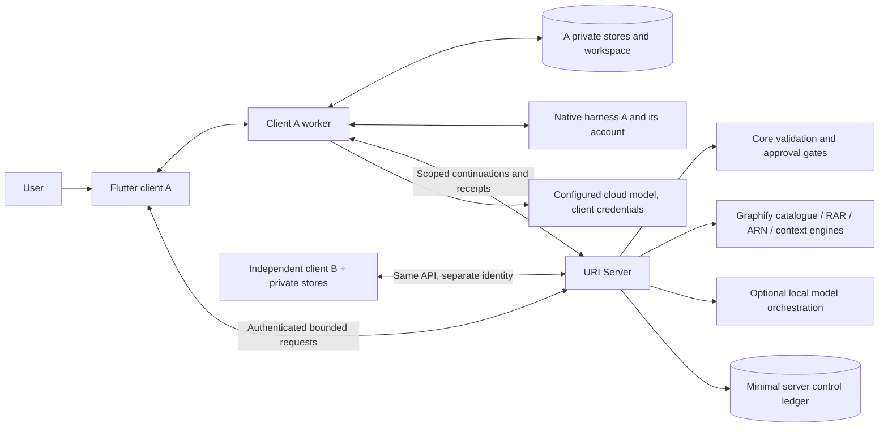

# URI Server–Client Interface Plan — Phase 1

Date: 2026-10-05. Status: PROPOSED; implementation has not begun. The User has authorized preservation and preparation, and settled the server/client ownership decisions. Endpoint/schema details below await review as the implementation contract.

## Evidence, scope and selected topology

Reuse the existing Core HTTP stack, model providers, Turn State assembly, capability resolver, approval gate, canonical executor and result feedback. Source anchor: accepted `e8e3b65259c45fc823addc3ef8969425a265bd1b`. Preserve the actual desktop/V1 compositions as donors, without merging them. See [Runtime inventory](RUNTIME_INVENTORY.md), [Contamination report](CONTAMINATION_REPORT.md), [Ownership matrix](SERVER_CLIENT_OWNERSHIP.md) and [Preservation manifest](PRESERVATION_MANIFEST.md).

One local server runs shared engines. Each Windows client runs the existing Flutter UI and a private Python worker that reuses existing store/tool/harness code. The worker is a client process with client-owned paths and credentials. It is not another URI Core server. Flutter communicates with its worker through framed JSON messages on child-process stdin/stdout; logs use stderr. HTTP requests to Core remain in the existing Flutter/HTTP client layer or the worker's transport port, with one authoritative coordinator per turn.

The worker is needed to reuse Python persistence and native harness containment without porting them to Dart or making the server own private files. Mobile clients may implement the same external protocol using their platform's storage/execution facilities later; Python deployment on mobile is not assumed or included.

The diagram does not grant execution authority. Core deterministically decides permitted capabilities and approvals. The client worker validates a Core-issued execution ticket and its local scope before executing. Neither model nor adapter can manufacture tickets, grant capabilities, or mark claims verified.

## Requirement IDs and measurable drivers

| ID | User requirement / invariant | Design consequence | Acceptance evidence |
|---|---|---|---|
| R1 | One shared local Core server | One installation identity and process lifecycle; reuse modular Core | Concurrent launch and wrong-listener checks |
| R2 | Independent client private database/memory/workspace/config | Client worker owns durable private stores; server has no paths to them | Two clients under one account, file-open tracing and negative isolation tests |
| R3 | Harness adapters/auth belong to clients | Native discovery/process/account access occurs only in worker | Server secret/path deny checks; real client-contained task |
| R4 | Client selects local/cloud/harness | Explicit reasoning source per client/turn; no automatic cost/account fallback | Exact provider selection and quota/unavailable cases |
| R5 | Preserve RAR/ARN/Graphify/safeguards | Reuse qualified sources; scope overlays; keep deterministic gates | Existing regressions plus canonical behavioral cases |
| R6 | Preserve existing desktop | No current shortcut, process, state or configuration cutover | Before/after source and deployment hashes |
| R7 | No consolidation implementation in Phase 1 | Clean isolated worktree; documentation and backup utilities only | Git and process evidence |
| R8 | Developer administration / production users deferred | Local pairing sufficient for this stage; retain existing guards without new RBAC/admin product | No privilege expansion or experience-tier authority |

Planning assumptions, not measurements: initially 2–4 local clients, maximum 4 active turns across the server, one active turn per client session, average 0.1 turn/s and burst 2 turn/s. Default serialized context cap 256 KiB and existing model-specific token budgets; whichever is stricter applies. At 0.1 turn/s this is at most 25.6 KiB/s request context before protocol overhead; a 2 turn/s burst is 512 KiB/s. Four bounded context snapshots require at most 1 MiB of payload memory before model/library overhead. No inference latency or total RAM guarantee is implied.

Initial non-stream request cap is 2 MiB, individual protocol frame cap 2 MiB, and attachments transfer only on explicit need, capped at 16 MiB per artifact in the new surface. Larger documents require bounded chunk extraction or a reviewed future limit, not silent truncation. These proposed limits do not alter legacy routes in C1. Initial overload response is 429 with bounded Retry-After; no unbounded queue. Reconsider limits after measured real-document workloads. Add workers/brokers only if demonstrated throughput requires them; persistence ownership stays unchanged.

Control-ledger storage estimate: at 100 terminal operations/day, 2 KiB metadata per operation and 30-day retention, payload storage is about 6 MiB, before indexes/journaling. Actual private-client storage and model RAM are workload-dependent and unmeasured. A rise above 4 concurrent turns, recurring 429s or context-read round trips dominating measured latency triggers a capacity review, not automatic services or queues.

## Systems of record and dependency direction

Client private stores remain existing JSON/JSONL/SQLite formats where possible. A client installation ID is distinct from user ID, device label, session ID, task ID, server ID and native harness account. Existing self-reported `device_id` is informational and cannot be promoted into authority.

Server owns public capability definitions, qualification metadata, its installation/configuration, pairing records, token hashes, and minimal execution-control metadata. Minimal ledger fields: server/client/principal/operation IDs, request digest, grant/approval digest and decision, expiry, state/version, receipt digest, and idempotency metadata. It contains no prompts, private profile/memory, document paths/content, native account handles or harness transcripts. Client stores the full consent/action/context/receipt history.

Client database → bounded context → server inference → untrusted proposal → Core validation/approval → execution ticket → client execution → receipt verification → reasoning feedback → proposed private mutation → client persistence acknowledgement. Server must never walk a client's filesystem or call a backend default private store when context is absent.

Server modules may depend on shared contracts and control interfaces. Client worker may depend on shared schemas, private stores, capability implementations and native adapters. Shared schemas must not depend on HTTP, model providers, account homes or process launch. Shared engines cannot import the worker or use global native CLI homes. Existing per-user store injection in `_build_user_context` is the migration seam, not evidence that every store is already transport-neutral.

## Authentication and client binding

Keep existing high-entropy bearer sessions and hashed-token persistence; extend session records for the new surface with a **server-issued pairing binding** to a client installation. Provisioning is a local developer action through the future server controller, using the current Windows account. A GUI/model claim to a client ID cannot create a pairing. No production administrator roles, management UI or tenant hierarchy is introduced.

Provisioning places a scoped pairing credential in that client's protected installation store and saves only its hash/identity in the server control store. Session acquisition/revocation binds the pairing and principal. Token storage is client-owned Windows protected storage; raw credentials never travel in query strings or appear in logs. Existing auth/ADMIN/capability policies remain; their architectural removal is not part of deferred production administration.

Use the existing cryptography dependency for an Ed25519 server identity/ticket signing key. Protect the server-owned private key with Windows protected storage. Local provisioning pins its public-key fingerprint in the client/launcher manifest. A nonce challenge is signed over server ID, generation and manifest digest; clients verify the pinned public key before transmitting bearer credentials. Public identity alone cannot prove authenticity. Token hashes remain lookup records and are never repurposed into signing credentials.

The new API requires a valid paired session for all private operations. Missing/invalid/expired tokens fail 401; a token bound to another client fails 403. Context/workspace identifiers are checked against the pairing and operation, not accepted from model output. Server installation identity must match the saved pairing before sending a credential. Loopback HTTP is the initial deployment boundary; remote/LAN access remains out of scope and retains current bind safeguards.

This is logical isolation for cooperative developer-owned applications, not protection against malicious code running as the same Windows user. Stronger OS-user/sandbox and production multi-user administration are deferred without weakening existing execution safeguards.

## API contract v1

New client routes use `/client/v1`; legacy `/ask`, streaming/auth routes remain during compatibility migration. C1 adds only `/runtime/identity` and `/runtime/status`, detailed in the launcher plan. Every new route is classified and tested; no default-public route inheritance.

| Route | Scope / request | Response and semantics |
|---|---|---|
| `POST /client/v1/session` | Locally provisioned pairing + existing principal authentication | Client-bound bearer session, server ID, expiry and contract version |
| `GET /client/v1/capabilities` | Paired principal/client | Public catalogue intersected with actual principal grants and qualified client advertisements; availability is not a grant |
| `POST /client/v1/turns` | Bounded TurnRequest | TurnEnvelope: reply, needs_context, proposal, needs_approval, client_action, awaiting_commit, failed or cancelled |
| `POST /client/v1/turns/{id}/continue` | Continuation with expected version, exact ticket/receipt or context response | Advances that client's turn exactly once; replay returns the prior response |
| `POST /client/v1/turns/{id}/approval` | Explicit UI consent, ticket/operation digest, expected version | Core revalidates grants, decline/expiry and current scope before issuing execution ticket |
| `POST /client/v1/turns/{id}/claim` | Signed execution ticket and expected control version | Atomically rechecks current approval/grant/expiry and marks dispatch claimed; no execution before this acknowledgement |
| `POST /client/v1/turns/{id}/commit` | Client CAS persistence result + mutation digest | Final acknowledged reply or conflict; never declares memory saved before acknowledgement |
| `POST /client/v1/turns/{id}/cancel` | Client-bound turn and expected version | Cancellation state; client worker terminates only its owned contained task tree |
| `GET /client/v1/turns/{id}/status` | Client-bound operation | Minimal control state; content replay comes from client, not server transcript storage |

These routes define the target surface; they are not currently implemented. The existing file/task/graph/connection endpoints gain a client facade only as each owning subsystem migrates. No new facade points at private backend `uri_workspace/users` trees.

Common envelope fields: `schema_version="uri.client.v1"`, `server_id`, `client_id`, `session_id`, `turn_id`, `operation_id`, `request_id`, `expected_version`, `idempotency_key`. Server and paired client IDs are derived/checked at the edge. IDs are opaque; UUID syntax alone is never authorization. Unknown fields/contract versions fail closed. Canonical JSON hashing uses the existing deterministic serialization primitives.

TurnRequest adds user text, bounded context package, explicit current attachment descriptors, qualified client capability advertisements and reasoning selection. ClientContext includes only task-relevant profile/memory pointers, active references, conversation projection, provenance/freshness and snapshot versions. Transfer packages do not include provider passwords, native harness credentials, source absolute paths or full database dumps.

Artifact descriptors: opaque client-owned ID, version, content hash, media type/byte count and session/task scope. Requested evidence fragments are bounded and consent-scoped. Source freshness is rechecked by the client before side effects. RAR bindings use exact candidate/evidence IDs; ARN traces remain task/client-scoped. The server can keep these in turn memory, but not as a global reusable cache.

## State transfer without server-owned private stores

`ClientStateSnapshot` supplies only the state needed by the existing canonical loop. Request-scoped adapter implementations expose current store reads over this snapshot. A missing read does not fall back to ambient files: the turn returns a typed `needs_context` continuation. The client worker validates the requested read against local granted scope, materializes a bounded result and resubmits it. Batch related reads to avoid per-field round trips.

Store writes become a `ClientMutationSet`: typed store operation, base version, previous state digest, payload digest and idempotency key. The client worker validates schema/scope/consent and applies a local transaction or existing store atomic-write discipline with compare-and-swap. Core receives a persistence receipt. A mixed JSON/SQLite write is not called atomic unless a transaction/journal proves it; use a client journal to recover incomplete multi-store commits.

Long-lived context is owned by the client. Server in-memory turn state expires after 15 minutes idle or 60 minutes wall time unless an explicit approved long-running execution ticket is outstanding. No inference can enlarge its own expiry. At expiry, drop private context and retain only minimal control metadata. New turns require fresh bounded context.

Minimal control ledger retention proposal: terminal records 30 days; unsettled operations until reconciled, never auto-replayed. On removal of old idempotency records, expired execution tickets remain invalid; the client cannot re-run old side effects as a new operation without new approval. Private client retention stays its configuration/policy. Logs must not record full requests or ticket contents containing private arguments.

## Model selection and external-harness loop

ReasoningSelection fields: `kind` in `server_local_model`, `client_cloud_model`, `client_external_harness`; provider/model or qualified adapter identity; explicit allowed fallback list (empty by default); timeout/cost preferences. This is a request preference, never authority. Core checks provider/adapter support and capability eligibility.

Selected local models run in the shared server provider layer. Server can orchestrate multiple roles using existing routing; residency is lazy and bounded. Startup performs metadata/readiness checks without model generation or warm-up. Clients do not independently evict server models. Reuse the current provider boundary; do not import the integration desktop residency seam as default policy without qualification.

Cloud requests use the client worker and client API credential. Server assembles bounded reasoning requests, the client sends them to its configured cloud provider, and returns structured proposals through the same continuation validation. Existing API-provider code can run client-side through a shared provider port. Credentials never move to server persistence. If a server-owned shared service is ever configured separately, that is an explicit server credential configuration, not an imported client account.

External harness reasoning is separate from external harness execution. The client adapter receives the bounded reasoning envelope in a proposal-only qualified posture. Tool activity inside that harness must be unavailable or bridged through Core-issued tickets; simply asking the CLI to emit JSON is not sufficient containment. Reasoning responses, grant requests and success claims remain untrusted. After client tool execution, return a verified receipt to the same reasoning source before drafting the user-visible result. No selected source may silently fall back to a local Brain or another billed provider.

Absent local Brain/Edge/Ollama must not block server startup or client pairing/capability discovery. A missing selected model or unqualified adapter produces a typed unavailable state. Quota exhaustion produces durable `WAITING_FOR_MODEL` where applicable, with an exact checkpoint and no silent substitution. Existing Antigravity execute refusal and M38 qualification limitations remain until adapter-specific live evidence permits promotion.

## Execution tickets, results and recovery

Extend existing capsule semantics with server/client/session/task/operation IDs, exact capability/argument digest, workspace handle and version, approval digest/status/expiry, allowed output handles, verifier identity and implementation digest, deadline and cancellation nonce. The server validates proposals against the real registry/grants and issues a ticket only after required approval. Authenticate tickets with the scoped session/control channel; a model-produced ticket-shaped object is invalid.

Tickets use the pinned server signing key and bounded lifetime; the default preparation-to-claim TTL is 60 seconds, with at most 5 seconds permitted clock skew. The claim transition is the dispatch linearization point: revalidate approval and capability state there, then enforce cancellation through the owned client task if a later revocation arrives. A signed but revoked/unclaimed/replayed ticket cannot launch work. Offline ticket execution is not supported.

Client validates all bindings and local workspace/source freshness before process launch. Native adapter discovery, supported account-profile selection, plugins/MCP injection and subprocess containment remain client-side. No sandbox-bypass flags. Client settings may narrow permitted execution, never enlarge server grants. Shared engine outcomes cannot directly invoke client shell commands.

Receipt includes operation/ticket digest, client-local run ID, verified outcome, bounded evidence/artifact descriptors, verifier identity, persisted state version, failure category and usage metadata. Reuse current claims-versus-verification separation and result ledger. Server independently checks receipt bindings/verifier qualification and authority; client/harness self-report alone is not success.

The trusted client worker runs the registered deterministic verifier against actual private artifacts and returns bounded evidence plus its qualified implementation identity. Core checks that evidence and the expected verifier contract. Server cannot independently reread a private client file: workflows requiring full server-side verification must obtain an explicitly authorized bounded artifact/evidence transfer. Otherwise report the verifier's precise confidence/limitations rather than claim stronger verification. Models and harness subprocesses cannot author the trusted worker's settlement record.

Idempotency scope: `(server_id, client_id, operation_id, idempotency_key, request_digest)`. Same key/digest returns prior state; same key with different digest returns 409. Serialize one turn's transitions using expected versions; use existing bounded concurrent execution controls for independent turns. Approval decline/revocation is checked again at dispatch, not only when prepared.

| Failure | Required behavior |
|---|---|
| Wrong server/client/session | Reject before reading private context or launching work |
| Missing context/client offline | needs_context/unavailable; no backend-store fallback |
| Provider timeout/quota | Honest failure or WAITING_FOR_MODEL; explicit recovery, no substitution |
| Receipt missing after possible side effect | EXECUTION_UNCERTAIN; inspect client checkpoint/artifacts before recovery; never blind retry |
| State CAS conflict | 409 STATE_VERSION_CONFLICT; reload/reason with fresh state; no replay of completed side effects |
| Server restart | Client supplies fresh context plus journal IDs; server ledger prevents duplicate dispatch; obsolete sessions/tickets fail closed |
| Client restart | Read its own durable journal, inspect process settlement, reconnect and reconcile; no automatic rerun |
| Cancel during execution | Signal owned client task, settle and report actual outcome; cancellation is not proof no side effect occurred |
| Overload / payload overflow | 429 / 413; bounded admission, no unbounded wait or silent truncation |
| Protocol mismatch | 426/409 CONTRACT_VERSION_UNSUPPORTED; no guessing fields |

Errors carry stable code, retryability, operation/version reference and safe detail. No private path, CLI transcript, token or key in HTTP errors. Time budgets are monotonic within processes; ticket expiry uses server UTC with bounded clock skew, not client-supplied timestamps.

## Source mapping and alternatives

| Existing seam | Planned adaptation |
|---|---|
| `server.py` principal/context construction and auth sessions | New paired context and strict client routes; legacy code stays until migration |
| `turn_state.py`, `decision_engine.py` | Snapshot/context continuation inputs; retain Graphify discovery and canonical proposal flow |
| `approval_gate.py`, capability resolver, `canonical_execution.py`, dispatcher | Ticket issue and client execution port, preserving gate order and feedback |
| Existing store injection / portable paths | ClientStateSnapshot / ClientMutationSet adapters; paths chosen by client installation |
| `model_router.py` and provider ABCs | Explicit local/cloud/harness reasoning source, per-client preference and no implicit warm-up |
| V1 memory/context/capsule/verifier/result ledger | Reuse qualified schemas, bounded provenance and receipt acceptance |
| Flutter HttpUriClient / AppState / SessionStore | Protocol facade and worker lifecycle; independent preferences and server-bound session |

Rejected: centrally storing each client's database in separate server directories (violates client ownership); synchronous server filesystem callbacks into clients (requires exposure and conflates ownership); permanent WebSocket/broker topology (unnecessary for initial local clients); porting every Python tool/store to Dart (unnecessary replacement); relying on harness JSON mode as a security boundary (unqualified).

Selected: client-initiated HTTP continuations plus local worker, existing store formats and reusable contracts. Consequences: more explicit turn/state transitions and client recovery responsibilities; unavailable clients cannot receive private state writes. Reopen transport only for measured latency/concurrency requirements, without changing state ownership.

Dependency evidence: accepted `requirements.txt:3–4` declares FastAPI/uvicorn and line 14 declares cryptography. Signing uses that existing dependency, not a replacement framework. Accepted `server.py:914` still starts user-store initialization and Graphify loading; identity/launcher preparation does not imply private-store separation already exists. C1 must contain compatibility startup in synthetic roots; C2/C3 perform the explicit state-port migration.

## Validation and design readiness

Design is ready to bound C1 implementation planning. The complete cross-process canonical-loop migration still requires per-store method coverage and adapter qualification before later slices freeze. This is an explicit sequence, not permission to invent runtime fallbacks.

Acceptance prerequisites: exact source/build/environment manifest; isolated clean base and synthetic client roots; no production tokens/documents. Required evidence: contract/schema and negative route checks; two-client isolation; scoped store/graph/attachment reads; source-freshness and CAS conflicts; approval decline/expiry; harness containment and private account separation; cancellation/crash/replay recovery; no-Brain full loop; qualified RAR/ARN/Graphify regressions; UI live parity.

Unresolved risks that gate later implementation: ownership of historical user directories; recovery of Windows account-bound native secrets on a different machine; exact compatibility of all store methods with snapshots; native per-install harness authentication/containment; compiled UI provenance; M38 fresh live qualification. None is resolved by merely drawing a boundary or passing schema tests.
