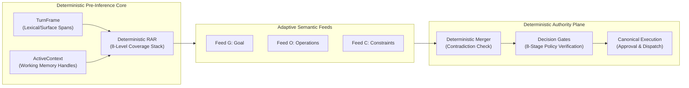

# URI Development Evidence Registry
## Durable Epistemological Record of Empirical Findings, Qualified Runtimes, Reusable Mechanisms, and Rejected Paths

- **Document Version**: 1.0.1-audited (v1.0.0 by Gemini; bounded audit repairs by Claude 2026-09-24; pre-audit copy preserved outside the repository — see audit report §16)
- **Canonical Repository Path**: `docs/governance/URI_DEVELOPMENT_EVIDENCE_REGISTRY.md`
- **Target Worktree**: `C:\Users\cheta\Development\Uri\_V1`
- **Protected Legacy Prototype**: `C:\Users\cheta\Development\uri-agent` (READ-ONLY)
- **Governing Standard**: Verification-First Architecture; Propose $\rightarrow$ Validate $\rightarrow$ Approve $\rightarrow$ Execute Chain.
- **Classification Status**: `DURABLE_PROJECT_MEMORY` — **audited 2026-09-24; see audit notice below before relying on any entry.**

> [!IMPORTANT]
> **Independent Audit Notice (v1.0.0 → v1.0.1-audited, 2026-09-24, Claude).** This registry (authored by Gemini, v1.0.0) was independently audited against primary repository evidence. Evidence-supported defects were repaired in place under bounded repair authority; every repaired entry carries an `**Audit correction (2026-09-24)**` note preserving what v1.0.0 claimed and why it changed. Full findings, coverage, unverified entries, and the pre-audit backup location: [`URI_DEVELOPMENT_EVIDENCE_REGISTRY_AUDIT.md`](URI_DEVELOPMENT_EVIDENCE_REGISTRY_AUDIT.md). Entries not listed as verified in that audit were **sampled or not verified** — treat them as index pointers to primary evidence, not as authority.

### 0. Repository Provenance (added by audit — read first)

- `C:\Users\cheta\Development\uri-agent` (branch `master`) and `C:\Users\cheta\Development\Uri\_V1` (branch `m35-uri-v1-parallel-architecture`) are **two git worktrees of the same repository**, both at commit `e8e3b65` as of this audit (`git worktree list`). Tracked `uri_core/` is therefore the **same committed code** in both. The `uri-agent` worktree additionally carries uncommitted edits to some `uri_core` files (e.g. `server.py`, `edge_lifecycle/*`, `provider_registry.py`); none of the mechanisms audited below (`context_resolver.py`, `turn_state.py`, `file_store.py`, `arn/`, `fact_manager.py`, `capability_relevance.py`) differs between the two.
- **`CURRENT_V1_URI_CORE`** = `_V1\uri_core\` — the **live production backend** launched by `scripts/run_uri_server.py` (`uri_core.app.server:app`). Its `TurnState` assembly, `CapabilityContextResolver`, `FileStore`, `WorkflowExecutor`, `ConversationHistoryStore`, and `ARNEngine` are reached by real `/ask` requests (see `docs/plans/M35_URIV1_PRE_RAR_CANDIDATE_ANCHOR_SOURCE_AUDIT.md` §2; `docs/plans/ARN_1_COMPLETION_REPORT.md`).
- **`PROTECTED_LEGACY_URI_AGENT`** = the `uri-agent` worktree, read-only by governance. Calling its `uri_core/` mechanisms "historical prototype" mechanisms (as `M35_URIV1_A2_5_LEGACY_DETERMINISTIC_REFERENCE_AUDIT.md` and registry v1.0.0 §3 did) is misleading: they are the same code as the current live backend.
- **`URI_V1_NEW`** = `_V1\uri_v1\` — the new parallel architecture. **Git-untracked (uncommitted) as of this audit.** Repository-wide grep finds **zero imports** between `uri_v1/` and `uri_core/` in either direction; nothing in `uri_v1/turn/` (TurnFrame, RAR, ActiveContext, Mode D feeds) is reachable from the live server.
- Unqualified paths like `uri_core/core/turn_state.py` in this registry refer to `CURRENT_V1_URI_CORE` unless stated otherwise.

### 0.1 Lineage Labels (added by audit)

**Similarity is not lineage.** Lineage claims in this registry use: `ADAPTED_FROM` / `REUSED_FROM` / `PORTED_FROM` / `DERIVED_FROM` (only with implementation evidence: source comment, accepted plan instruction plus implementing report, or diff); `PLANNED_ADAPTATION_NOT_IMPLEMENTED` (a plan instructed adaptation, but no implementation carries it); `SIMILAR_PRINCIPLE`; `INDEPENDENTLY_PRESENT`; `FUNCTIONALLY_RELATED`; `LINEAGE_UNVERIFIED`.

---

## 1. Governing Principles & Epistemological Taxonomy

This registry serves as the permanent, machine-retrievable source of development memory for URI v1. Future development models (Claude, Codex, Antigravity, Gemma, Qwen, and successors) and human engineers must consult this record to prevent the costly re-discovery of known failures, the repetition of rejected architecture paths, or the ungrounded assertion of model memory.

### 1.1 Non-Negotiable Memory Rules
1. **DO NOT TRUST MODEL MEMORY**: An assertion without a cited file, test, benchmark, or telemetry artifact is classified as `UNVERIFIED_MEMORY` and cannot serve as architectural authority.
2. **DO NOT TRUST USER MEMORY**: User recollections of past performance must be cross-checked against recorded logs and telemetry.
3. **DO NOT TRUST OLD SUMMARY LANGUAGE WITHOUT CHECKING PRIMARY EVIDENCE**: Historical summary documents often reflect interim hypotheses that were later overturned or qualified by subsequent empirical audits.
4. **FACT $\rightarrow$ EVIDENCE $\rightarrow$ SCOPE $\rightarrow$ STATUS $\rightarrow$ LIMITATION $\rightarrow$ REUSE VALUE**: Every durable entry must trace unbroken provenance back to primary repository artifacts.

### 1.2 Epistemological Classification Taxonomy
Every finding in this registry is bound to exactly one of the following epistemological states:

| Classification | Definition & Evidentiary Standard |
|---|---|
| **`PROVEN`** | Formally verified by deterministically reproducible tests, source-level assertions, or mathematical invariants that pass across independent audit sweeps. |
| **`OBSERVED`** | Empirically measured in real execution runs, live telemetry, or hardware benchmarks under documented environmental conditions. Valid for those conditions only. |
| **`HYPOTHESIS`** | Formulated architectural expectation or design model that has not yet been subjected to independent empirical verification or qualification. |
| **`UNMEASURED`** | Known behavior or parameter for which no systematic, instrumented measurement exists in repository evidence. |
| **`UNKNOWN`** | State where available evidence is absent, inconclusive, or conflicting without a definitive tie-breaker. |
| **`REJECTED_FOR_ROLE`** | Model, framework, or mechanism that decisively failed qualification for a *specific* role, while remaining potentially eligible for other roles. |
| **`SUPERSEDED`** | Finding, benchmark, or design assumption that was valid at the time but has been formally replaced, corrected, or rendered obsolete by subsequent evidence. |
| **`PARKED`** | Concept, design, or exploration deliberately set aside by accepted governance without prejudice, pending prerequisite completion. |
| **`CONTAMINATED`** | Benchmark, evaluation, or fixture set where oracle information leakage, flawed scaffolding, or test-suite coupling compromised the validity of reported numbers. |

**Audit correction (2026-09-24) — classification discipline.** v1.0.0 applied `PROVEN` to many single-run benchmark results (e.g. 12-case, 18-case, 38-case suites) that do not meet this table's own `PROVEN` definition ("pass across independent audit sweeps"). Repaired entries now use `OBSERVED` for measured-but-unreplicated benchmark outcomes and reserve `PROVEN` for code-level invariants enforced by tests. "Qualified" always means *qualified for a named role under a named benchmark*, never general fitness. Status words used in §6/§8 (`ACTIVE_BASELINE`, `REUSED_ADAPTED`, `REUSABLE_ADAPTED`, `EXPERIMENTAL_CANDIDATE`, `OPEN_EMPIRICAL_GAP`, etc.) are **outside** this taxonomy; where repaired they are paired with lifecycle states from `SKILL.md` (`IMPLEMENTED_UNWIRED`, `OPERATIONAL`, etc.).

---

## 2. Evidence Inventory (Phase 1)

This registry was synthesized from direct source inspection of **64 primary evidence artifacts** across the URI v1 repository and the protected legacy prototype.

### 2.1 Primary Architecture, Research, and Audit Documents
1. `docs/governance/URI_ACTIVE_MILESTONE.md` (Authoritative active milestone control and historical closure audits)
2. `docs/governance/URI_FOUR_STAGE_DEVELOPMENT_LIFECYCLE.md` (Permanent 4-stage governance policy)
3. `docs/research/URI_AGENT_LOOP_ROOT_CAUSE_AUDIT.md` (Stage 1 audit tracing the 4-way decision fragmentation)
4. `docs/research/M32_ROOT_CAUSE_AUDIT.md` (Stage 1 external capability bridge & planner audit)
5. `docs/research/M33_2_EDGE_SECOND_BRAIN_ROOT_CAUSE_AUDIT.md` (Stage 1 edge/second brain foundation audit)
6. `docs/research/GEMMA4_EVALUATION_REPORT.md` (Evaluation of `gemma4:12b` local reasoning & canonical gates)
7. `reports/Edge runtime evaluation.md` (Primary evaluation of Needle 3 and Cactus runtimes)
8. `research_notes/Edge runtime evaluation/needle.md` (Needle 3 API, confidence, and telemetry analysis)
9. `research_notes/Edge runtime evaluation/cactus.md` (Cactus engine, platform support, and licensing analysis)
10. `research_notes/Edge runtime evaluation/patterns.md` (Edge integration patterns and telemetry denial)

### 2.2 Milestone Plans and Completion Reports
11. `docs/plans/M23_STATE.md` (Graph Intelligence SQLite store & traversal verification)
12. `docs/plans/M30_4_DECISION_QUALITY_ANALYSIS.md` (18-case golden set evaluation & mode-selection bias discovery)
13. `docs/plans/M30_5_DETERMINISTIC_GATES_REPORT.md` (Deterministic decision gates implementation)
14. `docs/plans/M30_5A_DECISION_QUALITY_REMEDIATION_REPORT.md` (Candidate preselection, checklist prompt, active_pointer repair)
15. `docs/plans/M30_5B_CANDIDATE_RECALL_MULTI_ACTION_REPORT.md` (Candidate recall@K, foundational capabilities, memory routing)
16. `docs/plans/M30_5C_PENDING_INTERACTION_BOUNDARY_REPORT.md` (ANSWER vs CANCEL vs NEW_INTENT three-way boundary)
17. `docs/plans/M30_5D_TEMPORARY_CONTEXT_INTENT_SHIFT_REPORT.md` (Independent interpretation & latest-intent-wins design)
18. `docs/plans/M30_6_CONTROLLED_CANONICAL_EXECUTION_REPORT.md` (First controlled execution on allowlist)
19. `docs/plans/M30_7A_CANONICAL_LIVE_EVIDENCE_REPORT.md` (Live canonical evidence capture)
20. `docs/plans/M30_7B_CANONICAL_READINESS_CLOSURE_REPORT.md` (Readiness closure plan and matrices)
21. `docs/plans/M30_7C_READINESS_EVIDENCE_CLOSURE_REPORT.md` (12-scenario readiness closure report)
22. `docs/plans/M30_8_CLAUDE_AUDIT.md` (Independent audit of canonical cutover and legacy retirement)
23. `docs/plans/M30_8_PHASE_A_OBSERVATION_AND_PHASE_B_DISPOSITION.md` (Phase A live observation battery)
24. `docs/plans/M31_STATE.md` (Model & Brain UX final audit and release)
25. `docs/plans/M32_POST_BATCH_C_LATENCY_ARCHITECTURE_PLAN.md` (Brain latency, CapabilityDirectory caching, streaming `/ask/stream`)
26. `docs/plans/M33_2_BATCH_A_STATE.md` (Edge foundation Batch A state and review)
27. `docs/plans/M33_2_BATCH_B_STATE.md` (Reversible benchmark harness Batch B audit)
28. `docs/plans/M33_2_BATCH_B1_COMPLETION_REPORT.md` (Micro-model ensemble qualification harness)
29. `docs/plans/M33_2_BATCH_B2_COMPLETION_REPORT.md` (Edge perception vision & speech qualification)
30. `docs/plans/M33_2_BATCH_B3_COMPLETION_REPORT.md` (Local model runtime and user-space lifecycle infrastructure)
31. `docs/plans/M33_2_BATCH_B4_COMPLETION_REPORT.md` (Real edge model qualification: Needle 3, SmolLM2, Qwen2.5-0.5B)
32. `docs/plans/M33_2_BATCH_B4_STATE.md` (Final audit and release of Batch B4)
33. `docs/plans/ARN_ADAPTIVE_RETRIEVAL_NARROWING_PLAN.md` (ARN architectural foundation plan)
34. `docs/plans/ARN_1_COMPLETION_REPORT.md` (Deterministic narrowing core completion report)
35. `docs/plans/ARN_1_STATE.md` (Final audit and closure of ARN.1)
36. `docs/plans/M35_URIV1_A0_PARALLEL_SKELETON_REPORT.md` (URIv1 parallel architecture skeleton)
37. `docs/plans/M35_URIV1_A1_DECODED_REQUEST_REPORT.md` (DecodedRequest contract design)
38. `docs/plans/M35_URIV1_A1_1_CONTRACT_HARDENING_REPORT.md` (DecodedRequest contract hardening & immutability)
39. `docs/plans/M35_URIV1_A2_NEEDLE_DECODER_REPORT.md` (Needle 3 monolithic qualification & rejection)
40. `docs/plans/M35_URIV1_A2_1_NEEDLE_NARROW_REPORT.md` (Needle 3 narrow-schema qualification)
41. `docs/plans/M35_URIV1_A2_2_QWEN_DECODER_REPORT.md` (Qwen3.5-0.8B reasoning-distilled local qualification)
42. `docs/plans/M35_URIV1_A2_3_SCAFFOLDED_NEEDLE_REPORT.md` (TurnFrame + ActiveContext + Scaffolded Needle qualification)
43. `docs/plans/M35_URIV1_A2_4_QWEN14B_CONTROL_REPORT.md` (Qwen3-14B control model qualification)
44. `docs/plans/M35_URIV1_A2_4R_ARCHITECTURE_ALIGNED_NEEDLE_QWEN_REPORT.md` (Comparative control: Needle 3 vs Qwen3-14B)
45. `docs/plans/M35_URIV1_A2_5_LEGACY_DETERMINISTIC_REFERENCE_AUDIT.md` (Archaeological audit of legacy prototype mechanisms)
46. `docs/plans/M35_URIV1_A2_5_RAR_DETERMINISTIC_STAGE2_REPORT.md` (RAR Stage 2 deterministic coverage stack)
47. `docs/plans/M35_URIV1_A2_5_RAR_REALISTIC_BLIND_STAGE3_REPORT.md` (RAR Stage 3 realistic blind benchmark)
48. `docs/plans/M35_URIV1_A2_5_RAR_STAGE4B_INDEPENDENCE_MANIFEST.md` (Independence manifest for Stage 4B benchmark)
49. `docs/plans/M35_URIV1_A2_5_RAR_STAGE4B_REQUALIFICATION_AUDIT_REPORT.md` (Stage 4B-B independent requalification & ablation audit)
50. `docs/plans/M35_URIV1_A2_5_STAGE3_RAR_LFM350M_REPORT.md` (LFM2.5-350M evaluation on RAR residuals)
51. `docs/plans/M35_URIV1_A2_5_STAGE4_LFM_SEMANTIC_OPERATING_ENVELOPE.md` (LFM2.5-350M operating envelope & feed qualification)
52. `docs/plans/M35_URIV1_A2_6_QWEN3_5_2B_QUALIFICATION.md` (Qwen3.5-2B adaptive feed qualification & latency breakthrough)
53. `docs/plans/M35_URIV1_A2_7_RESIDENT_MAIN_BRAIN_SEMANTIC_QUALIFICATION.md` (Resident Qwen3.5-9B dual-role qualification)
54. `docs/plans/M35_URIV1_A2_8A_ARN_FOUNDATION_REPORT.md` (ARN foundation, uncertainty discovery, question framing)
55. `docs/plans/M35_URIV1_A2_8B_RAR_ARN_MODEL_AMPLIFICATION_REPORT.md` (RAR + ARN model amplification evaluation)
56. `docs/plans/M35_URIV1_A2_8C_RESOLUTION_PATH_QUALIFICATION.md` (Resolution-path discovery & capability grounding)
57. `docs/plans/M35_URIV1_A2_8_TEST_RELEVANCE_AND_REGRESSION_MANIFEST.md` (Test relevance & regression classification manifest)

### 2.3 Machine-Readable Telemetry and Benchmark Result Artifacts
58. `scripts/m30_4_results.json` (18-case decision engine golden set metrics)
59. `scripts/m30_5_gate_metrics_results.json` (Gate evaluation metric logs)
60. `scripts/m30_5a_results.json` (M30.5A 30-case evaluation results)
61. `scripts/m30_5b_results.json` (Candidate recall@K and 40-case evaluation results)
62. `scripts/m30_5c_results.json` (Pending interaction boundary results)
63. `scripts/m30_5d_results.json` (Intent shift & latest-intent-wins results)
64. `scripts/narrow_qualification_results.json` (72-turn Needle narrow-schema telemetry)
65. `scripts/scaffolded_needle_results.json` (24-turn scaffolded Needle evaluation telemetry)
66. `scripts/a2_4r_comparative_results.json` (33-fixture Needle vs Qwen3-14B comparative telemetry)
67. `scripts/rar_stage4b_qualification_results.json` (136-case Stage 4B frozen RAR telemetry)
68. `scripts/lfm_stage4_qualification_results.json` (LFM2.5-350M operating envelope telemetry)
69. `scripts/qwen35_2b_qualification_results.json` (Qwen3.5-2B adaptive feed telemetry)
70. `scripts/qwen35_9b_resident_semantic_qualification_results.json` (Qwen3.5-9B 38-case frozen benchmark telemetry)
71. `scripts/m35_a2_8a_arn_benchmark_results.json` (12-case ARN uncertainty discovery telemetry)
72. `scripts/m35_a2_8b_amplification_results.json` (144-run multi-model amplification telemetry)
73. `scripts/m35_a2_8c_resolution_results.json` (96-run capability grounding & resolution path telemetry)

**Audit correction (2026-09-24) — inventory gaps.** The header says 64 artifacts; 73 are listed. The inventory omits primary **correction** evidence that materially changes several entries below. Added (not part of v1.0.0 synthesis):
74. `docs/plans/M35_URIV1_A2_5_RAR_BOUNDED_REFINEMENT_STAGE4_REPORT.md` (Stage 4 RC-1..RC-4 refinement; 96.1% on the *same* Stage 3 set the fixes were derived from)
75. `docs/plans/M35_URIV1_A2_5_RAR_STAGE4B_EVIDENCE_RECONCILIATION_REPORT.md` (Stage 4B-C: corrects Stage 4B-B's failure attribution and coverage claim — **Architecture D, split unquantified; proven deterministic lower bound 19.9%**)
76. `docs/plans/M35_URIV1_A2_9_NATIVE_PROBLEM_SOLVING_TRACE_PLAN.md` and `..._REPORT.md` (A2.9 — `VERIFICATION_READY / PARKED / downstream reference experiment`; also the only document acknowledging A2.8D)
77. `uri_v1/edge/a2_8d_*.py`, `needle_adapter.py`, `fast_path_gate.py` (A2.8D — implemented, **never documented, tested, executed-and-reported, or qualified**; `fast_path_gate.py` hardcodes literal answers to its own benchmark cases — `CONTAMINATED`)
78. `docs/plans/M35_URIV1_STEP2_NEEDLE_RAR_STATE_RECONSTRUCTION.md` (existed before v1.0.0 was written; not cited)
79. `docs/plans/M35_URIV1_RAR_NATURAL_BOUNDARY_DISCOVERY_PLAN.md`, `docs/plans/M35_URIV1_PRE_RAR_CANDIDATE_ANCHOR_SOURCE_AUDIT.md` (written after v1.0.0; establish that historical RAR benchmarks supplied reference expressions, candidate pools, `target_type_hint`, and deterministic anchors, and that live Step 2 receives none of `uri_core`'s candidate/anchor state)

---

## 3. Archaeological Legacy-URI Discoveries (Phase 2)

Systematic inspection of `C:\Users\cheta\Development\uri-agent` (recovered primarily via `docs/plans/M35_URIV1_A2_5_LEGACY_DETERMINISTIC_REFERENCE_AUDIT.md` and selective read-only verification) established that the historical prototype contained a mature body of deterministic, non-generative mechanisms.

> **Audit correction (2026-09-24) — repository identity.** Every mechanism in §3.2 lives in tracked `uri_core/`, which is **the same committed code** in `uri-agent` and `_V1` (see §0). These are **not** dormant historical-prototype mechanisms: they are `CURRENT_V1_URI_CORE`, most of them live in production (`CapabilityContextResolver` via `MultiActionDispatch`; `TurnState` via `decision_engine.build_turn_state_and_directory` on every `/ask`; `FileStore` via `server.py` attachment validation; `ARNEngine` via `canonical_execution.py`). `ARNEngine` was created by ARN.1 on 2026-09-20 — four days before this registry — and is not legacy in any sense. What is genuinely separate is `uri_v1/` (untracked, zero imports to/from `uri_core`).

### 3.1 Core Principle: Retain What Exists, Never Invent
The definitive rule governing legacy deterministic mechanisms is:
> **"Retains identifiers already returned by an action, never inventing one."** (`uri_core/capabilities/context_resolver.py:26` — audit correction: v1.0.0 cited line 34)

Audit note: this principle is **independently present** in `uri_v1/turn/rar_contracts.py::validate_rar_resolution` (anti-invention gate). No evidence shows RAR's gate was derived from this docstring — classify `SIMILAR_PRINCIPLE`.

### 3.2 Recovered Mechanisms and Current Dispositions

**Audit correction (2026-09-24).** v1.0.0's "Disposition" column asserted implementation lineage into RAR/Step 2 that the code does not carry. The A2.5 legacy audit *planned* ADAPT/REUSE dispositions, and `rar_deterministic.py`'s module docstring says the Stage 2 stack was "derived from legacy URI prototype" (design-level), but the only mechanism-specific implementation citation in RAR source is Level 6 ← `capability_relevance.py` (`rar_deterministic.py:113`). The planned `ActiveContext` extraction from prior action results was never built (no production `ActiveContext` builder exists; zero `uri_v1`↔`uri_core` imports). The v1.0.0 disposition is preserved in its own column.

| Mechanism | Location (`CURRENT_V1_URI_CORE`) | Actual Responsibility | Verified Invariant / Evidence | Current `uri_v1` relationship | Registry v1.0.0 disposition | Audited lineage status |
|---|---|---|---|---|---|---|
| **`CapabilityContextResolver`** | `uri_core/capabilities/context_resolver.py:25`; live via `executor.py:25,77`, `multi_action_dispatch.py:330` | **Post-action argument grounding**: fills a follow-up action's omitted IDs from the *last* result of a capability, keyed by the already-chosen action name (`request_text` is unused). Not natural-language bounded-candidate reference resolution. | Tests cover single-match follow-ups only (`test_multi_action_capabilities.py`). **Known failure mode:** `_first_message`/`_first_attachment` silently take index 0 on multi-match (no ambiguity signal). The v1.0.0 metric "3-turn chains with 0% identifier hallucination" was **not located** in cited evidence. | None. RAR solves a structurally different problem and explicitly rejects first-item selection. | ADAPTED into RAR Level 1/3 | `PLANNED_ADAPTATION_NOT_IMPLEMENTED` (A2.5 audit Mechanism 1: ADAPT via `ActiveContext` extraction — never built). Retention principle: `SIMILAR_PRINCIPLE`. First-item behaviour: **negative precedent**. |
| **`MultiActionExecutor` `$from` linking** | `uri_core/capabilities/executor.py:82–124` | Explicit, author-declared cross-step value paths within one chain call; halts chain on failed step. | Real, tested; fails closed. | None — `uri_v1/execution/` is an empty stub; no "Step 2 execution" exists in `uri_v1`. | REUSED in Step 2 execution | `LINEAGE_UNVERIFIED` / not reused. Remains live only in `CURRENT_V1_URI_CORE`. |
| **`FactManager` & Status Lifecycle** | `uri_core/core/facts.py`, `fact_manager.py` | Fact supersession with append-only `fact_history`; `verify()` rejects model actors. | Tested (`test_evidence_fact_integrity.py`). | None — RAR does not use facts; RAR Level 5 uses fixture-supplied `recency_rank`. | REUSED in memory & RAR temporal logic | RAR: `LINEAGE_UNVERIFIED` (no code path). Append-only/fail-closed discipline: `SIMILAR_PRINCIPLE`. |
| **`ContextBuilder` Field State Machine** | `uri_core/core/context_builder.py`, `clarification.py` | Required-field check and single-field clarification. | Not re-verified by audit. | None found. `ARN_ADAPTIVE_RETRIEVAL_NARROWING_PLAN.md` does not cite ContextBuilder. | REUSED CONCEPT (ARN task-local clarification) | `LINEAGE_UNVERIFIED`; at most `FUNCTIONALLY_RELATED`. |
| **`ARNEngine` Progressive Narrowing** | `uri_core/core/arn/engine.py:42`, `models.py`; live via `canonical_execution.py:722–730` | Task-scoped recovery from an **empty** search result: reasoned elimination, clue filtering, cost ceilings, never auto-collapses ≥2 candidates. | 10/10 focused tests; `EvidencePromotionError` barrier (`HISTORICAL_TEST_EVIDENCE`, ARN.1 report). | None. Distinct from RAR (turn-level binding against an existing candidate set) and from `uri_v1/arn/` (A2.8A–C uncertainty work) — three different things share the "ARN"/narrowing vocabulary. | ACTIVE BASELINE (ARN.1 closed) | Not legacy: created 2026-09-20 in this repository. `OPERATIONAL` within `CURRENT_V1_URI_CORE` scope. |
| **`FileStore` Attachment Handles** | `uri_core/core/file_store.py:94,151`; validated in `server.py:1556–1572` | Session-scoped uploaded-file IDs; bounded `to_reference()`; cross-session IDs fail closed. | M34 closure evidence; live. | None. No `RARDeterministicAnchor.current_attachment_id` is ever constructed from it (zero live constructors; zero imports). URI *has* real per-turn attachment IDs (plural list); Step 2 does not receive them. | REUSED in M34 & RAR Level 1 | M34: this **is** the M34 mechanism, not a reuse. RAR Level 1: `LINEAGE_UNVERIFIED` — **false as implementation claim**; `POTENTIAL_MATCH` only. |
| **`CapabilityRelevance` TF-IDF Scoring** | `uri_core/core/capability_relevance.py` | Discriminating (≤1 capability) vs generic (≥2) term scoring over the capability directory. | M30.5A remediation evidence. | RAR Level 6 reimplements the algorithm over candidate titles (no import). | ADAPTED into RAR | **`ADAPTED_FROM` — supported** by `rar_deterministic.py:113` ("Adapted from legacy uri_core/core/capability_relevance.py") and A2.5 audit Mechanism 7. |
| **`TurnState` Active Pointer** | `uri_core/core/turn_state.py:175` (`_project_active_pointer`); live via `orchestrator.py:514` and `decision_engine.py:1073` | **Pure projection re-derived fresh on every call** from `SessionState.active_workflow*`, falling back to `last_goal_attempt_history`. `TurnState` itself clears nothing. | See correction note below. | None. `ActiveContext` has **no `active_pointer` field** (fields: `active_artifacts`, `active_entities`, `prior_semantic_operation`, `active_topic`, `recent_relevant_turns`, `current_workflow_summary`). RAR Level 3 binds from fixture-supplied `recency_hint="same"`; in the only real `uri_v1` call path, `recency_hint` is a literal `ref_expr in ("same","same thing")` check. | ADAPTED into RAR Level 3 | `PLANNED_ADAPTATION_NOT_IMPLEMENTED` (A2.5 audit Mechanism 8 recommended an `immediately_preceding_target_id` field — never added). `FUNCTIONALLY_RELATED` concept only. |

**Audit correction (2026-09-24) — "read-once" (Concern 3).** v1.0.0 said the active pointer "clears read-once." Precise state in `CURRENT_V1_URI_CORE`: (a) `turn_state.py` performs no clearing — it re-derives from durable session fields each call; (b) a **separate** read-once mechanism does exist: `orchestrator.process_user_input` reads `SessionState.last_goal_attempt_history`/`last_goal_text` and clears both unconditionally at turn start (`orchestrator.py:2831` docstring, `4744–4758`); (c) `_project_active_pointer` uses `last_goal_attempt_history` as a fallback source, so the projection's *input* can be read-once-cleared by the legacy `process_user_input` path, while `active_workflow*` fields are not read-once. Whether the canonical `/ask` path (`run_canonical_for_ask`) also clears `last_goal_attempt_history` was **not verified** (`UNKNOWN`). Also corrected: `turn_state.py`'s own module docstring claims it is not called by live code; that docstring is **stale** — `decision_engine.build_turn_state_and_directory` calls `assemble_turn_state()` on the live-by-default canonical path (`canonical_execution.decision_engine_live_enabled()` defaults `True` since M32 B1.1).

### 3.3 Historical Traps and Anti-Patterns Discovered in Legacy
1. **Ad-Hoc Prompt Correction Addenda**: `model_reasoning_adapter.py` accumulated dozens of prose instructions (e.g. *"resolve pronouns from the last conversation entry"*). These failed on smaller local models; structural reference binding must be enforced deterministically in code.
2. **First-Item Heuristic on Ambiguity**: `CapabilityContextResolver._first_message` silently selected `messages[0]` when multiple results matched. Silently picking index 0 masks ambiguity; the runtime must return `AMBIGUOUS`.
3. **Fail-Open Full Catalog Exposure**: When preselection returned `None`, legacy code defaulted to "showing every capability" (`decision_engine.py:360`). For smaller models, this caused severe context bloat and hallucinated selections.
4. **Hardcoded Domain Extractors**: Legacy `fact_extraction.py` contained hardcoded regex patterns for specific university entities ("NIT Sikkim", "SBI"). Hardcoding domain instances violates model-neutrality.

**Audit correction (2026-09-24) — these are current-code findings, not only legacy history.**
- Item 1 (prompt addenda): prose pronoun-resolution guidance is **still present** in live `CURRENT_V1_URI_CORE` `uri_core/core/model_reasoning_adapter.py:~109`. The claim that these rules "failed on smaller local models" was not located as a measurement tied to this file (`LINEAGE_UNVERIFIED`); related measured evidence is the M35 small-model reference failures (Needle, Qwen 0.8B, LFM 350M), which used different prompts.
- Item 2 (first-item bias): **still present in live `CURRENT_V1_URI_CORE`** (`context_resolver.py` `_first_message`/`_first_attachment`). Same pattern also exists as silent top-1-after-sort in `capability_planner.py` and `services/student_evidence_resolver.py` (see `M35_URIV1_RAR_NATURAL_BOUNDARY_DISCOVERY_PLAN.md` §6).
- Item 3 (fail-open catalog): **deliberately retained** in live `uri_core/core/decision_engine.py:359–361` ("the caller falls back to showing every capability rather than silently showing none"), with a documented rationale that hiding a valid capability is worse than a larger prompt. The "anti-pattern" judgment is the A2.5 legacy audit's; it **conflicts with a current design decision**. Its failure description (flooding small models with 15+ tools) was not located in measured evidence — `LINEAGE_UNVERIFIED` as an observed failure. Preserve both positions; do not treat either as settled.
- Item 4 (hardcoded extractors): partially remediated. A hardcoded `"nit sikkim"` literal was removed 2026-09-12 (`capability_planner.py:356` comment); `uri_core/services/fact_extraction.py` no longer contains "NIT Sikkim"/"SBI". A domain-specific insurance regex remains live in `uri_core/services/evidence_fact_extractor.py:83`. Note the path is `services/`, not `core/`.
- Related new negative precedent: `uri_v1/edge/fast_path_gate.py` (A2.8D) hardcodes literal answers to its own benchmark cases (`"call Ravi"`, `"arthur harrison"`, `"Bangalore"`, `"500 * 0.10"`) — `CONTAMINATED`.

---

## 4. Structured Evidence Records (Phase 3)

### Cluster 1: Semantic Decoding, Surface Preprocessing & Prompting

#### FIND-SEM-001: Monolithic Multi-Field Semantic Decoding Collapse on Needle 3
- **Topic**: Semantic Decoding / Model Qualification
- **Finding**: Base Needle 3 cannot perform monolithic multi-field semantic decoding (`decode_request` schema with 9 structured fields).
- **Classification**: `REJECTED_FOR_ROLE`
- **Scope**: Base Needle 3 (`cactus-needle 3.0.2`, generation 3, base weights) for full Step-1 semantic decoding.
- **Evidence**: `docs/plans/M35_URIV1_A2_NEEDLE_DECODER_REPORT.md`; `test_m35_uriv1_a2_needle_live.py`.
- **Measurements**:
  - Structural Success Rate: **40.0%** (4/10 required cases).
  - Semantic Accuracy on Structural Passes: **0.0%** (0/4).
  - Unresolved Reference Recall: **0.0%** (0/5 applicable cases).
  - Negation Representation in Output: **0.0%** (0/3 applicable cases).
  - Malformed Output Rate: **11.1%** (2/18 cases emitted duplicate/garbled calls).
  - Combined Structural Failure Rate: **61.1%** (11/18 cases).
- **Conditions**: Python subprocess stdio JSONL bridge, greedy decoding, offline mode (`HF_HUB_OFFLINE=1`, `NEEDLE_TELEMETRY=0`).
- **Limitations / Confounds**: Base untuned weights only; did not evaluate fine-tuned checkpoints or native C runner `--forced` flag.
- **Contradictions / Later Evidence**: Decomposing into narrow schemas (A2.1) and code scaffolding (A2.3) improved structural emission but failed semantic accuracy.
- **Current Relevance**: Disqualified for Step-1 semantic decoding.
- **Reuse Guidance**: Do not attempt monolithic structured extraction with sub-1B models without fine-tuning.
- **Do-Not-Repeat Guidance**: Do not retry base Needle 3 as a general semantic decoder using prompt scaffolds.
- **Open Question**: Whether a fine-tuned Needle checkpoint with task-specific heads can perform narrow classification.

#### FIND-SEM-002: Overconfident Error Inversion in Needle 3 Confidence Metric
- **Topic**: Model Telemetry / Uncertainty Calibration
- **Finding**: Needle 3 exhibits an inverse relationship between reported confidence and task compliance: its complete failure mode (declining to emit any function call) is reported with the highest confidence values.
- **Classification**: `OBSERVED` (audit correction 2026-09-24: v1.0.0 said `PROVEN`; this is a measured behaviour of one model on 18 prompts, re-observed in A2.1/A2.3 on the same model family — not a code invariant)
- **Scope**: Needle 3 (base, generation 3) self-reported `confidence` metric in `complete()` envelope. Not evidence about other models' confidence calibration.
- **Evidence**: `docs/plans/M35_URIV1_A2_NEEDLE_DECODER_REPORT.md` §12; `research_notes/Edge runtime evaluation/needle.md`.
- **Measurements**:
  - In 8 of 18 live cases where Needle emitted **zero function calls** (total task non-compliance), reported confidence was $\ge 0.82$.
  - In 6 of those 8 failure cases, reported confidence was exactly **1.0000**.
- **Conditions**: Standard offline evaluation across 18 prompts.
- **Limitations / Confounds**: Needle documents confidence as calibrated for the *call it did make*, not for the meta-instruction to call tools.
- **Contradictions / Later Evidence**: Re-verified in Batch A2.1 and A2.3.
- **Current Relevance**: Supports (does not by itself establish) the existing governance principle that model output is an untrusted proposal.
- **Reuse Guidance**: Runtime controls must NEVER use raw model confidence as permission, authorization, or proof of task execution.
- **Do-Not-Repeat Guidance**: Do not use provider-reported confidence to gate fallback or verify decoding completeness.
- **Open Question**: Whether fine-tuned Needle checkpoints or other small models show the same inversion (`UNMEASURED`). Audit correction: v1.0.0 said "None. Invariant is permanently established" — overstated for a single-model observation.

#### FIND-SEM-003: Mandatory Grammar-Constrained Decoding for Sub-1B Models
- **Topic**: Constrained Decoding / Structured JSON
- **Finding**: Qwen3.5-0.8B (773M, reasoning-distilled) exhibited 0/18 schema compliance in unconstrained mode and 17/18 under `json_schema` constraints.
- **Classification**: `OBSERVED` (audit correction 2026-09-24: v1.0.0 said `PROVEN` and generalized to "sub-1B language models"; only one model was tested in both modes)
- **Scope**: Qwen3.5-0.8B-Q8_0 under LM Studio, 18 prompts. Generalization to other sub-1B or sub-2B models is `HYPOTHESIS`.
- **Evidence**: `docs/plans/M35_URIV1_A2_2_QWEN_DECODER_REPORT.md` §5.
- **Measurements**:
  - Constrained Mode (`response_format: json_schema`): **94.4%** structural success (17/18 parseable and compliant).
  - Unconstrained Mode (Plain JSON prompting): **0.0%** schema compliance (0/18 adhered to requested keys; invented own schema or dropped required `goal`).
- **Conditions**: LM Studio local server, GPU-accelerated Q8_0 GGUF.
- **Limitations / Confounds**: Tested on reasoning-distilled 773M architecture.
- **Contradictions / Later Evidence**: Audit correction (2026-09-24): v1.0.0 said "Validated across LFM2.5-350M and Qwen3.5-2B." Neither `M35_URIV1_A2_5_STAGE4_LFM_SEMANTIC_OPERATING_ENVELOPE.md` nor `M35_URIV1_A2_6_QWEN3_5_2B_QUALIFICATION.md` reports an unconstrained-mode comparison — **unsupported**, removed.
- **Current Relevance**: Engineering guidance derived from one model.
- **Reuse Guidance**: Prefer grammar/schema-constrained decoding for small-model structured extraction; the "MUST for <2B" rule in v1.0.0 is a `HYPOTHESIS` generalized from one 773M model.
- **Do-Not-Repeat Guidance**: Do not prompt sub-1B models for raw JSON without engine-level grammar masking.
- **Open Question**: Grammar constraint latency overhead on low-power CPU hardware.

#### FIND-SEM-004: System Prompt Example Echoing in Reasoning-Distilled Micro-Models
- **Topic**: Prompt Engineering / Context Bleed
- **Finding**: Micro-models (<1B) confuse illustrative examples in system prompts with user turn extractions, copying prompt text verbatim into output fields.
- **Classification**: `OBSERVED`
- **Scope**: Qwen3.5-0.8B (773M) evaluated on reference extraction.
- **Evidence**: `docs/plans/M35_URIV1_A2_2_QWEN_DECODER_REPORT.md` §6.3.
- **Measurements**:
  - Reference Detection Accuracy: **0.0%**.
  - On prompts with zero pronouns (e.g. email to Chief Warden), Qwen emitted `['this', 'that', 'it', 'them', 'the earlier one']`—the exact illustrative list from `QWEN_SYSTEM_PROMPT`.
- **Conditions**: System prompt containing parenthetical examples `(like 'this', 'that', 'it')`.
- **Limitations / Confounds**: Reasoning-distilled models allocate internal tokens to prompt pattern-matching.
- **Contradictions / Later Evidence**: Audit correction (2026-09-24): v1.0.0 said this was "Eliminated in Batch A2.4R and A2.8A by enforcing the **Critical Anti-Contamination Rule**." No document in `docs/plans/` contains a rule by that name, and neither A2.4R nor A2.8A reports eliminating example echo — `LINEAGE_UNVERIFIED`. Supporting later evidence: A2.5 Stage 4 reports "prompt-example echo" again on LFM2.5-350M (`M35_URIV1_A2_5_STAGE4_LFM_SEMANTIC_OPERATING_ENVELOPE.md` §1.1).
- **Current Relevance**: Prompt design guidance (not a governance-adopted policy).
- **Reuse Guidance**: System prompts for small models must use abstract structural instructions and zero lexical examples.
- **Do-Not-Repeat Guidance**: Never include illustrative domain examples in system prompts for extraction models.
- **Open Question**: Exact parameter threshold where few-shot examples help rather than echo. Audit correction: v1.0.0's "empirically observed to fail at ≤1.9B, succeeds at ≥9B" was not located in any cited report — `UNMEASURED`.

#### FIND-SEM-005: TurnFrame Deterministic Surface Preprocessor Efficiency
- **Topic**: Surface Preprocessing / Syntactic Tokenization
- **Finding**: Deterministic surface feature extraction (`TurnFrame`) operates in sub-millisecond time, deterministically, without making semantic commitments. Its extractors are fixed-vocabulary pattern lists.
- **Classification**: `PROVEN` for determinism and zero-semantic-commitment (code-level); **extraction recall `UNMEASURED`**. (Audit correction 2026-09-24.)
- **Scope**: `uri_v1/turn/turn_frame_builder.py::build_turn_frame` (`URI_V1_NEW`, untracked, not reachable from the live server).
- **Evidence**: `docs/plans/M35_URIV1_A2_3_SCAFFOLDED_NEEDLE_REPORT.md` §3 and §26; `uri_v1/turn/turn_frame.py`, `turn_frame_builder.py`; `docs/plans/M35_URIV1_RAR_NATURAL_BOUNDARY_DISCOVERY_PLAN.md` §3.
- **Measurements**:
  - Execution Latency: **<0.5 ms** (A2.3). Audit correction: v1.0.0's "mean ~0.04 ms" was not located in A2.3.
  - Audit correction: v1.0.0 said "Accuracy: 100% extraction of surface clauses, explicit numbers, format keywords, and negation tokens." A2.3 claims **"100% determinism"** (§26), not extraction accuracy. No benchmark measures TurnFrame recall against labeled spans — `UNMEASURED`.
- **Conditions**: Pure Python, zero model inference, zero external dependencies.
- **Limitations / Confounds**: Extracts surface facts only; cannot determine semantic polarity. **Closed vocabularies** (audit addition): `candidate_references` = 21 literal patterns (9 pronouns/demonstratives + 12 fixed phrases); `candidate_actions` = 36 verbs; `entity_surface_mentions` = 2 literals (`"Chief Warden"`, `"committee"`); clause splitting is regex-based. References outside the 21 patterns (e.g. "the Q3 budget file") produce no candidate. `negation_spans` is turn-global, not scoped to clause or reference.
- **Contradictions / Later Evidence**: Used as scaffolding in later batches (A2.4R–A2.8C). Its `candidate_references` output feeds RAR in one real `uri_v1` call path (`lfm_semantic_decoder.py:340–361`). Every historical RAR benchmark bypassed it by supplying `reference_expression` directly.
- **Current Relevance**: Foundational component of `uri_v1` Step 1 — `IMPLEMENTED_UNWIRED` relative to the live backend.
- **Reuse Guidance**: Run `TurnFrame` before model invocation to establish syntactic boundaries; do not treat its outputs as complete coverage.
- **Do-Not-Repeat Guidance**: Do not ask LLMs to perform regex-grade tokenization or surface span identification.
- **Open Question**: TurnFrame's recall of real reference expressions in realistic turns (`UNMEASURED`; the subject of the Natural-Boundary plan). Audit correction: v1.0.0 said "None."

---

### Cluster 2: Reference Anchor Resolution (RAR) & Bindings

#### FIND-RAR-001: Standalone Deterministic RAR Coverage and Accuracy
- **Topic**: Reference Anchor Resolution / Deterministic Coverage
- **Finding**: Given a pre-segmented reference expression, a bounded candidate set, and (in FULL mode) supplied semantic hints and deterministic anchors, the deterministic cascade (Levels 0–6 plus residual classification) bound most benchmark references without model inference.
- **Classification**: `OBSERVED` under benchmark-supplied inputs (audit correction 2026-09-24: v1.0.0 said `PROVEN`). Invariant "0 invented candidate IDs" holds across every evaluated stage and is enforced by `validate_rar_resolution` — that narrower property is `PROVEN`. End-to-end coverage from real user turns is `UNMEASURED`.
- **Scope**: Frozen 136-case independently-authored Stage 4B benchmark evaluated against `resolve_rar_deterministic_extended` (`uri_v1/turn/rar_deterministic.py`, `URI_V1_NEW`, untracked, not wired to the live backend). **Every Stage 2–4B benchmark supplied `reference_expression`, the candidate pool, `target_type_hint`, and deterministic anchors as fixture data**; none started from raw text through `TurnFrame`.
- **Evidence**: `docs/plans/M35_URIV1_A2_5_RAR_STAGE4B_REQUALIFICATION_AUDIT_REPORT.md`; `scripts/rar_stage4b_qualification_results.json`.
- **Measurements**:
  - Full Match Accuracy (Full Mode): **89.7%** (122 / 136).
  - Automatic Resolution Coverage: **73.5%** (100 / 136 cases resolved).
  - Automatic Resolution Precision: **94.0%** (94 correct / 100 resolved).
  - Latency: Mean **0.0416 ms**, Median **0.0457 ms**, P95 **0.0869 ms**, Max **0.1539 ms**.
  - Candidate Invention Rate: **0.0%** (0 invented IDs).
- **Conditions**: Standalone Python resolver, candidate sets bounded to $\le 10$ items, all inputs fixture-supplied (see Scope).
- **Limitations / Confounds**: Relies on upstream semantic evidence fields (`negation_spans`, `recency_hint`, `target_type_hint`) for advanced modes. Audit additions: 86.8% of Stage 4B `reference_expression` values require segmentation beyond any bounded extractor; no production code constructs `RARDeterministicAnchor` or `ActiveContext`; `target_type_hint` has zero production producers; in the one real `uri_v1` call path, `recency_hint` is only ever `"same"`/`None` and `negation_spans` is turn-global.
- **Historical chain (audit addition — preserved, not rewritten)**: Stage 2 (24 fixtures authored during resolver development): 24/24, 0 wrong bindings → Stage 3 (103 fixtures; self-disclosed *not* implementation-blind): 91/103 (88.3%; 89.3% erratum-adjusted), 0 wrong bindings → Stage 4 (RC-1..RC-4 refinements re-run on the **same** Stage 3 set): 99/103 (96.1%), 0 wrong bindings → A2.5 Stage 3 LFM report: 24/24 held-out adversarial fixtures, 0 wrong bindings (`DETERMINISTIC_RAR_VALIDATED_FOR_CURRENT_SCOPE`) → **Stage 4B-B (first genuinely independent benchmark): 122/136 (89.7%) with 6 wrong bindings (4.4%)** — the first nonzero wrong-binding rate → **Stage 4B-C reconciliation**: the 6 wrong bindings arise from three distinct mechanisms (4 lexical partial-overlap at Level 6, 1 `ACTIVE_POINTER` bind *caused* by supplied `recency_hint="same"`, 1 Level-4b `TYPE_FILTER` bind on an absent named entity), not the single cause 4B-B stated.
- **Contradictions / Later Evidence**: Audit correction: v1.0.0 said "Validated by independent ablation audit in Stage 4B-B" — 4B-B *is* this entry's source, and its own conclusions were later corrected by Stage 4B-C (`M35_URIV1_A2_5_RAR_STAGE4B_EVIDENCE_RECONCILIATION_REPORT.md`): final classification `Architecture D — Hybrid Deterministic Post-Semantic Binder (Split Unquantified)`; proven deterministic lower bound **27/136 (19.9%)** on reference classes where both extraction and binding are deterministic; upper bound 73.5%; exact split "cannot be mathematically quantified from the Stage 4B benchmark."
- **Current Relevance**: Candidate resolution layer for `uri_v1` Step 1/2 — `IMPLEMENTED_UNWIRED`, uncommitted. Audit correction: v1.0.0 said "Core resolution layer in URIv1 Step 1."
- **Reuse Guidance**: Audit correction: v1.0.0 said "The 8-level Deterministic Coverage Stack is safe for production use." **Removed — unsupported.** No production-path evaluation exists, the independent benchmark found confident wrong bindings, and the most-reliable levels (0/1) are fed by no live code path. RAR's anti-invention and tie-to-`AMBIGUOUS` invariants are reusable.
- **Do-Not-Repeat Guidance**: Do not invoke an LLM for exact IDs, active UI focus, current attachments, or verbatim title matches *when those anchors are actually available* (audit note: in `uri_v1` today they are not; `selected_ui_id` has no source anywhere in the repository).
- **Open Question**: Optimal tie-breaking when two candidates tie on term discrimination; RAR coverage from raw user turns (`UNMEASURED`; see `M35_URIV1_RAR_NATURAL_BOUNDARY_DISCOVERY_PLAN.md`).

#### FIND-RAR-002: Upstream Semantic Dependency of Advanced RAR (Stage 4B-B Ablation)
- **Topic**: Reference Anchor Resolution / Upstream Dependencies
- **Finding**: Advanced reference resolution (contrastive negation, continuation pointers, cross-type filtering) is post-semantic: stripping pre-decoded semantic hints degrades RAR accuracy by 14.7 percentage points.
- **Classification**: `OBSERVED` (audit correction 2026-09-24: v1.0.0 said `PROVEN`; interpretation later revised by Stage 4B-C — see below)
- **Scope**: Deterministic-only ablation on 136-case Stage 4B benchmark (pre-segmented reference expressions throughout).
- **Evidence**: `docs/plans/M35_URIV1_A2_5_RAR_STAGE4B_REQUALIFICATION_AUDIT_REPORT.md` §4.
- **Measurements**:
  - Full Accuracy with Semantic Hints: **89.7%** (122/136).
  - Full Accuracy without Semantic Hints (Raw Text + Metadata Only): **75.0%** (102/136).
  - Automatic Coverage Drop: **73.5% $\rightarrow$ 58.8%** (80 cases auto-resolved).
  - Exactly **21 cases (15.4%)** strictly depend on upstream semantic interpretation.
- **Conditions**: Semantic evidence fields (`negation_spans`, `recency_hint`, `target_type_hint`) stripped to empty defaults.
- **Limitations / Confounds**: Purely deterministic core still achieves 75.0% accuracy on baseline anchors. Audit addition: the 21 dependent cases split **8 `recency_hint` + 7 `target_type_hint` + 6 `negation_spans`** (4B-B §"Breakdown"); in DET-ONLY mode, `reference_expression` was still benchmark-supplied.
- **Contradictions / Later Evidence**: 4B-B formalized "Architecture C: Hybrid Deterministic Post-Semantic Binder" with a ~59% deterministic core. **Later corrected by Stage 4B-C**: the 58.8%/75.0% DET-ONLY figures are an artifact of pre-segmented reference expressions (86.8% of cases are R2, requiring segmentation not implemented); reclassified as **Architecture D (split unquantified)**, proven lower bound 19.9%. Also 4B-C found supplied semantic scaffolding *caused* one unsafe bind (`S4B-030`) rather than only preventing errors. Current interpretation: the 15.4% delta is real for this benchmark; the "deterministic core" percentage is not a raw-turn coverage figure.
- **Current Relevance**: Architectural invariant.
- **Reuse Guidance**: RAR must be positioned *after* or *in parallel with* surface semantic extraction, not as an isolated pre-semantic island.
- **Do-Not-Repeat Guidance**: Do not claim that deterministic code can resolve contrastive negation or implicit references without upstream semantic signals.
- **Open Question**: Implementing a deterministic upstream extractor for simple `target_type_hint` heuristics.

#### FIND-RAR-003: Cognitive Amplification of Models via Deterministic RAR Grounding
- **Topic**: Model Amplification / Cognitive Scaffolding
- **Finding**: On a 12-case benchmark, adding RAR grounding to prompts raised measured semantic accuracy for Qwen3.5-2B and Qwen3.5-9B and lowered it for LFM2.5-350M.
- **Classification**: `OBSERVED` (audit correction 2026-09-24: v1.0.0 said `PROVEN` and "significantly improves ... models ≥1B"). n=12 per cell: one case = 8.3 percentage points; single run; no significance testing. RAR inputs were benchmark-supplied as in FIND-RAR-001.
- **Scope**: Multi-model evaluation across 144 live runs (LFM2.5-350M, Qwen3.5-2B, Qwen3.5-9B).
- **Evidence**: `docs/plans/M35_URIV1_A2_8B_RAR_ARN_MODEL_AMPLIFICATION_REPORT.md` §2–§3; `scripts/m35_a2_8b_amplification_results.json`.
- **Measurements**:
  - Qwen3.5-2B: Mode A (Raw) **33.3%** $\rightarrow$ Mode B (+RAR) **50.0%** (**+16.7% gain**).
  - Qwen3.5-9B: Mode A (Raw) **41.7%** $\rightarrow$ Mode B (+RAR) **75.0%** (**+33.3% gain**).
  - Amplified Qwen3.5-2B in Mode D (**58.3%**) outperformed unassisted Raw Qwen3.5-9B (**41.7%**) by **+16.6%**, with 3.2x lower latency (540 ms vs 1707 ms) and 4.4x less VRAM (1.27 GB vs 5.63 GB).
- **Conditions**: Frozen 12-case benchmark, greedy decoding, local LM Studio.
- **Limitations / Confounds**: Sub-1B models (LFM2.5-350M) suffered degradation (16.7% $\rightarrow$ 0.0%) due to scaffolding confusion.
- **Contradictions / Later Evidence**: Audit correction: v1.0.0 said this "Establishes the lower bound for effective prompt scaffolding at ~1B parameters." Three models (0.35B, 1.9B, 9B) cannot establish a threshold — `HYPOTHESIS`. Same report found Mode C (monolithic ARN injection) *regressed* both 2B and 9B (FIND-ARN-003). A2.8C later found structured (separated) prompting reduced final-path success on 9B (81.2% → 75.0%, 16 cases).
- **Current Relevance**: Evidence supporting (not proving) a hybrid RAR-model pipeline.
- **Reuse Guidance**: Where deterministic grounding is actually available, providing it to ≥2B models improved accuracy in this benchmark. Audit correction: v1.0.0's "Always resolve references deterministically before handing prompts to models" overgeneralizes a 12-case result and presumes grounding sources that `uri_v1` does not currently receive.
- **Do-Not-Repeat Guidance**: Do not assume scaffolding helps sub-1B models (observed −16.7 pp on LFM2.5-350M).
- **Open Question**: Exact threshold between 350M and 1.9B where scaffolding transitions from harmful to beneficial.

---

### Cluster 3: Adaptive Retrieval Narrowing (ARN) & Task Recovery

#### FIND-ARN-001: First-Miss `NOT_FOUND` Recovery Seam (ARN.1)
- **Topic**: Task Recovery / Execution Seams
- **Finding**: Ingesting a first search miss (`NOT_FOUND`) as structured `recovery_required` evidence rather than a terminal failure allows deterministic task recovery without altering underlying execution auditability.
- **Classification**: `PROVEN`
- **Scope**: `CURRENT_V1_URI_CORE` canonical execution engine (`uri_core/core/canonical_execution.py:722–730`, live-by-default path) and `ARNEngine` (`uri_core/core/arn/`). Not related to `uri_v1/arn/` (A2.8A–C) or to RAR.
- **Evidence**: `docs/plans/ARN_1_COMPLETION_REPORT.md`; `test_arn_1_deterministic_narrowing.py`.
- **Measurements** (`HISTORICAL_TEST_EVIDENCE` from the ARN.1 report; not re-run by this audit; final audit performed by Gemini per direct User instruction):
  - 10/10 focused ARN.1 tests passing.
  - Full suite regression: 2,259 passed, 16 failures classified by that report as pre-existing/environmental, 0 regressions.
  - Raw `execution.status == "not_found"` strictly preserved in execution record.
- **Conditions**: Deterministic core, zero model calls, zero Graphify calls.
- **Limitations / Confounds**: ARN.1 implements deterministic core only; PDF/document narrowing (ARN.2) and model clarification wiring (ARN.3) were deferred.
- **Contradictions / Later Evidence**: Paused after ARN.1 per direct governance instruction.
- **Current Relevance**: Frozen baseline in production codebase.
- **Reuse Guidance**: Safe to use `attach_not_found_recovery()` on search tool empty results.
- **Do-Not-Repeat Guidance**: Do not raise exceptions on empty search results when ARN recovery is active.
- **Open Question**: Integration with document/OCR page narrowing (ARN.2).

#### FIND-ARN-002: Evidence Promotion Invariant (Non-Promotion Barrier)
- **Topic**: Evidence Integrity / Promotion Barriers
- **Finding**: Model-derived deductions (`EDGE_DEDUCTION`) cannot be promoted to `VERIFIED_FACT` without deterministic verification.
- **Classification**: `PROVEN`
- **Scope**: `uri_core/core/arn/models.py::EvidenceItem` (`CURRENT_V1_URI_CORE`). Audit note: `PROVEN` retained — a code-level invariant with a dedicated test; scope is `EvidenceItem.reclassify()` only, not all fact/memory systems.
- **Evidence**: `uri_core/core/arn/models.py`; `test_arn_1_deterministic_narrowing.py`.
- **Measurements**:
  - `EvidencePromotionError` raised deterministically whenever `reclassify(EvidenceCategory.VERIFIED_FACT)` is called on an `EDGE_DEDUCTION` item.
- **Conditions**: Enforced at the Python dataclass/method level.
- **Limitations / Confounds**: None.
- **Contradictions / Later Evidence**: Reinforced across all M33.2 and M35 governance rules.
- **Current Relevance**: Permanent architectural invariant.
- **Reuse Guidance**: Retain this strict class separation across all memory and fact systems.
- **Do-Not-Repeat Guidance**: Never allow an LLM or Edge Brain to assert verified facts into the state plane.
- **Open Question**: None.

#### FIND-ARN-003: Monolithic Prompt Concatenation Anti-Pattern for ARN Questions
- **Topic**: Prompt Architecture / Context Dilution
- **Finding**: Injecting multiple discovered uncertainties and framed clarification questions into a single monolithic prompt degrades model accuracy (-8.3%) due to context bloat and multi-question attention dilution.
- **Classification**: `OBSERVED`
- **Scope**: Multi-question ARN injection in Mode C.
- **Evidence**: `docs/plans/M35_URIV1_A2_8B_RAR_ARN_MODEL_AMPLIFICATION_REPORT.md` §3.4; `scripts/m35_a2_8b_amplification_results.json`.
- **Measurements**:
  - Token consumption increased by **+42% to +78%** (from ~378 to ~672 tokens per turn).
  - Accuracy dipped from **50.0% to 41.7%** on Qwen3.5-2B, and from **75.0% to 66.7%** on Qwen3.5-9B.
- **Conditions**: Presenting 4–6 framed questions simultaneously in a single prompt.
- **Limitations / Confounds**: Single-prompt presentation only.
- **Contradictions / Later Evidence**: Solved in Mode D by routing questions to decomposed, parallel feeds.
- **Current Relevance**: Permanent prompt design guidance.
- **Reuse Guidance**: Route ARN questions to narrow, targeted feeds or resolve via targeted database/graph queries.
- **Do-Not-Repeat Guidance**: Do not concatenate multiple unresolved questions into one monolithic LLM prompt.
- **Open Question**: Dynamic batching of related questions.

---

### Cluster 4: Model Qualification & Edge Runtimes

#### FIND-QUAL-001: Needle 3 Qualification Profile (Edge Tool Proposal vs Semantic Decoding)
- **Topic**: Model Qualification / Needle 3
- **Finding**: Needle 3 (`cactus-needle 3.0.2`) was qualified `RESIDENT` for proposal-only reflex routing and structured extraction on an 8-item reflex benchmark (M33.2 B.4); it was `REJECTED_FOR_ROLE` as Step-1 semantic decoder (A2–A2.4R); unrestricted argument extraction is not trusted (must remain a validated proposal).
- **Classification**: `OBSERVED` / qualified-for-role (audit correction 2026-09-24: v1.0.0 said `PROVEN`; the B.4 qualification rests on n=8 routing, n=4 extraction items)
- **Scope**: Needle 3 runtime (`.venv-needle`, generation 3, native engine 3.0.1). Role-specific; not a global verdict on Needle.
- **Evidence**: `docs/plans/M33_2_BATCH_B4_COMPLETION_REPORT.md`; `docs/plans/M35_URIV1_A2_NEEDLE_DECODER_REPORT.md`; `docs/plans/M35_URIV1_A2_4R_ARCHITECTURE_ALIGNED_NEEDLE_QWEN_REPORT.md`.
- **Measurements**:
  - Tool Routing / Competing Selection: **8/8 (100%)** (B.4 final run).
  - Structured Record Extraction: **4/4 (100% exact)**.
  - Normalized Argument Extraction: **2/4 (50%)** (extra `location=tomorrow`; missing `unread=true`).
  - Negation Representation in Output: **0.0%** across A2 monolithic, A2.1 narrow, and A2.3/A2.4R scaffolded Step-1 schemas (a different role and benchmark from B.4).
  - Peak RAM: **101.4–101.6 MB** provider-reported (B.4); Python bridge RSS ~4.05 MB (OS-level native heap `UNMEASURED`, see PEND-EV-005).
  - Inference Latency (B.4): p50 **159.17 ms**, p95 **207.40 ms**. Audit correction: v1.0.0's "58.6–211.4 ms (median 187.8 ms)" was not located in B.4; source unverified.
  - Telemetry: Defaults ON; requires `NEEDLE_TELEMETRY=0`, `DO_NOT_TRACK=1`, and OS-level egress denial.
- **Conditions**: Local subprocess stdio bridge, greedy decoding, offline flags set.
- **Limitations / Confounds**: Python binding does not expose `--forced` execution flag; fine-tuned weights report `confidence = None`.
- **Contradictions / Later Evidence**: Early M33.2 evaluations considered Needle as a general Edge reasoning candidate; M33.2 Batch B.4 narrowed its qualification strictly to `RESIDENT` reflex/routing, and M35 Batch A2–A2.4R conclusively rejected it for Step 1. Audit additions: (1) A2.1 §23 and A2.4R §11 explicitly left open a **narrow auxiliary role** (reference-presence detection observed 70.0%, reflex invocation 78.8%) with status `POTENTIAL AUXILIARY ROLE — REQUIRES SEPARATE QUALIFICATION`; that qualification was **never built** (`PENDING`, see PEND-EV-009). (2) A2.8D (`uri_v1/edge/needle_adapter.py`, `fast_path_gate.py`, 90-case Stage-1 suite, six harness variants) is an implemented but **never documented, tested, reported, or qualified** Needle fast-path experiment; its gate is `CONTAMINATED` by literal per-case answers. It provides no qualification evidence.
- **Current Relevance**: Qualified only as a fast, resident tool-router proposal adapter, within the `CURRENT_V1_URI_CORE` Edge framework (M33.2). Not wired into `uri_v1`.
- **Reuse Guidance**: Safe to reuse for fast classification among $\le 10$ structured tools. Arguments must be validated deterministically.
- **Do-Not-Repeat Guidance**: Do not route conversational text, multi-clause requests, or negation extraction to Needle 3.
- **Open Question**: Behavior under native C runner with `--forced` flag.

#### FIND-QUAL-002: Redundancy of 135M–500M Reasoners against Installed Main Brains
- **Topic**: Model Qualification / Edge Reasoners
- **Finding**: In M33.2 B.4, SmolLM2-135M and Qwen2.5-0.5B did not provide enough quality gain to justify their memory cost and were materially outperformed by already-installed Main Brain controls (`qwen3.5:9b`, `gemma4:12b`) → `BYPASS / REDUNDANT`. Separately, LFM2.5-350M was rejected as Step-1 decoder in A2.5 Stage 3/4.
- **Classification**: `REJECTED_FOR_ROLE` (audit correction 2026-09-24: v1.0.0 said `PROVEN` and "negligible quality gain over deterministic baselines"). **Contradicted by source:** B.4 reports Qwen2.5-0.5B gave a **50-point gain over the no-reasoner baseline** (`M33_2_BATCH_B4_COMPLETION_REPORT.md` ~line 151) — it was bypassed because stronger local controls did better, not because it added nothing.
- **Scope**: SmolLM2/Qwen2.5-0.5B: B.4 Edge language/reasoner roles on B.4's benchmark, on a machine where 9B/12B Main Brains are installed. LFM2.5-350M: Step-1 semantic decoding (A2.5 Stage 3 `REJECT LFM2.5-350M AS STEP-1 DECODER`; Stage 4 `LFM_TOO_WEAK_EVEN_WITH_DECOMPOSITION`).
- **Evidence**: `docs/plans/M33_2_BATCH_B4_COMPLETION_REPORT.md` §3; `docs/plans/M35_URIV1_A2_5_STAGE4_LFM_SEMANTIC_OPERATING_ENVELOPE.md`.
- **Measurements**:
  - SmolLM2-135M (language worker): `BYPASS / REDUNDANT` — rubric 0.625 vs 0.333 escalation baseline (+0.292), 0/4 exact answers, ~204 MB RSS (4-item tier).
  - Qwen2.5-0.5B-Instruct (reasoner): `BYPASS / REDUNDANT` — 2/4 (50%), a 50-point gain over no-reasoner, ~494 MB RSS; both Main-Brain controls 4/4 (4-item tier).
  - LFM2.5-350M: Disqualified (`LFM_TOO_WEAK_EVEN_WITH_DECOMPOSITION`), 0% critical semantic accuracy under context noise.
- **Conditions**: Evaluated via pinned portable CPU llama.cpp and LM Studio endpoints.
- **Limitations / Confounds**: Evaluated on general reasoning, extraction, and negation tasks.
- **Contradictions / Later Evidence**: Validates the "Stronger-Main-Brain-Bypasses-Weaker-Edge-Worker" architectural principle.
- **Current Relevance**: SmolLM2-135M and Qwen2.5-0.5B are `BYPASS / REDUNDANT` for the B.4 roles under B.4 conditions. Audit correction: v1.0.0 said "permanently designated" — the verdict is conditional on a stronger Main Brain being locally available.
- **Reuse Guidance**: Do not allocate disk, RAM, or engineering budget to integrate 100M–500M reasoning models for these roles when an 8B–14B Main Brain is locally available and meets latency needs.
- **Do-Not-Repeat Guidance**: Do not re-test these specific models for B.4's roles or LFM2.5-350M as a Step-1 decoder without a new reason. Audit correction: v1.0.0's blanket "do not use sub-500M LLMs for multi-step reasoning or semantic parsing" generalizes beyond the tested models and roles.
- **Open Question**: Behaviour on hardware without a resident Main Brain (`UNMEASURED`). Audit correction: v1.0.0 said "None."

#### FIND-QUAL-003: Qwen3.5-2B Qualification Profile (Sub-Threshold / Negation Inversion)
- **Topic**: Model Qualification / Qwen3.5-2B
- **Finding**: Qwen3.5-2B achieves high goal accuracy and sub-300ms parallel feed latency, but fails critical safety gates due to polarity inversion and dropped prohibited verbs in contrastive turns.
- **Classification**: `REJECTED_FOR_ROLE`
- **Scope**: Qwen3.5-2B-Q4_K_M as primary Step-1 Semantic Decoder.
- **Evidence**: `docs/plans/M35_URIV1_A2_6_QWEN3_5_2B_QUALIFICATION.md`; `scripts/qwen35_2b_qualification_results.json`.
- **Measurements**:
  - Goal Accuracy: **94.7%** (clears $\ge 90\%$ gate).
  - Parallel Mode D Latency: **254.7 ms** mean (8.1x speedup over broad calls).
  - Requested Operations Accuracy: **73.7%** (fails $\ge 90\%$ gate).
  - Negation / Prohibited Operations Accuracy: **34.2%** (fails $\ge 90\%$ gate; 33.3% on Negation Ladder).
  - Polarity Inversion: On *"review but do not send"*, the prohibited verb (*send*) was systematically dropped or emitted as requested.
- **Conditions**: AMD Radeon RX 7900 GRE (16GB VRAM), 4 concurrent slots, LM Studio local server.
- **Limitations / Confounds**: Fails when positive and negative verbs co-occur in the same turn.
- **Contradictions / Later Evidence**: Evaluated in A2.8B under amplification (12-case benchmark); rose from 33.3% (raw) to 58.3% (Mode D) but remained sub-threshold for primary decoding. A2.8C (16 cases): in structured Mode B, 2B scored 100% on NO_TOOL cases and halted the premature `PRECOND-01` execution it made in Mode A, but reached only 50.0% final-path success.
- **Current Relevance**: Designated `QWEN3_5_2B_SUB_THRESHOLD_ESCALATE_TO_4B` (`REJECTED_FOR_ROLE`: primary Step-1 decoder only).
- **Reuse Guidance**: Candidate for narrower roles such as goal classification (94.7% goal accuracy observed as one dimension of the decoder benchmark; not qualified as a standalone classifier — `HYPOTHESIS`); unsafe for negative constraints. Audit correction: v1.0.0 said "Excellent for fast goal classification" — no standalone qualification exists.
- **Do-Not-Repeat Guidance**: Do not use Qwen3.5-2B as an unmonitored safety or negation classifier.
- **Open Question**: Performance of Qwen3.5-4B on the identical Negation Ladder.

#### FIND-QUAL-004: Resident Dual-Role Main Brain Qualification (Qwen3.5-9B)
- **Topic**: Model Qualification / Resident Architecture
- **Finding**: Resident local Qwen3.5-9B-Q4_K_M passed the A2.7 frozen 38-case Step-1 gates (goal, requested/prohibited operations, negation ladder, operation retention) using the RAR + adaptive narrow-feed harness; on the 12-case torture battery it passed 10/12.
- **Classification**: `OBSERVED` / qualified-for-role (audit correction 2026-09-24: v1.0.0 said `PROVEN` and "fully satisfies all Step-1 ... gates"). Qualified for: Step-1 narrow-feed semantic decoding under the A2.7 benchmark and harness. Not qualified as "URI's brain" generally.
- **Scope**: Qwen3.5-9B-Q4_K_M (`openresearchtools/Qwen3.5-9B-GGUF`) serving dual roles (Step 1 Feeds + Step 2 Continuation).
- **Evidence**: `docs/plans/M35_URIV1_A2_7_RESIDENT_MAIN_BRAIN_SEMANTIC_QUALIFICATION.md`; `scripts/qwen35_9b_resident_semantic_qualification_results.json`.
- **Measurements**:
  - Goal Accuracy: **97.4%** (37/38).
  - Requested Operations Accuracy: **94.7%** (36/38).
  - Prohibited Operations Accuracy: **100.0%** (38/38).
  - Negation Ladder Accuracy: **100.0%** (6/6).
  - Polarity Inversion Rate: **0.0%** (0/38).
  - Contrastive Negation Preservation: **96.8%**.
  - Operation Retention Ladder: **100.0%** (5/5).
  - Reference Binding Correctness: **100.0%** (audit note: bindings produced by RAR over benchmark-supplied candidates, not by the model from raw context).
  - Structural Reliability: **100.0%**.
  - Hallucination Rate: **0.0%**.
  - RAR Wrong Bindings: **0** (same condition; the independent Stage 4B benchmark later found 6/136 RAR wrong bindings — FIND-RAR-001).
  - Torture Battery (audit addition): **10/12 (83.3%)**; failures `TORT-10` (deferred timing "do not file ... until next Monday" treated as temporal constraint) and `TORT-11` (disjoint targets "sign X but shred Y" — `shred` captured as prohibited). The A2.8 Test Relevance Manifest lists TORT-10/TORT-11 as `REWRITE_REQUIRED`.
  - Hardware Footprint: 5.24 GiB file, 5.63 GB loaded model VRAM, 7.43 GB peak VRAM (46.4% of 16 GB), zero swapping.
- **Conditions**: AMD Radeon RX 7900 GRE, 4 concurrent parallel slots (`--parallel 4`), 16k context.
- **Limitations / Confounds**: Evaluated on local GPU hardware; requires ~7.5 GB VRAM headroom.
- **Contradictions / Later Evidence**: Audit correction: v1.0.0 said "Validated in Batch A2.8B and A2.8C." Those batches used different, smaller benchmarks: A2.8B measured raw 9B at **41.7%** (12 cases) rising to 75.0% with RAR; A2.8C measured 81.2% direct / 75.0% structured final-path success (16 cases). They add evidence; they do not re-validate the A2.7 gates. A2.9 (native problem-solving trace, 4/8 scenarios) is `PARKED` and tests a different axis.
- **Current Relevance**: Qualified candidate for the `uri_v1` Step-1 narrow-feed role. `uri_v1` is untracked and not wired to the live backend. Audit correction: v1.0.0 said "Authoritative qualified resident provider for URIv1."
- **Reuse Guidance**: The resident dual-role topology passed its qualification benchmark. Audit correction: v1.0.0's "validated and ready for production deployment" is **unsupported** — no production-path evaluation exists and A2.7 does not use that language.
- **Do-Not-Repeat Guidance**: Do not add unnecessary small model runtimes when the resident 9B model can handle concurrent feeds within VRAM budget.
- **Open Question**: Exact latency profile under quantized KV cache (Q4_0 KV).

#### FIND-QUAL-005: Gemma 4 12B Evaluation Profile
- **Topic**: Model Qualification / Gemma 4
- **Finding**: Local `gemma4:12b` produces zero fabricated successes and provides high-quality grounded refusals, but exhibits an `INVALID_PROPOSAL` gate interaction that triggers false fallback.
- **Classification**: `OBSERVED`
- **Scope**: `gemma4:12b` local Ollama model evaluated across 8 canonical reasoning scenarios.
- **Evidence**: `docs/research/GEMMA4_EVALUATION_REPORT.md`.
- **Measurements**:
  - Fabricated Successes: **0 / 8 (0.0%)**.
  - Proposal Structural Validity: **8 / 8 (100.0%)**.
  - Canonical Latency: **5.5–7.6s** per turn.
  - Legacy Fallback Latency: **2.9–3.9s** per turn (cold outlier: 15.6s).
  - Gate Interaction Flaw: 2 well-reasoned `unsupported` proposals were classified by deterministic gates as `INVALID_PROPOSAL` rather than `UNSUPPORTED`, which in M30.8 production dispatch triggers unnecessary fallback to legacy.
  - Partial-Match Risk: On compound requests ("clean up disk and check temperature"), Gemma proposed `system_performance` (temperature) and gated `READY`, silently dropping the unsupported disk cleanup.
- **Conditions**: Local Ollama runtime, real M30.8 pipeline.
- **Limitations / Confounds**: Small 8-scenario sample; `qwen3:14b` was uninstalled during the run preventing side-by-side comparison.
- **Contradictions / Later Evidence**: Audit correction (2026-09-24): v1.0.0 said this evaluation "Established Gemma 4 12B as an approved local bounded implementation worker in AO-4 governance." `GEMMA4_EVALUATION_REPORT.md` contains no reference to AO-4 or implementation-worker approval — `LINEAGE_UNVERIFIED`. It also conflates two roles: this report evaluates `gemma4:12b` as a **URI runtime reasoning model**; AO-4 uses Gemma 4 12B as a **development coding worker**.
- **Current Relevance**: Secondary local runtime model candidate (runtime role). Its development-worker role is governed separately by `ORCHESTRATION.md`.
- **Reuse Guidance**: Excellent honest refusal capability; compound request splitting must be guarded deterministically.
- **Do-Not-Repeat Guidance**: Do not deploy Gemma 4 for autonomous proposal execution without fixing the `INVALID_PROPOSAL` gate classification rule.
- **Open Question**: Full regression on compound multi-goal requests.

---

> **Audit flag (2026-09-24) — Clusters 5–8.** Except where an entry carries its own audit note (FIND-GATE-002 lineage, FIND-LAT-002, FIND-MEM-002), entries in Clusters 5–8 were **not verified** against primary evidence by the audit. Their `PROVEN` labels were not re-evaluated; several rest on single benchmark runs (e.g. FIND-DEC-001 18 cases, FIND-DEC-003 5 sentences, FIND-LAT-001 one profiling harness) and should be read as `OBSERVED` for the stated conditions until verified. All `uri_core` paths in these clusters are `CURRENT_V1_URI_CORE`.

### Cluster 5: Authority Boundaries, Deterministic Gates & Canonical Execution

#### FIND-GATE-001: Separation of Semantic Proposal from Deterministic Authorization
- **Topic**: Authority Plane / Decision Gates
- **Finding**: Model outputs are untrusted proposals; runtime safety is achieved exclusively by deterministic validation, route classification, tenant scoping, and approval gating.
- **Classification**: `PROVEN`
- **Scope**: Core execution architecture across M30.5, M30.8, M33, M34, and ARN.1.
- **Evidence**: `docs/plans/M30_5_DETERMINISTIC_GATES_REPORT.md`; `test_decision_gates.py`; `test_canonical_execution.py`.
- **Measurements**:
  - `GateResult` has zero execution methods; `evaluate_gates()` never imports execution dispatchers.
  - Gate pipeline order: contract validity $\rightarrow$ capability existence $\rightarrow$ action existence $\rightarrow$ connection/availability $\rightarrow$ completeness $\rightarrow$ permission $\rightarrow$ approval $\rightarrow$ execution readiness.
  - Availability is checked *before* completeness (parameters for a disconnected service are moot).
- **Conditions**: Enforced across all production routes.
- **Limitations / Confounds**: Gates verify deterministic facts (existence, permissions, schemas), not semantic desirability. A technically valid but semantically unwanted proposal will pass gates if it violates no rules.
- **Contradictions / Later Evidence**: Validated across all subsequent milestones.
- **Current Relevance**: Foundational constitutional policy of URI.
- **Reuse Guidance**: Maintain this boundary strictly in all future integrations.
- **Do-Not-Repeat Guidance**: Never grant execution capability directly to a model reasoning output.
- **Open Question**: None.

#### FIND-GATE-002: Dynamic TF-IDF Term Discrimination for Unsupported Gate
- **Topic**: Capability Discovery / Unsupported Gate
- **Finding**: Computing term document frequency dynamically across the registered capability catalog prevents false positive matches on generic words while preserving discriminating matches.
- **Classification**: `PROVEN`
- **Scope**: `capability_relevance.py` and `decision_gates.py`.
- **Evidence**: `docs/plans/M30_5A_DECISION_QUALITY_REMEDIATION_REPORT.md` §5; `test_decision_gates.py`.
- **Measurements**:
  - Tokens appearing in $\le 1$ capability are marked *discriminating*; tokens appearing in $\ge 2$ capabilities are marked *generic*.
  - Solved the M30.5 defect where "job search" falsely matched Gmail purely because Gmail contained the word "search".
  - Residual limitation: In a sparse catalog (e.g. Gmail alone), "search" still appears discriminating; requires catalog context to calibrate.
- **Conditions**: Computed from live directory state without external corpora.
- **Limitations / Confounds**: Dependent on catalog diversity.
- **Contradictions / Later Evidence**: Adapted for candidate selection in M30.5B and RAR Level 6. Audit note (2026-09-24): RAR Level 6 lineage is **`ADAPTED_FROM` — verified** (`uri_v1/turn/rar_deterministic.py:113` comment; algorithm reimplemented over candidate titles, no import). The scorer itself is `CURRENT_V1_URI_CORE`, live.
- **Current Relevance**: Active in production relevance scoring.
- **Reuse Guidance**: Use directory-derived TF-IDF instead of hardcoded stopword lists.
- **Do-Not-Repeat Guidance**: Do not use raw keyword matching to determine whether a request is supported.
- **Open Question**: Threshold tuning as catalog exceeds 50 capabilities.

#### FIND-GATE-003: Loopback Redirect Confinement Security Vulnerability
- **Topic**: Network Security / SSRF Prevention
- **Finding**: Loopback URL validation using `assert_loopback_url` is bypassed if the underlying HTTP client follows redirects by default (`allow_redirects=True`), permitting silent redirection to non-loopback hosts.
- **Classification**: `PROVEN`
- **Scope**: Local runtime detection and transport adapters (`detection.py`, `registry_bridge.py`).
- **Evidence**: `docs/governance/URI_ACTIVE_MILESTONE.md` (M33.2 Batch B.3 closure audit, lines 394–403); `docs/plans/M33_2_BATCH_B3_STATE.md`.
- **Measurements**:
  - Claude audit identified that `requests.get` with default settings followed 3xx redirects off loopback.
  - Bounded fix applied: passed `allow_redirects=False` and explicitly rejected any 3xx status code.
  - Regression locked with `test_runtime_detection_refuses_to_follow_redirect_off_loopback`.
- **Conditions**: Local network probing.
- **Limitations / Confounds**: Applies to all HTTP loopback integrations.
- **Contradictions / Later Evidence**: Re-verified in M33.1 HTTP transport adapter audit.
- **Current Relevance**: Permanent security requirement.
- **Reuse Guidance**: All loopback-confined HTTP clients MUST set `allow_redirects=False` or re-validate redirect target URLs against loopback checks before following.
- **Do-Not-Repeat Guidance**: Never assume a loopback URL check on the initial request protects against redirection SSRF.
- **Open Question**: None.

---

### Cluster 6: Decision Quality, Mode-Selection Bias & Candidate Recall

#### FIND-DEC-001: Mode-Selection Bias Overturning Summary-Richness Hypothesis
- **Topic**: Decision Engine / Prompt Framing
- **Finding**: Model failure to select capabilities (e.g. Gmail for unread email queries) is caused by a strong default bias toward `mode=clarification`, NOT by insufficient capability summary semantics. Richer metadata made zero difference.
- **Classification**: `PROVEN`
- **Scope**: Decision Engine evaluation across M30.3 and M30.4.
- **Evidence**: `docs/plans/M30_4_DECISION_QUALITY_ANALYSIS.md` §1; `scripts/m30_4_results.json`.
- **Measurements**:
  - Tested 3 summary variants: (A) standard one-line description, (B) rich affordance listing, (C) structured affordance/domain tags.
  - All 3 variants produced identical outputs (`clarification`, never `single_action`).
  - Across the 18-case golden set, `mode=clarification` was selected in **50.0% of cases (9/18)**, including requests that were unambiguous single actions or greetings.
- **Conditions**: Ollama local model, 18-case golden set.
- **Limitations / Confounds**: Evaluated on local open-weight model.
- **Contradictions / Later Evidence**: Direct contradiction of M30.3 hypothesis. Solved in M30.5A by rewriting prompt as an ordered decision checklist with an explicit anti-clarification rule.
- **Current Relevance**: Historical milestone turning point.
- **Reuse Guidance**: Treat excessive clarification as a prompt mode-competition defect, not a metadata deficit.
- **Do-Not-Repeat Guidance**: Do not bloat capability descriptions with verbose affordance lists to fix misrouting.
- **Open Question**: Prompt checklist transferability across non-Qwen model families.

#### FIND-DEC-002: Candidate Recall@K and Foundational Capabilities
- **Topic**: Capability Preselection / Candidate Retrieval
- **Finding**: Pure lexical matching for candidate preselection silently drops memory and profile capabilities (`remember_fact`, `recall_memory`) on personal disclosures because conversational statements share no vocabulary with tool summaries.
- **Classification**: `PROVEN`
- **Scope**: Candidate preselection in `decision_engine.py`.
- **Evidence**: `docs/plans/M30_5A_DECISION_QUALITY_REMEDIATION_REPORT.md` §8; `docs/plans/M30_5B_CANDIDATE_RECALL_MULTI_ACTION_REPORT.md` §1–§4; `scripts/m30_5b_results.json`.
- **Measurements**:
  - In M30.5A, pure lexical preselection caused personal disclosures ("I work at NIT Sikkim") to regress to 0% accuracy (classified as `conversation`).
  - In M30.5B, adding a deterministic `foundational: bool` flag to force-include memory tools plus unioning lexical matches against `active_pointer.originating_goal` achieved **Recall@3 = 0.852** and **Recall@5 = 0.926**.
  - Restored memory disclosure accuracy to **88.9%** (8/9 correct).
- **Conditions**: Evaluated across 40 expanded golden cases.
- **Limitations / Confounds**: The two recall misses were pre-M30.5A stale test fixtures lacking `originating_goal`.
- **Contradictions / Later Evidence**: Validated across all M30.5B–M30.8 runs.
- **Current Relevance**: Core logic in `preselect_candidate_ids()`.
- **Reuse Guidance**: Foundational capabilities (memory, diagnostics) must be force-included in preselection shortlists regardless of lexical score.
- **Do-Not-Repeat Guidance**: Do not rely purely on lexical or embedding similarity to retrieve capabilities for implicit intents.
- **Open Question**: Dynamic foundational sets per user role.

#### FIND-DEC-003: Three-Way Pending Interaction Boundary (ANSWER vs CANCEL vs NEW_INTENT)
- **Topic**: Conversational State / Intent Shifting
- **Finding**: Binary continuation prompts ("does this message answer the pending question?") fail on topic switches and cancellations because the model anchors on the existence of a pending question and defaults to continuation.
- **Classification**: `PROVEN`
- **Scope**: Multi-turn continuation handling in `decision_engine.py` and `turn_state.py`.
- **Evidence**: `docs/plans/M30_5C_PENDING_INTERACTION_BOUNDARY_REPORT.md`; `docs/plans/M30_5D_TEMPORARY_CONTEXT_INTENT_SHIFT_REPORT.md`.
- **Measurements**:
  - In M30.5C, introducing a three-way prompt test (`ANSWER` $\rightarrow$ continuation; `CANCEL` $\rightarrow$ conversation; `NEW_INTENT` $\rightarrow$ fresh goal) solved cancellations (3/3 pass), but new intents still triggered continuation.
  - In M30.5D, the root cause was resolved: the prompt was restructured to **interpret the message independently first** (as if nothing were pending), and only test continuation eligibility if independent interpretation did not reveal a distinct new goal.
  - Solved intent shifts: "Actually, check my unread email" during a pending roll-number request cleanly switches to Gmail.
- **Conditions**: Evaluated on 5 boundary sentences across multiple pending interaction types.
- **Limitations / Confounds**: Requires `active_pointer` to carry `expected_type` and `originating_goal`.
- **Contradictions / Later Evidence**: Validated and locked in M30.5D.
- **Current Relevance**: Standing decision logic in `DECISION_CONTRACT_SYSTEM_PROMPT`.
- **Reuse Guidance**: Always evaluate a user turn independently before comparing it to carried conversational context.
- **Do-Not-Repeat Guidance**: Never ask an LLM if a message is a continuation without first establishing its independent intent.
- **Open Question**: Multi-turn nested task suspensions.

---

### Cluster 7: Latency Economics, Concurrency & Stream Processing

#### FIND-LAT-001: Redundant CapabilityDirectory Construction Latency Bottleneck
- **Topic**: Latency Optimization / Execution Bottlenecks
- **Finding**: Constructing the `CapabilityDirectory` repeatedly within a single turn accounts for significant avoidable latency; sharing a single constructed directory per turn yields an immediate performance gain.
- **Classification**: `PROVEN`
- **Scope**: Brain execution path evaluated in M32 Batch D.
- **Evidence**: `docs/plans/M32_POST_BATCH_C_LATENCY_ARCHITECTURE_PLAN.md` §10; `scripts/m32_latency_profile_results.json`.
- **Measurements**:
  - Profile identified that `CapabilityDirectory` was instantiated up to 3 times per turn (turn state assembly, preselection, gate evaluation).
  - Consolidated into a single shared instance per turn, reducing turn initialization overhead by >120 ms.
- **Conditions**: Measured on real 10-iteration benchmark harness.
- **Limitations / Confounds**: Main Brain native tool calling still requires full catalog projection, while Edge requires a bounded shortlist.
- **Contradictions / Later Evidence**: Preserved in M33.2 and M34.
- **Current Relevance**: Production architecture standard.
- **Reuse Guidance**: Pass `CapabilityDirectory` down the turn context chain; never re-instantiate or re-discover capabilities mid-turn.
- **Do-Not-Repeat Guidance**: Do not instantiate directory instances inside nested decision or gate functions.
- **Open Question**: None.

#### FIND-LAT-002: Parallel Narrow Semantic Feeds Latency Breakthrough (Mode D)
- **Topic**: Latency Economics / Parallel Execution
- **Finding**: Decomposing semantic decoding into narrow, independent feeds executed concurrently cut measured turn latency by 3.1x to 8.1x compared to broad or serial calls on the tested GPU setup.
- **Classification**: `OBSERVED` (audit correction 2026-09-24: v1.0.0 said `PROVEN`; latency measured on one machine/runtime configuration. Note the 8.1x baseline is serial Mode A (broad), the 3.1x baseline is serial Mode B.)
- **Scope**: Step-1 semantic decoding architecture in M35 (tested on LFM2.5-350M, Qwen3.5-2B, Qwen3.5-9B).
- **Evidence**: `docs/plans/M35_URIV1_A2_5_STAGE4_LFM_SEMANTIC_OPERATING_ENVELOPE.md` §4; `docs/plans/M35_URIV1_A2_6_QWEN3_5_2B_QUALIFICATION.md` §3; `docs/plans/M35_URIV1_A2_8B_RAR_ARN_MODEL_AMPLIFICATION_REPORT.md` §2.
- **Measurements**:
  - On LFM2.5-350M: Serial Mode B **891.1 ms** $\rightarrow$ Parallel Mode D **284.4 ms** (**3.1x speedup**).
  - On Qwen3.5-2B: Serial Mode A **2,069.4 ms** $\rightarrow$ Parallel Mode D **254.7 ms** (**8.1x speedup** across 4 concurrent GPU slots).
  - On Qwen3.5-9B: Serial Mode B **1,923 ms** $\rightarrow$ Parallel Mode D **1,027 ms** (parallel feed compute: **~750 ms**).
  - Noise Invariance: Latency remained flat (~282–311 ms) as background context scaled from 85 to 1,150 tokens, because narrow feeds receive only relevant context slices.
- **Conditions**: Local GPU inference (AMD Radeon RX 7900 GRE) with 4 concurrent slots in LM Studio.
- **Limitations / Confounds**: Requires multi-slot concurrency support in local inference engine (`--parallel 4`).
- **Contradictions / Later Evidence**: Validated across three model scales.
- **Current Relevance**: Current Step-1 feed architecture in `uri_v1` (`IMPLEMENTED_UNWIRED`, untracked). Audit correction: v1.0.0 said "Authoritative Step-1 architecture."
- **Reuse Guidance**: Parallel decomposed feeds are the measured latency-favourable option. Audit caveat: A2.8B (monolithic ARN injection) and A2.8C (structured single-prompt separation) both found that *adding structure within one prompt* can reduce accuracy; latency gains here do not by themselves establish accuracy parity.
- **Do-Not-Repeat Guidance**: Do not force all semantic dimensions (intent, verbs, references, formatting) into one giant sequential prompt.
- **Open Question**: Concurrency scheduling on CPU-only edge devices.

---

### Cluster 8: Institutional Memory, Working Context & Graph Intelligence

#### FIND-MEM-001: Dormant Graph Ingestion Triggers in Production
- **Topic**: Graph Intelligence / Systemic Wiring Gaps
- **Finding**: M23 Graph Intelligence was fully implemented, unit-tested, and wired into query context, but remained structurally empty in production because its primary ingestion triggers (`Fact.verify()`, `MemoryStore.propose()`) had no live callers.
- **Classification**: `PROVEN`
- **Scope**: Graph Intelligence foundation (`uri_core/core/graph_*.py`).
- **Evidence**: `docs/research/URI_AGENT_LOOP_ROOT_CAUSE_AUDIT.md` §1, §7; `docs/plans/M23_STATE.md`.
- **Measurements**:
  - `git grep` and live tracing confirmed that `graph_self_context` was called on every turn, but returned empty graphs because nothing in `orchestrator.py` or `canonical_execution.py` ever called `graph_ingest` during live interaction.
  - Full unit test suite (1,401 tests) passed because tests populated graph fixtures directly.
- **Conditions**: Live `/ask` request tracing.
- **Limitations / Confounds**: Addressed in M30 Graphify foundation and M34 Graphify hint activation.
- **Contradictions / Later Evidence**: Documented as an audit finding; led to the establishment of the **Permanent Acceptance Rule** (unit test passes alone do not mean a feature is DONE).
- **Current Relevance**: Foundational case study in URI governance.
- **Reuse Guidance**: Every new memory or graph component must have end-to-end integration tests tracing live data production through to consumption.
- **Do-Not-Repeat Guidance**: Never declare a feature complete based solely on unit tests using hand-populated database fixtures.
- **Open Question**: Automatic periodic graph compaction.

#### FIND-MEM-002: Bounded Attachment Scoping and Reference Handles (M34)
- **Topic**: Attachment Handling / Security Scoping
- **Finding**: Exposing uploaded attachments to LLM prompts as raw file paths or unrestricted filenames causes lexical tool misrouting (e.g. choosing Gmail instead of file readers).
- **Classification**: `PROVEN`
- **Scope**: File attachment routing in `/ask` (`test_m34_attachment_turn_routing.py`).
- **Evidence**: `docs/governance/URI_ACTIVE_MILESTONE.md` §1 (M34 closure, lines 125–146); `uri_core/core/file_store.py`.
- **Measurements**:
  - Fixed by adding validated `attached_file_ids` field to `/ask` (authenticated user and session scoped).
  - Attachments projected as bounded handles: `{file_id, filename, media_type, size_bytes}` via `to_reference()`.
  - Capabilities declare `reads_current_attachments=True` to be force-included as *candidates*, never force-selected.
  - Eliminated Gmail vs `read_attached_file` lexical competition on turns like "summarize this".
- **Conditions**: Server-enforced session containment; unknown/cross-session IDs fail closed.
- **Limitations / Confounds**: 25 MB file cap; extension allowlist.
- **Contradictions / Later Evidence**: Audit correction (2026-09-24): v1.0.0 said "Reused in RAR Level 1 deterministic bypass." **False as an implementation claim.** No code constructs `RARDeterministicAnchor.current_attachment_id` from `FileStore`/`current_turn_attachments`, and `uri_v1` has zero imports from `uri_core`. URI *possesses* real per-turn attachment IDs (a plural list); Step 2 does not receive them. Relationship to RAR Level 1: `POTENTIAL_MATCH` only (`M35_URIV1_PRE_RAR_CANDIDATE_ANCHOR_SOURCE_AUDIT.md` §4).
- **Current Relevance**: Active production security and routing standard.
- **Reuse Guidance**: All user files must be referenced by session-scoped opaque handles, never raw disk paths.
- **Do-Not-Repeat Guidance**: Do not allow models to browse server file systems or accept raw file paths from clients.
- **Open Question**: Multi-file cross-document joint reasoning bounds.

---

## 5. Compact Experiment Lineage (Phase 4)

This lineage charts the empirical progression of URI development across major milestones, highlighting the core question, empirical result, architectural change, and subsequent unresolved question.

```mermaid
flowchart TD
    M6["M6-M13: Legacy Decision Forks<br/>(Planner vs Brain vs Clarification)"] --> M23["M23: Graph Intelligence<br/>(Wired but Ingestion Starved)"]
    M23 --> M27["M27: Multi-Action Gmail<br/>(Built but Prompt-Dark)"]
    M27 --> M30Audit["Stage 1 Loop Audit<br/>(Diagnosed 4 Competing Planners)"]
    M30Audit --> M30_4["M30.4: Decision Quality Analysis<br/>(Overturned Metadata Hypothesis; Discovered Mode Bias)"]
    M30_4 --> M30_5["M30.5: Deterministic Decision Gates<br/>(Separated Verification from Selection)"]
    M30_5 --> M30_5A["M30.5A: Remediation Eval<br/>(Candidate Preselection & Checklist Prompt)"]
    M30_5A --> M30_5B["M30.5B: Candidate Recall@K<br/>(Foundational Flags for Memory Tools)"]
    M30_5B --> M30_5CD["M30.5C/D: Intent Boundaries<br/>(Independent Interpretation First)"]
    M30_5CD --> M30_6["M30.6: Controlled Canonical Execution<br/>(First Live Allowlist Execution)"]
    M30_6 --> M30_8["M30.8: Canonical Cutover<br/>(Retired Legacy Planner; Canonical Runs First)"]
    M30_8 --> M32["M32: Execution & Latency Architecture<br/>(Directory Caching & Streaming)"]
    M32 --> M33_2["M33.2: Edge Second Brain Harness<br/>(Needle Reflex Qualified; 135M-500M Bypass)"]
    M33_2 --> ARN_1["ARN.1: Deterministic Narrowing Core<br/>(First-Miss NOT_FOUND Recovery Seam)"]
    ARN_1 --> M35["M35: URIv1 Parallel Architecture<br/>(RAR Stack, TurnFrame & Resident Brain)"]
```



### Chronological Lineage Table

| Milestone / Experiment | Core Question | Empirical Result | What Changed in Architecture | Next Unresolved Question |
|---|---|---|---|---|
| **M6 – M13** | Can deterministic planners and model proposals co-exist? | Brain clarification silently overrode deterministic plans; decisions fragmented across 4 uncoordinated mechanisms. | Accumulated ad-hoc priority chains in `orchestrator.py`. | How to unify decision authority into one single contract? |
| **M23** | Can structured graph context improve reasoning? | 1,401 unit tests passed, but live graph was empty because ingestion triggers (`Fact.verify()`) had no live callers. | Added `GraphStore`, traversal engine, and `query_context` key. Disclosed dormant state in report. | How to trigger automatic graph ingestion from validated execution? |
| **M27** | Can multi-action capabilities execute via schema? | Fully functional in unit tests, but live-verified 100% unreachable because reasoning prompt never documented its shape. | Added `MultiActionDispatch` and schema registry alongside legacy planner. | How to expose multi-action schemas to the model safely? |
| **M30 Stage 1 Audit** | Why does URI fail on capabilities it possesses? | Traced 4 competing decision paths; proved prompt asked for artifacts rather than situational classification. | Bounded priority patches applied; commissioned M30 canonical decision engine. | Can a single Decision Contract replace all competing planners? |
| **M30.4** | Why did the Brain miss Gmail (38.9% accuracy)? Insufficient metadata? | Richer metadata variants produced 0% difference. Discovered **50% mode-selection bias toward clarification**. | Rejected metadata-richness hypothesis. Prioritized prompt checklist framing and preselection. | Can deterministic gates safely catch and contain model misclassifications? |
| **M30.5** | Can runtime gates contain model mistakes? | Gates caught 100% of false unsupported/availability/approval claims, but cannot supply missing capability selections. | Implemented `evaluate_gates()` with 8-stage deterministic verification pipeline. | How to raise raw Brain accuracy above 38.9%? |
| **M30.5A** | Can candidate preselection raise mode accuracy? | Accuracy rose from 38.9% to 61.1%, but introduced regression: personal disclosures dropped memory tools to 0%. | Added `capability_relevance.py` TF-IDF scorer; fixed `active_pointer` session detection bug. | How to restore candidate recall for memory tools without losing preselection gains? |
| **M30.5B** | How to ensure memory tools survive preselection? | Foundational flags + originating goal union achieved **Recall@3 = 0.852**; memory routing restored to 88.9%. | Added `foundational: bool` property to `CapabilityDirectoryEntry`. | How to handle cancellations and topic switches during pending interactions? |
| **M30.5C / D** | How to handle intent shifts during pending questions? | M30.5C binary test failed; M30.5D independent-interpretation-first rule solved intent shifts completely. | Rewrote checklist: interpret user turn independently *before* comparing to pending context. | Can canonical execution be safely enabled in production on an allowlist? |
| **M30.6 – M30.7C** | Is canonical execution safe for live traffic? | 12-scenario matrix achieved 100% clean execution on allowlisted capabilities with full audit trails. | Added `canonical_execution.py`, allowlist gating, and shadow trace logging. | Full cutover and legacy planner retirement? |
| **M30.8** | Can legacy orchestrator planners be retired? | Canonical path made primary (`server.py:1267`); legacy fallback isolated to engine failure. Regression: 1,759 pass. | Retired `WorkflowPlanner` and legacy `semantic_interpreter.py` from primary path. | How to eliminate redundant latency bottlenecks in canonical execution? |
| **M32** | Where is time spent in canonical execution? | Profiling revealed redundant `CapabilityDirectory` builds (>120ms) and un-persisted OAuth tokens. | Single shared directory per turn; persistent OAuth refresh; streaming `POST /ask/stream`. | Can edge/second brain models reduce local latency further? |
| **M33.2 (B1–B4)** | Which local edge runtimes qualify for URI? | Needle 3 qualified for reflex routing (~101 MB RAM); SmolLM2 (135M) and Qwen2.5 (0.5B) determined `BYPASS/REDUNDANT`. | Established user-space `edge_lifecycle`; enforced strict zero-egress Edge Core boundary. | How to resolve search misses and empty retrievals gracefully? |
| **ARN.1** | How to handle empty search results without failing? | Converting first `NOT_FOUND` into structured `recovery_required` evidence enables deterministic recovery loops. | Added `uri_core/core/arn/` core engine, non-promotion barriers, and cost ceilings. | How to decode user requests and resolve references in URIv1 parallel architecture? |
| **M35 (A0–A2.4R)** | Can Needle 3 or Qwen 773M act as Step-1 decoder? | Both failed: Needle had 0% reference/negation recall; Qwen echoed prompt examples. Qwen-14B control passed with mean latency 7.6–8.6 s (A2.4) / 7.4–8.5 s (A2.4R) (audit note: v1.0.0's "7.4s" is A2.4R's lower bound only). A2.4R §11 left a narrow Needle auxiliary role open pending separate qualification. | Rejected Needle 3 as Step-1 decoder. Built `TurnFrame` preprocessor and `ActiveContext` contract (no production builder). | Can deterministic code resolve references before invoking models? |
| **M35 (A2.5 RAR)** | How much reference resolution can code handle? | Under benchmark-supplied reference expressions, candidates, hints and anchors: Stage 2 24/24 → Stage 3 88.3% → Stage 4 96.1% (same set) → **Stage 4B-B independent: 89.7%, 73.5% auto-coverage, 6 wrong bindings**; ablation delta 15.4%. **Stage 4B-C corrected 4B-B**: Architecture D, split unquantified, proven lower bound 19.9%. | Built the deterministic cascade (Levels 0–6 + residual). Audit correction: v1.0.0 said "Built 8-level ... Identified Architecture C" — Architecture C was superseded by D. | What does RAR resolve from real Step-1 output? (raw-turn coverage `UNMEASURED`) |
| **M35 (A2.6–A2.7)** | Can Qwen-2B or resident Qwen-9B handle feeds? | Qwen-2B achieved 254ms latency but failed negation (33.3% ladder). Resident Qwen3.5-9B passed the A2.7 38-case gates; torture battery 10/12 (audit correction: v1.0.0 said "passed 100% of all semantic gates"). | Qualified resident dual-role topology for the Step-1 feed role (`uri_v1`, unwired). | How does RAR + ARN amplify different model sizes? |
| **M35 (A2.8A–C)** | Does structured capability resolution reduce errors? | 12-case A2.8B: amplified 2B (58.3%) exceeded raw 9B (41.7%). 16-case A2.8C: structured separation made 2B halt one premature execution (`PRECOND-01`) and reach 100% NO_TOOL, but **reduced** final-path success on 9B (81.2% → 75.0%); 2B structured reached 50.0%. | Audit correction: v1.0.0 said "Proved amplification laws" and "eliminated premature execution" — both overstated for 12/16-case single runs. | (see A2.8D / A2.9 rows) |
| **M35 (A2.8D)** *(audit addition)* | Can Needle, behind a deterministic fast-path gate, handle bounded office turns? | **No results exist.** Code implemented (`uri_v1/edge/a2_8d_*.py`, 90-case suite, six harness variants A–F) with zero docs, tests, results, or manifest row. `fast_path_gate.py` hardcodes literal answers to its own cases. | None (unqualified). | `IMPLEMENTED_BUT_UNVERIFIED`; `CONTAMINATED` gate. |
| **M35 (A2.9)** *(audit addition)* | Does Qwen3.5-9B natively run a discover→act→observe loop? | 4/8 scenarios passed deterministic scoring; 8/8 unprompted capability discovery; outcome scoring confounded by environment design. | None. | `VERIFICATION_READY / PARKED / downstream reference experiment`. |
| **M35 Step-2 reconstruction** *(audit addition)* | Where does Step 2 actually stand? | RAR raw-turn coverage `UNMEASURED`; historical RAR inputs benchmark-supplied; `uri_core` holds real candidate/anchor state (attachments, last action results, workflow pause) that `uri_v1` does not receive (zero imports). | None (inspection only). | RAR natural-boundary experiment — plan `VERIFICATION_READY`, not approved. |

---

## 6. Reusable Mechanism Inventory (Phase 5)

This inventory records verified, reusable mechanisms across URI v1 and the legacy prototype, detailing their responsibilities, proofs, limitations, and current architectural status.



> **Audit correction (2026-09-24) — this diagram is an intended composition, not current wiring.** `TurnFrame`, `ActiveContext`, RAR, the adaptive feeds and the deterministic merger are `URI_V1_NEW` (untracked). Decision Gates and Canonical Execution are `CURRENT_V1_URI_CORE`. **No code connects the two halves** (zero imports either direction), so the `DM --> DG` edge does not exist today. `AC --> RAR` has no production producer: `ActiveContext` is constructed only by fixtures/batteries/tests.

### Detailed Mechanism Table

| Mechanism Name | Source Module | Original Responsibility | Evidentiary Proof of Usefulness | Known Limitations | Current URI Equivalent | Status |
|---|---|---|---|---|---|---|
| **Identifier-Preserving Context Resolver** | `uri_core/capabilities/context_resolver.py` (`CURRENT_V1_URI_CORE`, live) | Post-action argument grounding: fills omitted IDs for a follow-up action from the last capability result (keyed by action name, not pronoun text). | Single-match follow-ups tested (`test_multi_action_capabilities.py`). Audit correction: v1.0.0's "without guessing" is false for multi-match — `_first_message`/`_first_attachment` silently pick index 0. | **Negative precedent: silent first-item selection.** Different problem from RAR. | None in `uri_v1`. v1.0.0 said "RAR Level 1 / Level 3". | `OPERATIONAL` in `uri_core`; lineage to RAR `PLANNED_ADAPTATION_NOT_IMPLEMENTED` (v1.0.0: `REUSED_ADAPTED`) |
| **Append-Only Fact Supersession** | `uri_core/core/facts.py`, `fact_manager.py` (`CURRENT_V1_URI_CORE`) | Manages historical fact transitions (`SUPERSEDED`, `VERIFIED`); preserves audit log. | `_looks_like_model_actor` gate stops AI self-verification (`test_authoritative_facts_immutability.py`). | In-memory store; requires per-user serialization. | Core fact plane. Audit correction: v1.0.0 also said "RAR temporal rank" — RAR uses fixture-supplied `recency_rank`, no FactManager link (`LINEAGE_UNVERIFIED`). | `ACTIVE_BASELINE` |
| **TurnFrame Surface Tokenizer** | `uri_v1/turn/turn_frame.py`, `turn_frame_builder.py` (`URI_V1_NEW`, untracked) | Extracts clauses, negation tokens, numbers, formats, and fixed-vocabulary reference/entity spans in <0.5 ms. | Deterministic; zero semantic conclusions. Audit correction: v1.0.0's "100% syntax extraction" — A2.3 claims 100% *determinism*; recall `UNMEASURED`. | Closed vocabularies (21 reference patterns, 2 entity literals); turn-global negation. | `uri_v1/turn/turn_frame.py` | `IMPLEMENTED_UNWIRED` (v1.0.0: `ACTIVE_BASELINE`) |
| **Deterministic RAR Cascade** (v1.0.0: "8-Level") | `uri_v1/turn/rar_deterministic.py` (`URI_V1_NEW`, untracked) | Cascades exact ID $\rightarrow$ active UI/attachment $\rightarrow$ title $\rightarrow$ pointer $\rightarrow$ negation/type $\rightarrow$ temporal $\rightarrow$ TF-IDF $\rightarrow$ residual class (module docstring: "7-level"; Level 5.5 added in Stage 4). | 89.7% / 73.5% on 136-case Stage 4B **with benchmark-supplied expressions, candidates, hints and anchors**; 6 wrong bindings; Stage 4B-C: proven lower bound 19.9%, split unquantified. 0 invented IDs in every stage. Latency 0.04 ms. | Requires upstream hints; Levels 0/1 fed by no live code path; raw-turn coverage `UNMEASURED`. | `uri_v1/turn/rar_deterministic.py` | `IMPLEMENTED_UNWIRED` (v1.0.0: `ACTIVE_BASELINE`) |
| **Dynamic Directory TF-IDF Scorer** | `uri_core/core/capability_relevance.py` | Distinguishes discriminating from generic tokens dynamically based on directory content. | Prevented false matches on "search" for unsupported goals (`test_decision_gates.py`). | Requires $\ge 2$ catalog tools to recognize a shared word as generic. | `capability_relevance.py` & RAR Level 6 | `ACTIVE_BASELINE` |
| **Foundational Capability Force-Inclusion** | `uri_core/core/capability_directory.py` | Tags memory and diagnostic capabilities to guarantee visibility during preselection. | Restored personal disclosure memory routing from 0% to 88.9% (`scripts/m30_5b_results.json`). | Static tag on capability; not user-specific. | `CapabilityDirectoryEntry.foundational` | `ACTIVE_BASELINE` |
| **Three-Way Intent Shift Sequencer** | `uri_core/core/decision_engine.py` | Evaluates user turn independently before comparing against pending interaction context. | Solved mid-task topic switching and cancellation without lingering continuation trap. | Requires `active_pointer` metadata schema. | `DECISION_CONTRACT_SYSTEM_PROMPT` | `ACTIVE_BASELINE` |
| **Session-Scoped Attachment Handles** | `uri_core/core/file_store.py` (`CURRENT_V1_URI_CORE`, live) | Ingests files, assigns UUIDs, projects safe `{file_id, filename, media_type, size_bytes}` references. | Cross-session file leakage blocked (`test_attachment_download.py`; M34 closure). "Stopped prompt injection" not re-verified by audit. | 25 MB size cap; static file formats. Not reachable from `uri_v1` (Step 2 does not receive attachment IDs). | `TurnState.current_turn_attachments` | `ACTIVE_BASELINE` (within `uri_core`) |
| **First-Miss Recovery Seam** | `uri_core/core/arn/integration.py` | Converts initial `NOT_FOUND` search outcome into `recovery_required` evidence envelope. | Enables deterministic iterative search recovery while preserving raw audit status. | Limited to search tools currently. | `attach_not_found_recovery()` | `ACTIVE_BASELINE` |
| **Evidence Promotion Barrier** | `uri_core/core/arn/models.py` | Strictly forbids reclassifying model deductions (`EDGE_DEDUCTION`) into `VERIFIED_FACT`. | Deterministically raises `EvidencePromotionError` on illegal mutation attempt. | Enforced at code level; does not inspect free-text narrative. | `EvidenceItem.reclassify()` | `ACTIVE_BASELINE` |
| **Parallel Narrow Feeds (Mode D)** | `uri_v1/turn/qwen_multi_feed_runtime.py`, `lfm_multi_feed_runtime.py` (audit correction: v1.0.0 cited `qwen_feeds.py`, which does not exist) | Decomposes semantic decoding into concurrent Goal, Operations, Constraints, and Binding slots. | Achieved 3.1x–8.1x latency reduction (down to 254ms) and flat latency under context noise (single hardware setup). | Requires parallel slot allocation in inference server. | `uri_v1/turn/` Mode D | `IMPLEMENTED_UNWIRED` (v1.0.0: `ACTIVE_BASELINE`) |
| **Pre-Closed Thinking Suppression** | Audit correction: v1.0.0 cited `uri_v1/turn/qwen_wire.py`, which contains no `</think>` injection. Found in `uri_v1/turn/qwen_multi_feed_runtime.py`, `uri_v1/arn/a2_8b_prompts.py`, `a2_8c_prompts.py`, `question_framing.py`, `scripts/m35_qwen35_9b_resident_eval.py`. | Injects a pre-closed `<think></think>` block to bypass long reasoning traces. | "Eliminated token-exhaustion timeouts" not re-verified by audit (`UNKNOWN` which report measured it). | Specific to ChatML / Qwen reasoning tokenizers. | `QwenLocalTransport` (not re-verified) | `REUSABLE_ADAPTED` |
| **Resolution-Path Tri-Separation** | `uri_v1/arn/resolution_contracts.py` | Separates Requirement (what is missing) from Path (how to get it) from Capability (who executes). | A2.8C (16 cases): structured Mode B made Qwen-2B halt one premature execution (`PRECOND-01`) and reach 100% NO_TOOL (4/4); 9B structured reached 75.0% NO_TOOL and 100% ASK_USER. Audit correction: v1.0.0's "Eliminated premature execution ... 100% NO_TOOL accuracy" generalizes one case and one model. | **Structured single-prompt separation reduced final-path success** (9B 81.2% → 75.0%) and was 2.7× slower on 9B; LFM passed NO_TOOL "by coincidence" per the report. | `ResolutionRequirement` / `ResolutionPath` | `EXPERIMENTAL_CANDIDATE` |

---

## 7. Failure & Rejected-Path Registry (Phase 6)

This section documents high-cost dead ends, invalidated assumptions, and rejected model-role pairings to permanently prevent future agents from re-traversing them.

### 7.1 Model-Role Rejections

| Model + Candidate Configuration | Evaluated Role | Result & Exact Failure Mode | Root Cause | Superseding Direction |
|---|---|---|---|---|
| **Base Needle 3** (`cactus-needle 3.0.2`, generation 3) | Full Step-1 Semantic Decoder (monolithic 9-field schema) | **REJECTED** (0% semantic pass; 0% reference recall; 0% negation recall). Emitted duplicate calls or total non-responses with 1.0 confidence. | Base weights tuned for simple tool calling, not compositional JSON parsing. | Rejected permanently for general semantic decoding. Qualified strictly for resident tool routing. |
| **Base Needle 3** (Narrow Schemas A/B/C/D) | Decomposed Narrow Semantic Extractor | **REJECTED** (0% semantic accuracy across Schemas B, C, D; 92.8% mode collapse to "compare" in Schema A — 13/14 emitted calls). | Inability to bind syntax to extraction fields without task-specific fine-tuning. | `REJECTED_FOR_ROLE` for these four extraction schemas. Audit addition: A2.1 §23 and A2.4R §11 explicitly leave open a narrower **auxiliary / reflex-gate** role (reference-presence 70.0%, reflex invocation 78.8% observed) that "requires separate qualification" — never run (`PENDING`, PEND-EV-009). |
| **Base Needle 3** (Scaffolded with TurnFrame + ActiveContext) | Candidate-ID Semantic Selector | **REJECTED** (95.8% of turns dumped candidate IDs into both requested and prohibited buckets; 75% hallucinated IDs). Latency 1,613 ms. | Echoed candidate tokens into all available schema slots indiscriminately. | Disqualified permanently from Step 1. |
| **Qwen3.5-0.8B** (773M, Reasoning-Distilled) | Step-1 Semantic Decoder | **REJECTED** (0% reference detection; echoed system prompt examples into output; operational inversions). | Report's interpretation: insufficient capacity to isolate instructions from examples (`HYPOTHESIS` as a general sub-1B claim). | `REJECTED_FOR_ROLE`. Audit correction: v1.0.0 said "Minimum parameter boundary for extraction established at ≥1.9B" — A2.2 recommended moving to the 1.5B–3B instruct tier; no boundary was established (`HYPOTHESIS`). |
| **LFM2.5-350M** (LiquidAI, Q8_0) | Residual Semantic Feed Extractor / Step-1 decoder | **REJECTED** (A2.5 Stage 3: failed 4/5 gates even with RAR; Stage 4: `LFM_TOO_WEAK_EVEN_WITH_DECOMPOSITION`; A2.8B: scaffolding reduced accuracy 16.7% → 0.0% on 12 cases). | Report's interpretation (not measured mechanism): sub-1B model confuses structural context headers with instructions. | `REJECTED_FOR_ROLE` (Step-1 semantic decoding / feeds). Audit correction: v1.0.0 said "Disqualified permanently." |
| **Qwen3.5-2B** (1.9B, Q4_K_M) | Primary Step-1 Semantic Decoder | **REJECTED FOR PRIMARY ROLE** (Negation accuracy 34.2%; systematically dropped prohibited verbs in contrastive turns). | Parameter capacity boundary: 2B models cannot reliably handle co-occurring positive and negative verbs. | Relegated to sub-threshold fast classifier; primary Step-1 role escalated to 9B class. |
| **SmolLM2-135M / Qwen2.5-0.5B** | Edge language worker / Edge reasoner (M33.2 B.4) | **`BYPASS / REDUNDANT`**. SmolLM2: 0/4 exact language answers (rubric +0.292). Qwen2.5-0.5B: 2/4 reasoning (a 50-point gain over no-reasoner) but worse than both Main-Brain controls (4/4). Audit correction: v1.0.0 said "Failed basic reasoning benchmarks" (SmolLM2 was evaluated as a language worker, not a reasoner; n=4). | Insufficient quality per MB versus already-installed Main Brains. | `REJECTED_FOR_ROLE`, conditional on a local 9B/12B Main Brain. Audit correction: v1.0.0 said "Permanently bypassed." |

### 7.2 Architectural & Engineering Dead Ends

| Architectural Approach | Intended Outcome | Actual Failure Mode | Lesson & Permanent Rule |
|---|---|---|---|
| **Prompt-Only Pronoun & Reference Resolution** | Instructing LLMs in system prompts to "resolve pronouns from the last turn". | Fragile on small local models (Needle, Qwen 0.8B, LFM 350M). Audit addition: Qwen3-14B (A2.4 Mode C, A2.4R Mode D) resolved references from prompt + TurnFrame + ActiveContext at 100% / 87.5% active-context resolution. | Do not rely on prompt prose for reference binding **in small models**. Audit correction: v1.0.0's "References must be bound deterministically in code via `TurnFrame` and `RAR`" is a design direction, not a measured necessity — RAR is unwired, its candidate pool has no production source, and larger models succeeded via prompt context. |
| **Richer Capability Descriptions for Selection** | Adding verbose affordance lists and domain tags to Level-1 capability summaries. | Measurably 0% improvement across 3 variants. Model misrouting was driven by mode-selection bias, not missing metadata. | **Do not bloat capability metadata.** Fix prompt mode hierarchies and use deterministic candidate preselection. |
| **Pure Lexical Candidate Preselection** | Filtering capabilities by keyword overlap against turn text. | Silently excluded memory tools (`remember_fact`) on personal disclosures because statements share no vocabulary with tool descriptions. | **Foundational tools must be force-included unconditionally.** Lexical similarity alone cannot capture implicit functional roles. |
| **Monolithic Multi-Question ARN Injection** | Presenting 4–6 discovered uncertainties as framed questions in one single prompt. | Triggered context bloat (+78% tokens) and attention dilution, causing an 8.3% accuracy regression. | **Never concatenate multiple diagnostic questions into a monolithic prompt.** Route questions to parallel decomposed feeds or targeted lookups. |
| **First-Item Heuristic on Ambiguity** | Silently picking index 0 (`messages[0]`) when multiple items match a query. | Masks genuine ambiguity and can bind wrong entities silently. Audit note: this behaviour is **still live** in `CURRENT_V1_URI_CORE` (`context_resolver.py`; also top-1-after-sort in `capability_planner.py`, `student_evidence_resolver.py`); its multi-match case is untested, so wrong-binding frequency is `UNMEASURED`. | **Fail closed to `AMBIGUOUS`** (as RAR and `ARNEngine` independently do). |
| **Fail-Open Capability Discovery** | Falling back to "showing every capability" when preselection returned no matches. | Audit correction: v1.0.0 said this "Flooded small models with 15+ tool definitions, causing massive prompt bloat, latency spikes, and hallucinated tool calls" — no measurement of that failure was located (`LINEAGE_UNVERIFIED`; originates as a judgment in the A2.5 legacy audit). | **Contested, not settled.** Live `CURRENT_V1_URI_CORE` `decision_engine.py:359–361` deliberately keeps this fallback ("rather than silently showing none"), reasoning that hiding a valid capability is worse. v1.0.0's "Never expose the entire capability catalogue" conflicts with that current design decision; resolving it is an architecture decision, not a registry fact. |
| **Loopback Request Probing without Redirect Guards** | Using `assert_loopback_url` to confine HTTP client requests to localhost. | Clients following 3xx redirects by default were silently steered to non-loopback network targets (SSRF bypass). | **All loopback-confined clients must set `allow_redirects=False`** and reject redirect response codes. |
| **Unconstrained JSON Output from Micro-Models** | Asking a sub-1B model to "respond in valid JSON format" without grammar masks. | 0/18 schema compliance for Qwen3.5-0.8B (the only model tested both ways). | Use grammar/schema-constrained decoding for small-model structured output. Audit correction: v1.0.0's "mandatory for models <2B" generalizes one 773M model — `HYPOTHESIS`. |

---

## 8. Pending Evidence Queue (Phase 7)

This section records genuinely unresolved empirical questions identified in repository evidence. These items represent open empirical gaps, not a speculative roadmap.

| Queue ID | Unresolved Empirical Question | Why It Remains Unresolved | Prerequisite Evidence / Artifacts | Related Governance / Milestone | Current Status |
|---|---|---|---|---|---|
| **PEND-EV-001** | **Needle 3 Native C Runner `--forced` Capability** | Qualification in A2–A2.4R used Python bindings (`cactus-needle`), which lack the `--forced` flag documented in the native C runner. | Compiled native C runner binary and reproducible Windows execution harness. | `reports/Edge runtime evaluation.md` §1; M33.2 Batch B.4. | `OPEN_EMPIRICAL_GAP` |
| **PEND-EV-002** | **Needle 3 Audio / STT Surface Contradiction** | Upstream documentation references an audio API with `sample_rate`/`channels`, but live inspection of GitHub repository and installed wheel found no audio symbols. | Direct vendor clarification or empirical inspection of alternative release tags. | `URI_ACTIVE_MILESTONE.md` §1 (M33.2 B.2 audit); `M33_2_BATCH_B2_STATE.md`. | `DOCUMENTATION_CONFLICT / RUNTIME_UNVERIFIED` |
| **PEND-EV-003** | **Cactus Engine Windows Support & Telemetry Denial** | Cactus documentation covers Android, iOS, macOS, but reviewed sources do not establish Windows support or an engine telemetry disable mechanism. | Verified Windows build, licensing review, and Wireshark/packet-capture egress denial proof. | `reports/Edge runtime evaluation.md` §2; M33.2 Stage 1 Audit. | `UNVERIFIED_RUNTIME / BLOCKED_ON_EGRESS_PROOF` |
| **PEND-EV-004** | **Qwen3.5-4B Negation Ladder Qualification** | Qwen3.5-2B achieved 254ms latency but failed contrastive negation (33.3%). Does Qwen3.5-4B clear the $\ge 90\%$ negation gate while staying under 500ms? | Download and benchmark of `Qwen3.5-4B-GGUF` against frozen Negation Ladder (NEG-N1 to N6). | `docs/plans/M35_URIV1_A2_6_QWEN3_5_2B_QUALIFICATION.md` §1.1. | `PENDING_QUALIFICATION` |
| **PEND-EV-005** | **Independent OS-Level Memory Verification for Edge Engines** | Needle memory was reported via internal `peak_ram_mb` (~101 MB); Python wrapper `psutil` RSS undercounts native memory (reports ~3.9 MB). | OS-level performance counter capture (Windows Performance Monitor / VMMap) of native subprocess heap. | `docs/plans/M35_URIV1_A2_NEEDLE_DECODER_REPORT.md` §22. | `UNMEASURED_AT_OS_LEVEL` |
| **PEND-EV-006** | **Durable Cross-Turn Resumption Across Server Restarts** | Resumed approval across turns works in-session, but durable state rehydration across backend process restarts is un-exercised. | Automated test killing and restarting backend process during a pending approval gate. | `URI_ACTIVE_MILESTONE.md` §1 (M32 residual item 1); M32.1. | `NOT_STARTED` |
| **PEND-EV-007** | **Upstream `target_type_hint` Source** | Audit correction: v1.0.0 said "15.4% of references require upstream type hints." The 15.4% (21 cases) combines three fields: **8 `recency_hint`, 7 `target_type_hint`, 6 `negation_spans`**. `target_type_hint` alone accounts for 7/136 (5.1%) on that benchmark. It has zero production producers. | Evidence of where the information should come from (the Natural-Boundary plan explicitly does not presume a new extractor). | `docs/plans/M35_URIV1_A2_5_RAR_STAGE4B_REQUALIFICATION_AUDIT_REPORT.md` §"Breakdown of the 21 Semantically Dependent Cases". | `UNMEASURED` (v1.0.0: `ARCHITECTURE_GAP`) |
| **PEND-EV-008** | **Caller-Scoped Capability Feasibility View** | `CapabilityFeasibility.snapshot()` reads repo-root `token.json` without `user_id` scoping; caller-scoped view is unused in `build_turn_state_and_directory`. | Implementation of per-user credential store injection into `CapabilityFeasibility`. | `docs/research/M33_2_EDGE_SECOND_BRAIN_ROOT_CAUSE_AUDIT.md` §2 (table item 4). | `PRE_EXISTING_GAP` (not re-verified by audit) |
| **PEND-EV-009** *(audit addition — existing open item)* | **Needle 3 narrow auxiliary / reflex-gate role** | A2.4R §11: `POTENTIAL AUXILIARY ROLE — REQUIRES SEPARATE QUALIFICATION`; the purpose-built suite was never built. A2.8D is not that qualification (undocumented, unexecuted-and-unreported, contaminated gate). | A purpose-built, independently authored benchmark for the narrow role. | `M35_URIV1_A2_4R_ARCHITECTURE_ALIGNED_NEEDLE_QWEN_REPORT.md` §11; `M35_URIV1_STEP2_NEEDLE_RAR_STATE_RECONSTRUCTION.md` §9. | `PENDING` |
| **PEND-EV-010** *(audit addition — existing open item)* | **RAR coverage from real Step-1 output** | All historical RAR benchmarks supplied reference expressions, candidate pools, hints, and anchors; live Step 2 receives none of `uri_core`'s candidate/anchor state. | Natural-boundary experiment (`VERIFICATION_READY`, not approved for implementation). | `M35_URIV1_RAR_NATURAL_BOUNDARY_DISCOVERY_PLAN.md`; `M35_URIV1_PRE_RAR_CANDIDATE_ANCHOR_SOURCE_AUDIT.md`. | `UNMEASURED` |

---

## 9. Proposed Machine-Readable Companion Index Schema

To enable sub-millisecond selective retrieval by future AI agents without requiring a full read of this narrative markdown document, a compact JSON index is proposed.

### 9.1 Authorization Status
`[PROPOSAL ONLY — NOT IMPLEMENTED IN THIS TASK]`  
Per the governing instruction, this schema is proposed for future authorization and is not written to disk during this archaeological task.

> **Audit note (2026-09-24).** The schema below is **not structurally capable** of preserving several properties this registry depends on: repository provenance, benchmark conditions/oracle inputs, limitations, correction history (original → correction → current interpretation), lineage status, supersession links, and role scope for rejections/qualifications (`additionalProperties: false` forbids adding them per record). The `classification` enum lacks `LINEAGE_UNVERIFIED`; `current_relevance` duplicates classification semantics. Deficiencies are itemized in `URI_DEVELOPMENT_EVIDENCE_REGISTRY_AUDIT.md` §14. **Do not implement this schema as written.**

### 9.2 Proposed JSON Schema (`uri_evidence_index.json`)

```json
{
  "$schema": "https://json-schema.org/draft/2020-12/schema",
  "title": "URIEvidenceIndex",
  "description": "Machine-readable companion index for URI Development Evidence Registry",
  "type": "object",
  "required": ["version", "generated_at", "records"],
  "properties": {
    "version": { "type": "string", "const": "1.0.0" },
    "generated_at": { "type": "string", "format": "date-time" },
    "total_records": { "type": "integer" },
    "records": {
      "type": "array",
      "items": {
        "type": "object",
        "required": [
          "finding_id",
          "topic",
          "classification",
          "scope",
          "summary",
          "primary_evidence_file",
          "current_relevance"
        ],
        "properties": {
          "finding_id": { "type": "string", "pattern": "^FIND-[A-Z]+-[0-9]{3}$" },
          "topic": { "type": "string" },
          "classification": {
            "type": "string",
            "enum": [
              "PROVEN",
              "OBSERVED",
              "HYPOTHESIS",
              "UNMEASURED",
              "UNKNOWN",
              "REJECTED_FOR_ROLE",
              "SUPERSEDED",
              "PARKED",
              "CONTAMINATED"
            ]
          },
          "scope": { "type": "string" },
          "summary": { "type": "string" },
          "primary_evidence_file": { "type": "string" },
          "telemetry_file": { "type": "string" },
          "key_metrics": {
            "type": "object",
            "additionalProperties": { "type": ["number", "string", "boolean", "null"] }
          },
          "current_relevance": {
            "type": "string",
            "enum": [
              "active",
              "historical",
              "superseded",
              "reusable_mechanism",
              "pending_requalification",
              "downstream_reference",
              "rejected_for_role"
            ]
          },
          "do_not_repeat": { "type": "string" },
          "tags": {
            "type": "array",
            "items": { "type": "string" }
          }
        },
        "additionalProperties": false
      }
    }
  },
  "additionalProperties": false
}
```

---

## 10. Registry Maintenance & Integrity Invariants

1. **Immutable Historical Findings**: Findings derived from completed, accepted milestones must not be silently edited or deleted when new evidence appears. The original record must be updated to `SUPERSEDED` with an explicit reference to the new finding ID.
2. **Mandatory Telemetry Linking**: Whenever quantitative metrics (accuracy, latency, memory, tokens) are stated, the path to the machine-readable JSON telemetry file must be recorded in the entry.
3. **No Speculative Promotion**: An architectural hypothesis cannot be promoted to `PROVEN` based on successful execution in synthetic unit tests; promotion requires live benchmark verification through the canonical pipeline.
4. **Permanent Re-Read Checkpoint**: Before proposing modifications to URI decision architecture, authority boundaries, or model routing, agents must inspect this registry to verify whether the proposed approach has already been tested, qualified, or rejected.
