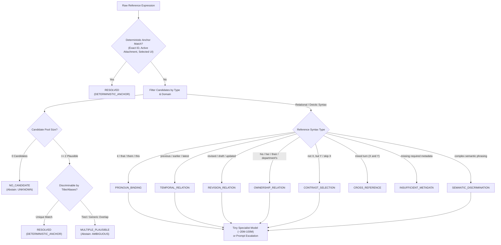

# M35 — URIv1 Parallel Architecture
## Legacy Deterministic Reference & Context Architecture Audit
### Pre-Stage 2 Archaeological Audit for Reference Anchor Resolution (RAR)

- **Date**: September 21, 2026
- **Status**: READ-ONLY ARCHITECTURAL AUDIT
- **Target Worktree**: `C:\Users\cheta\Development\Uri\_V1`
- **Inspected Baseline (Protected Prototype)**: `C:\Users\cheta\Development\uri-agent` (STRICTLY READ-ONLY)
- **Branch**: `m35-uri-v1-parallel-architecture`
- **Git HEAD**: `e8e3b65259c45fc823addc3ef8969425a265bd1b` (uncommitted)
- **Primary Mechanism**: **RAR (Reference Anchor Resolution)** — distinct from prototype **ARN (Adaptive Retrieval Narrowing)**.

---

## 1. Executive Summary & Purpose

Before writing additional deterministic Reference Anchor Resolution (RAR) logic for URIv1, this audit inspects the historical URI prototype (`C:\Users\cheta\Development\uri-agent`) to establish:
1. What deterministic context, state, object selection, evidence binding, candidate narrowing, attachment handling, and workflow continuity mechanisms already worked reliably in production.
2. What deterministic rules, algorithms, and data structures can be directly adapted or conceptually reused for URIv1 RAR.
3. What historical traps, brittle assumptions, and silent fall-throughs must be explicitly avoided.
4. How previous deterministic mechanisms can partition unresolved references into stable, structured failure classes before invoking a small specialist model.

### Key Finding
The legacy URI prototype contains a surprisingly mature, battle-tested body of **deterministic, non-generative binding mechanisms**. Mechanisms such as `CapabilityContextResolver`, `FactManager` supersession tracking, `StoredFile.to_reference()` attachment handling, `plausible_matches()` term-document frequency discrimination, and `ARNEngine` candidate elimination were designed under the explicit rule: **"Retains identifiers already returned by an action, never inventing one."**

However, because these mechanisms evolved organically across multiple milestones (M10 through M34), they were fragmented across separate packages (`uri_core/capabilities`, `uri_core/core`, `uri_core/services`). In several critical handoffs, they defaulted to prompt-level instructions (e.g. instructing a large LLM to "resolve pronouns from the last turn") rather than formalizing deterministic reference binding as a first-class turn contract.

URIv1 Batch A2.5 RAR provides the exact architectural container needed to unify these proven deterministic mechanisms into a coherent, high-certainty **RAR Deterministic Coverage Stack**.

---

## 2. Legacy Components Inspected & Execution Paths

The audit traced the following files, contracts, and execution paths in `C:\Users\cheta\Development\uri-agent`:

| Subsystem / Area | Key Implementation Files | Key Test Files | Architectural Role in Prototype |
|---|---|---|---|
| **Context & Follow-up Grounding** | `uri_core/capabilities/context_resolver.py`<br>`uri_core/capabilities/executor.py` | `test_multi_action_capabilities.py`<br>`test_canonical_execution.py`<br>`test_m33_batch_b_registry_bridge_and_dispatch.py` | Retains identifiers (`message_id`, `thread_id`, `attachment_id`, `filename`) returned by prior actions; binds pronouns ("that one", "its attachment", "prepare a reply"). |
| **Action Chain Reference Linking** | `uri_core/capabilities/executor.py`<br>`uri_core/core/multi_action_dispatch.py` | `test_multi_action_capabilities.py`<br>`test_canonical_execution.py` | Resolves reference expressions (`$from`, `$step_id.path`) across multi-step action execution chains deterministically. |
| **Session State & Fact Manager** | `uri_core/core/state.py`<br>`uri_core/core/turn_state.py`<br>`uri_core/core/facts.py`<br>`uri_core/core/fact_manager.py` | `test_fact_manager_evidence.py`<br>`test_authoritative_facts_immutability.py`<br>`test_evidence_fact_integrity.py` | Manages `current_facts`, `evidence_facts`, `historical_facts`, and append-only `fact_history`; handles fact supersession and verification gates. |
| **Context Assembly & Clarification** | `uri_core/core/context_builder.py`<br>`uri_core/core/clarification.py`<br>`uri_core/core/query_context.py` | `test_context_builder.py`<br>`test_evidence_aware_context.py`<br>`test_decision_gates.py` | Evaluates required task fields against facts/evidence; isolates `missing_fields`; produces single-field-at-a-time clarification without prose generation. |
| **Adaptive Retrieval Narrowing (ARN)** | `uri_core/core/arn/engine.py`<br>`uri_core/core/arn/models.py`<br>`uri_core/core/arn/integration.py` | `test_arn_1_deterministic_narrowing.py` | Iteratively narrows search candidates through clue filtering, evidence reclassification barriers, deduplication, and cost ceiling exhaustion. |
| **Secure Attachment Handling** | `uri_core/core/file_store.py`<br>`uri_core/app/server.py`<br>`uri_core/core/turn_state.py` | `test_attachment_download.py`<br>`test_m34_attachment_turn_routing.py` | Generates UUID `file_id`, enforces extension/size guards, scopes to session, projects bounded metadata (`to_reference()`), force-includes attachment readers. |
| **Candidate Preselection & Discrimination** | `uri_core/core/capability_directory.py`<br>`uri_core/core/capability_relevance.py`<br>`uri_core/core/decision_engine.py` | `test_decision_gates.py`<br>`test_m30_5b_candidate_recall.py`<br>`test_m34_attachment_turn_routing.py` | Computes live Term Document Frequency (generic vs discriminating words); filters candidates by discriminating overlap; force-includes foundational and attachment tools. |
| **Continuity & Read-Once Carried History** | `uri_core/core/orchestrator.py`<br>`uri_core/core/turn_state.py` | `test_orchestrator_session_workflow.py`<br>`test_canonical_execution.py` | Read-once carry-forward of unresolved goal attempts (`last_goal_attempt_history`); projection of `active_pointer` for pending user interaction. |

---

## 3. In-Depth Analysis of Discovered Deterministic Mechanisms

### Mechanism 1: `CapabilityContextResolver` (Conversational Entity & Follow-up Grounding)
- **Source**: `uri_core/capabilities/context_resolver.py`
- **Tests**: `test_multi_action_capabilities.py` (L196–206), `test_m33_batch_b_registry_bridge_and_dispatch.py` (L363–396)

1. **What problem did it solve?**
   Resolved conversational follow-ups containing deictic and relational pronouns (e.g., *"Read that one"*, *"Check its attachment"*, *"Prepare a reply"*) against real identifiers returned by the immediately preceding action.
2. **What inputs did it use?**
   - Preceding action execution result (dict containing `messages`, `thread_id`, `attachments`, `from`, `subject`, etc.).
   - Current action name (e.g. `read_message`, `read_attachment`, `create_draft`).
   - Optional capability identifier.
3. **What state did it rely on?**
   In-memory session cache: `self._current["message"]`, `self._current["thread_id"]`, `self._current["attachment"]`, and `self._external_current[capability]`.
4. **What deterministic rule or algorithm did it use?**
   - For `read_message`: returns `{"message_id": message["message_id"]}` if present.
   - For `read_thread`: returns `{"thread_id": thread_id or message.get("thread_id")}`.
   - For `read_attachment`: extracts `message_id`, `attachment_id`, `filename` from cached attachment.
   - For `create_draft`: maps `in_reply_to_thread_id`, `to: message.get("from")`, `subject: message.get("subject")`.
   - Invariant: if cached object is absent or lacks required key, returns `{}`.
5. **What output did it produce?**
   A grounded input dictionary of exact entity identifiers and metadata.
6. **How was ambiguity handled?**
   Deterministic pick of first item: `_first_message` picked `messages[0]`; `_first_attachment` picked `attachments[0]`. If multiple messages existed in a search result, it anchored to the first/most recent message.
7. **How was missing information handled?**
   Returned `{}` (empty dict). Caller fallback logic preserved the missing field.
8. **Did it ever guess?**
   **Never.** Explicit docstring: *"Retains identifiers already returned by an action, never inventing one."*
9. **What tests proved the behaviour?**
   `test_context_resolves_grounded_conversational_followups()` proved 3-turn chaining: `search_messages` → `read_message` ("Read that one") → `read_attachment` ("Check its attachment") → `create_draft` ("Prepare a reply").
10. **Is the mechanism still architecturally useful for RAR?**
    **Extremely useful.** It is the direct precursor to RAR's relational and pronoun binding.
11. **Disposition**: **ADAPT**.
12. **Why?**
    The legacy implementation was tied to action dispatch (`action_name == "read_message"`). In URIv1, reference resolution happens at **Step 1** (before action selection). We must adapt the extraction rules so that `RARCandidate` objects (messages, attachments, contacts) are extracted from prior turn results into `ActiveContext`, allowing RAR to bind linguistic expressions directly.

---

### Mechanism 2: `MultiActionExecutor` Reference Linking (`_resolve_references` / `$from`)
- **Source**: `uri_core/capabilities/executor.py` (L102–120)
- **Tests**: `test_canonical_execution.py`, `test_multi_action_capabilities.py`

1. **What problem did it solve?**
   Dynamically wired outputs from earlier steps into inputs of later steps within a multi-step workflow chain.
2. **What inputs did it use?**
   Step inputs dictionary containing `$from` or `$step_id.path.to.field` strings, plus `completed` step execution dictionary.
3. **What state did it rely on?**
   In-memory `completed: Dict[str, Dict[str, Any]]` map of finished steps in the current chain.
4. **What deterministic rule or algorithm did it use?**
   Recursive path traversal: splits `$step_0.result.messages.0.message_id` on `.` and array indices, walking the JSON structure to extract the exact primitive.
5. **What output did it produce?**
   Fully resolved input dictionary with all `$references` replaced by concrete values.
6. **How was ambiguity handled?**
   Path references were absolute and unambiguous (`$step_id.key`).
7. **How was missing information handled?**
   Returned `None` if the path did not exist; parameter validation then halted execution with `invalid_input` or `halted`.
8. **Did it ever guess?**
   **Never.** Exact structural lookup only.
9. **What tests proved the behaviour?**
   Multi-action chained execution tests in `test_canonical_execution.py`.
10. **Is the mechanism still architecturally useful for RAR?**
    Useful for Step 2 execution plans and multi-reference dependency tracking.
11. **Disposition**: **REUSE CONCEPT**.
12. **Why?**
    In Step 1 RAR, references are linguistic rather than JSON paths, but the principle of strict immutable resolution against a finished step dictionary is identical.

---

### Mechanism 3: `FactManager` & `Fact` Supersession / Historical Tracking
- **Source**: `uri_core/core/facts.py`, `uri_core/core/fact_manager.py`
- **Tests**: `test_fact_manager_evidence.py`, `test_authoritative_facts_immutability.py`

1. **What problem did it solve?**
   Prevented stale/superseded facts from being treated as current truth while preserving full historical auditability.
2. **What inputs did it use?**
   Incoming `Fact` or `evidence_fact` (dict with `name`, `value`, `status`, `source`).
3. **What state did it rely on?**
   `session.current_facts`, `session.evidence_facts`, `session.historical_facts`, and `session.fact_history`.
4. **What deterministic rule or algorithm did it use?**
   - If `new_fact.name` exists in `current_facts` with different value:
     - Old fact status set to `"SUPERSEDED"`.
     - Old fact archived into `historical_facts[name]` and appended to `fact_history[name]`.
     - New fact stored in `current_facts[name]`.
     - Action recorded as `"SUPERSEDED"`.
   - If values match and old status was `PROVISIONAL` while new is `VERIFIED`:
     - Upgrades status in-place to `VERIFIED` (`"UPGRADED_TO_VERIFIED"`).
   - Non-model verification gate (`facts.py:48–58`): `Fact.verify()` strictly rejected verifiers matching `_looks_like_model_actor()` (ai, model, bot, gpt, claude, etc.).
5. **What output did it produce?**
   Status dictionary (`replaced`, `previous_value`, `action`, `fact`).
6. **How was ambiguity handled?**
   Latest verified input supersedes older input; prior values are preserved in append-only list.
7. **How was missing information handled?**
   New fact created with `action: "CREATED"`.
8. **Did it ever guess?**
   **Never.** Explicit equality and status checks.
9. **What tests proved the behaviour?**
   `test_fact_manager_evidence.py` verified:
   - Test 1: User provisional fact creation.
   - Test 2: In-place upgrade to verified when document confirmed same value.
   - Test 3: Supersession and historical archival when new document provided updated value.
10. **Is the mechanism still architecturally useful for RAR?**
    **Critical.** Directly addresses relational reference resolution: "the previous version", "the current one", "the revised order", "what was it before".
11. **Disposition**: **ADAPT**.
12. **Why?**
    The `Fact` status model (`CONFIRMED`, `VERIFIED`, `PROVISIONAL`, `HISTORICAL`, `SUPERSEDED`) and append-only `fact_history` provide the exact ground truth needed to resolve revision and temporal references deterministically without model guessing.

---

### Mechanism 4: `ContextBuilder` & `Clarification` Field Satisfaction State Machine
- **Source**: `uri_core/core/context_builder.py`, `uri_core/core/clarification.py`
- **Tests**: `test_context_builder.py`, `test_evidence_aware_context.py`

1. **What problem did it solve?**
   Determined whether a task had sufficient factual backing to execute, and generated single-field clarification questions without open-ended LLM loops.
2. **What inputs did it use?**
   Task name (`"noting"`, `"letter"`), `current_facts` dict, `relevant_evidence` dict/list.
3. **What state did it rely on?**
   `TASK_REQUIREMENTS` specification table mapping task type to required fields and canned questions.
4. **What deterministic rule or algorithm did it use?**
   - For each requirement:
     - Check if field is in `current_facts` -> `satisfied_fields.append({"source": "TASK_FACT"})`.
     - Else check if field is in `relevant_evidence` (including nested `facts`, `data`) -> `satisfied_fields.append({"source": "VERIFIED_EVIDENCE"})`.
     - Else -> `missing_fields.append(field)`.
   - `ready_to_draft = (len(missing_fields) == 0)`.
   - `get_next_question()` returns the *first* unsatisfied field's question, strictly one at a time.
5. **What output did it produce?**
   Context dict with `satisfied_fields`, `missing_fields`, `ready_to_draft: bool`, and next question.
6. **How was ambiguity handled?**
   Fixed declaration priority: `TASK_FACT` checked before `VERIFIED_EVIDENCE`.
7. **How was missing information handled?**
   Reported explicitly in `missing_fields` list; triggered clarification rather than guessing.
8. **Did it ever guess?**
   **Never.** Missing fields blocked drafting readiness deterministically.
9. **What tests proved the behaviour?**
   `test_context_builder.py` demonstrated 3-stage noting: Stage 1 (partial facts -> not ready, question 1) -> Stage 2 (user answers -> question 2) -> Stage 3 (all satisfied -> `ready_to_draft: True`).
10. **Is the mechanism still architecturally useful for RAR?**
    **Highly useful.** It embodies the principle of *safe abstention* (`UNKNOWN` / `AMBIGUOUS`) when required fields/entities are absent.
11. **Disposition**: **REUSE CONCEPT**.
12. **Why?**
    While `TASK_REQUIREMENTS` was task-specific, the mechanism of checking required reference bindings against active evidence and isolating missing items into a formal list directly supports RAR's structured abstention.

---

### Mechanism 5: `ARNEngine` Progressive Candidate Elimination & Deduplication
- **Source**: `uri_core/core/arn/engine.py`, `uri_core/core/arn/models.py`
- **Tests**: `test_arn_1_deterministic_narrowing.py`

1. **What problem did it solve?**
   Managed recovery when a search failed (`NOT_FOUND`), progressively narrowing candidates through user clues without open-ended looping.
2. **What inputs did it use?**
   Search query, candidate list (`Candidate`), `UserClue` (`key`, `value`), `CostCeiling` (`max_searches`).
3. **What state did it rely on?**
   `ARNState`: `candidates`, `eliminated`, `sources_checked`, `user_clues`, `status` (`ACTIVE`, `FOUND`, `USER_ELIMINATED_ALL`, `EXHAUSTED`).
4. **What deterministic rule or algorithm did it use?**
   - Progressive elimination: `eliminate_candidate(id, reason)` moves candidate to `eliminated` list.
   - User clue filtering: filters candidates where `metadata[clue.key] == clue.value`. If all candidates ruled out, sets status to `USER_ELIMINATED_ALL`.
   - Search deduplication: normalizes queries (`query.strip().lower()`); skips repeated lookups.
   - Cost ceiling: decrements remaining search budget; transitions to `EXHAUSTED` with reason `cost_ceiling_reached`.
   - Non-promotion barrier: `EvidenceItem(EDGE_DEDUCTION)` explicitly raises `EvidencePromotionError` if reclassification to `VERIFIED_FACT` is attempted.
   - Structured clarification: `get_clarification_recommendation()` computes discriminating metadata axis (e.g. `"category"`) and candidate groups, without generating conversational prose.
5. **What output did it produce?**
   Updated `ARNState` with remaining candidates or structured clarification recommendation.
6. **How was ambiguity handled?**
   Identified candidate groups along shared metadata axes and surfaced them for user selection.
7. **How was missing information handled?**
   Budget exhaustion produced `EXHAUSTED` status; clue mismatch produced `USER_ELIMINATED_ALL`.
8. **Did it ever guess?**
   **Never.** Zero generative fallback.
9. **What tests proved the behaviour?**
   `test_arn_1_deterministic_narrowing.py` (10 unit tests covering progressive elimination, deduplication, clue filtering, cost ceilings, and promotion barriers).
10. **Is the mechanism still architecturally useful for RAR?**
    **Yes.** It provides the mathematical and structural foundation for candidate narrowing and safe abstention.
11. **Disposition**: **REUSE CONCEPT**.
12. **Why?**
    Existing ARN is a stateful search recovery engine. RAR is single-turn reference binding. However, ARN's candidate metadata filtering and structured disambiguation recommendation directly inform RAR's `AMBIGUOUS` candidate grouping.

---

### Mechanism 6: `FileStore` & Turn Attachment Handle Verification
- **Source**: `uri_core/core/file_store.py`, `uri_core/app/server.py`
- **Tests**: `test_attachment_download.py`, `test_m34_attachment_turn_routing.py`

1. **What problem did it solve?**
   Safely ingested, validated, and bounded user attachments, exposing them to the reasoning system without passing raw bytes or permitting cross-session leakage.
2. **What inputs did it use?**
   Uploaded files, `AskRequest(attached_file_ids=[...])`, `session_id`.
3. **What state did it rely on?**
   `FileStore` index (`index.json`), `StoredFile` metadata records.
4. **What deterministic rule or algorithm did it use?**
   - Server-generated UUID `file_id`; sanitized original filename for display only.
   - 25 MB byte cap and extension allow-list.
   - `StoredFile.to_reference()`: projects only `{file_id, filename, media_type, size_bytes}`.
   - `_current_turn_attachment_references`: looks up each ID in `FileStore`; verifies `record.session_id == session_id`; cross-session or unknown IDs fail closed (omitted).
   - In `decision_engine.py`: if `current_turn_attachments` is non-empty, capabilities declaring `reads_current_attachments=True` are force-included in candidate preselection.
5. **What output did it produce?**
   Safe attachment reference list in turn state.
6. **How was ambiguity handled?**
   Explicit `file_id` handles prevent ambiguous file matching.
7. **How was missing information handled?**
   Unattached turns simply omit attachment context; invalid IDs fail closed.
8. **Did it ever guess?**
   **Never.** Strict session containment and explicit handle validation.
9. **What tests proved the behaviour?**
   `test_m34_attachment_turn_routing.py` (verified handle projection, cross-session failure, and reader force-inclusion).
10. **Is the mechanism still architecturally useful for RAR?**
    **Directly applicable.** This is the exact foundation for RAR's `RARDeterministicAnchor.current_attachment_id` and `is_attachment` candidate flag.
11. **Disposition**: **REUSE CODE / ADAPT**.
12. **Why?**
    The `to_reference()` shape `{file_id, filename, media_type, size_bytes}` and the session validation logic map 1:1 to URIv1's attachment contracts.

---

### Mechanism 7: `CapabilityRelevance` TF-IDF Term Discrimination & Candidate Preselection
- **Source**: `uri_core/core/capability_relevance.py`, `uri_core/core/decision_engine.py`
- **Tests**: `test_decision_gates.py` (L189+), `test_m30_5b_candidate_recall.py`

1. **What problem did it solve?**
   Prevented common generic words (e.g. "search", "check", "email") from falsely matching every capability, dynamically computing term discrimination from the directory.
2. **What inputs did it use?**
   `goal_text`, `CapabilityDirectory` summaries.
3. **What state did it rely on?**
   Live directory contents (`directory.summaries()`).
4. **What deterministic rule or algorithm did it use?**
   - Computes Term Document Frequency (`compute_term_document_frequency`): counts how many capabilities contain each word token.
   - Tokens appearing in $\le 1$ capability are marked **discriminating**; tokens appearing in $\ge 2$ capabilities are marked **generic**.
   - `discriminating_overlap`: computes `discriminating_score = len(discriminating_terms) / denominator`.
   - `plausible_matches`: filters to candidates with `discriminating_score >= 0.02`.
   - `preselect_candidate_ids`: unions lexical matches, `originating_goal` matches (for continuing turns), foundational capabilities (`remember_fact`, `recall_memory`), and attachment readers.
5. **What output did it produce?**
   Ordered list of plausible capability IDs with scores and matched discriminating terms.
6. **How was ambiguity handled?**
   Scored by discriminating overlap; sorted by `(-score, capability_id)`.
7. **How was missing information handled?**
   Returns `None` if directory is empty or preselection cannot run.
8. **Did it ever guess?**
   **Never.** Pure token frequency and set intersection arithmetic.
9. **What tests proved the behaviour?**
   `test_decision_gates.py` proved that "search" alone does not falsely pass the Unsupported Gate for generic requests.
10. **Is the mechanism still architecturally useful for RAR?**
    **Highly useful.** It provides an elegant, zero-LLM algorithm for scoring candidate relevance against reference expressions and domain tags.
11. **Disposition**: **ADAPT**.
12. **Why?**
    The algorithm can be adapted from capability descriptors to `RARCandidate` descriptors (evaluating title, domain tags, and aliases against referring expressions).

---

### Mechanism 8: `TurnState` Active Pointer & Read-Once Carried Attempt History
- **Source**: `uri_core/core/turn_state.py`, `uri_core/core/orchestrator.py` (L2850–2865, L4740–4765)
- **Tests**: `test_canonical_execution.py`, `test_orchestrator_session_workflow.py`

1. **What problem did it solve?**
   Maintained conversational continuity when the user responded to an ongoing goal or clarifying question (e.g., replying *"Amit"* to *"Who is the student?"*).
2. **What inputs did it use?**
   `session.active_workflow`, `session.active_workflow_question`, `session.last_goal_attempt_history`.
3. **What state did it rely on?**
   Session memory: `last_goal_text`, `last_goal_attempt_history`.
4. **What deterministic rule or algorithm did it use?**
   - Read-once carry forward: Orchestrator reads `last_goal_attempt_history` at the start of the turn and **immediately clears it** (`session.last_goal_attempt_history = None`). This guarantees carried state does not linger or accumulate indefinitely.
   - `_project_active_pointer`:
     - Checks if a workflow is waiting for input (`awaiting_clarification_answer` / `paused_workflow`).
     - Extracts `missing_field`, `expected_type` (inferred deterministically via name heuristics: "id" -> "identifier", "email" -> "email_address", "date" -> "date"), `originating_goal`, and `prompt_asked`.
5. **What output did it produce?**
   `active_pointer` dict in `TurnState`.
6. **How was ambiguity handled?**
   If no pending interaction exists, `active_pointer["kind"] = "none"`.
7. **How was missing information handled?**
   Empty pointer record with all fields set to `None`.
8. **Did it ever guess?**
   **Never.** Read strictly from the prior turn's execution record.
9. **What tests proved the behaviour?**
   `test_canonical_execution.py` proved continuation recovery across clarification turns.
10. **Is the mechanism still architecturally useful for RAR?**
    **Critical.** This is the exact mechanism that tells RAR: *"The user is currently answering a clarification question about field X of entity Y."*
11. **Disposition**: **ADAPT**.
12. **Why?**
    In URIv1 Step 1, when the user provides a bare answer (e.g. an ID, name, or pronoun), the `ActiveContext` active pointer deterministically anchors the referent without needing generative semantic parsing.

---

## 4. Special Focus Findings: Legacy vs. RAR Equivalents

| Requirement Dimension | Legacy Prototype Mechanism | Concrete Legacy Code / Tests | Architectural Equivalence to RAR |
|---|---|---|---|
| **Explicit-Anchor Binding** | Verbatim reference to explicit ID or alias | `capability_resolver.py:149–155`<br>`test_multi_action_capabilities.py` | **Full Equivalence.** Exact ID or alias match short-circuits deterministically before model invocation. |
| **Attachment Binding** | Bounded reference projection and reader force-inclusion | `file_store.py:108–120` (`to_reference`)<br>`server.py:AskRequest.attached_file_ids`<br>`test_m34_attachment_turn_routing.py` | **Full Equivalence.** `RARDeterministicAnchor.current_attachment_id` directly models legacy `current_turn_attachments`. |
| **Active-Object Binding** | Foreground UI / active workflow object | `turn_state.py:199–227` (`_project_active_pointer`) | **Full Equivalence.** `active_pointer` models the foreground object currently awaiting input. |
| **Previous/Current Object Selection** | Read-once carry forward of previous turn's target | `orchestrator.py:2855–2861, 4744–4758`<br>`context_resolver.py:70–74` | **Partial Equivalence.** Legacy captured last message/action result; RAR formalizes this via candidate `recency_rank` (0 = current, 1 = previous). |
| **Current vs. Superseded Facts** | Fact status lifecycle and append-only conflict history | `facts.py:6–13` (`FACT_STATUSES`)<br>`fact_manager.py:49–63` (`fact_history`)<br>`test_fact_manager_evidence.py` | **Full Equivalence.** `SUPERSEDED` vs `CONFIRMED`/`VERIFIED` status cleanly separates current from superseded versions. |
| **Entity-to-Resource Relationships** | Message sender, thread, and attachment linkage | `context_resolver.py:98–123` (message `from` -> draft `to`; message -> attachment) | **Partial Equivalence.** Legacy hardcoded email-to-attachment relations; RAR generalizes this via candidate `owner` and `domain_tags`. |
| **Thread/Message Relationships** | Thread ID inheritance and reply threading | `context_resolver.py:60–66, 114` (`in_reply_to_thread_id`) | **Full Equivalence.** Structural relationship preserved across turns. |
| **Candidate-Set Narrowing** | Dynamic filtering via user clues and elimination reasons | `arn/engine.py:57–78` (`apply_user_clue`, `eliminate_candidate`)<br>`test_arn_1_deterministic_narrowing.py` | **Conceptual Equivalence.** Proves candidate elimination rules based on metadata matching without LLM intervention. |
| **Alias Matching** | Multi-action capability aliases and action synonyms | `capability_directory.py:90, 264` (`aliases`)<br>`test_m33_batch_b...py:398–415` | **Full Equivalence.** `RARCandidate.exact_aliases` mirrors legacy `aliases`. |
| **Temporal / Reference Ordering** | Ordinal indexing over thread messages and fact history | `context_resolver.py:72` (`messages[-1]`)<br>`fact_manager.py:60` (`fact_history`) | **Partial Equivalence.** Legacy used implicit array order; RAR requires explicit monotonic `recency_rank`. |
| **Pronoun Antecedent Support** | Action-targeted pronoun binding to prior evidence | `context_resolver.py:78–82` ("that one", "its attachment") | **Partial Equivalence.** Legacy bound pronouns during tool execution; RAR pulls this forward into Step 1 semantic decoding. |
| **Clarification after Ambiguity** | Axis-based discrimination recommendation without prose | `arn/engine.py:100–113` (`get_clarification_recommendation`) | **Full Equivalence.** Groups ambiguous candidates along shared metadata keys, directly producing `RAROutcome.AMBIGUOUS`. |
| **UNKNOWN / No-Match Behaviour** | Fail-closed empty dict / `USER_ELIMINATED_ALL` / `not_found` | `context_resolver.py:126`<br>`arn/models.py:ARNStatus.USER_ELIMINATED_ALL` | **Full Equivalence.** Safe abstention without fabrication. |

---

## 5. Comparison Against Current A2.5 RAR Contracts

### A. Legacy Capability Already Represented in New RAR
1. **Strict Candidate-Only Membership**: `validate_rar_resolution()` enforces that resolved and ambiguous IDs must be members of `candidates`. This matches `CapabilityContextResolver`'s core rule: *"Retains identifiers already returned by an action, never inventing one."*
2. **Deterministic Bypass**: `resolve_rar_deterministically()` covers explicit IDs, current turn attachments, and selected UI objects, exactly matching legacy `FileStore` handles and `_project_active_pointer`.
3. **Tri-State Safe Abstention**: `RAROutcome.RESOLVED`, `UNKNOWN`, `AMBIGUOUS` directly mirror legacy's distinct handling of single matches, empty sets (`not_found`), and multiple candidates (`ClarificationRecommendation`).
4. **Verbatim Alias Short-Circuit**: Exact alias matching on `RARCandidate.exact_aliases` mirrors legacy `CapabilityDirectoryEntry.aliases`.

### B. Legacy Capability Missing from New RAR (Identified for Stage 2)
1. **Dynamic Term Document Frequency Scoring**: `RARCandidate` matching in RAR currently has no discriminating vs generic term scorer. Adapting `capability_relevance.py`'s `discriminating_overlap` algorithm will allow RAR to score candidates by unique title/tag overlap without relying on a model.
2. **Read-Once Carried Attempt Target**: Legacy `orchestrator.py` carried the immediately preceding turn's target and cleared it read-once. RAR needs an explicit `ActiveContext` field for `immediately_preceding_target_id`.
3. **Structured Clarification Axis**: `ARNEngine` had `get_clarification_recommendation()`, which computed the exact metadata key (e.g. `category`, `date`) that discriminates ambiguous candidates. RAR currently returns `ambiguous_candidate_ids` as an unannotated tuple.
4. **Structured Failure Classification**: Legacy distinguished `cost_ceiling_reached`, `not_found`, `user_eliminated_all`, and `awaiting_user_response`. RAR currently collapses all non-resolutions into either `UNKNOWN` or `AMBIGUOUS`.

### C. New RAR Capability That Did Not Exist Previously
1. **Model-Neutral Decoupled Contract**: Legacy mixed context resolution with Gmail-specific execution code. RAR is 100% model-neutral and decoupled from execution.
2. **Step-1 Linguistic Scope**: Legacy context resolution ran *after* action selection (during execution). RAR resolves linguistic references *before* runtime routing, enabling Step 1 to output clean semantic goals.
3. **Contrast & Negation Evidence Modeling**: `RAREvidence.negation_spans` explicitly isolates rejected referents (e.g. *"not that one"*), which legacy never modeled structurally (relying solely on prompt instructions).

### D. Legacy Behaviour That Should NOT Be Carried Forward
1. **Hardcoded Domain Extractors**: `fact_extraction.py` and `evidence_fact_extractor.py` hardcoded regexes for "SBI General Insurance" and "NIT Sikkim". Hardcoding domain entities in python code violates model-neutrality.
2. **Ad-Hoc Prompt Correction Addenda**: `model_reasoning_adapter.py` accumulated dozens of lines of prose rules (e.g. *"resolve pronouns from the last conversation entry"*, *"don't repeat the same question"*). Prose rules in prompts are fragile and fail on smaller models; reference resolution must be structurally enforced by code.
3. **First-Item Heuristic on Ambiguity**: `CapabilityContextResolver._first_message` silently picked the first message when multiple messages were returned. Silently picking index 0 masks ambiguity; RAR must return `AMBIGUOUS` instead of guessing.
4. **Fail-Open Full Catalog Exposure**: In `decision_engine.py:360`, when preselection could not run, it returned `None`, causing the caller to "fall back to showing every capability". In Step 1 reference resolution, failing open causes massive prompt bloat and candidate hallucination.

---

## 6. Architecture Evaluation: Layered Reduction & Structured Failure Classes

The user's proposed architecture envisions:
$$\text{raw reference} \longrightarrow \text{deterministic RAR} \longrightarrow \text{structured failure class} \longrightarrow \text{deterministic refinement} \longrightarrow \text{tiny specialist} \longrightarrow \text{larger reasoning}$$

### Can Legacy Mechanisms Partition Unresolved RAR Cases into Stable Classes?
**Yes, decisively.** By combining legacy deterministic checks, an unresolved reference that escapes Level 0/1 deterministic bypass can be mechanically classified into one of **10 structured classes**:



### The 10 Structured Unresolved Classes
1. **`NO_CANDIDATE`**: Candidate set contains zero members matching the required target type or domain tags. *Action: Return `UNKNOWN` immediately without invoking model.*
2. **`MULTIPLE_PLAUSIBLE`**: Two or more candidates match all available metadata with identical scores (e.g. two budget spreadsheets from the same month). *Action: Return `AMBIGUOUS` with candidate IDs for user clarification.*
3. **`PRONOUN_BINDING`**: Expression is a bare deictic/pronoun (*"it"*, *"that"*, *"them"*) with no distinguishing nouns. *Action: Evaluate active pointer or immediately preceding target.*
4. **`TEMPORAL_RELATION`**: Expression contains ordinal/temporal markers (*"previous"*, *"earlier"*, *"latest"*). *Action: Evaluate candidates sorted by monotonic `recency_rank`.*
5. **`REVISION_RELATION`**: Expression references document state (*"revised draft"*, *"original order"*). *Action: Evaluate fact history / version tags.*
6. **`OWNERSHIP_RELATION`**: Expression references entity affiliation (*"his application"*, *"the warden's memo"*). *Action: Cross-reference candidate `owner` field against active entities.*
7. **`CONTRAST_SELECTION`**: Turn contains negation spans (*"not that one"*, *"skip the invoice"*). *Action: Filter out negated candidate before resolving remaining candidate.*
8. **`CROSS_REFERENCE`**: Multi-reference turn where referents belong to different semantic types (e.g. document + person). *Action: Partition into independent sub-queries.*
9. **`INSUFFICIENT_METADATA`**: Candidates lack the metadata needed to test the reference (e.g. candidates have no timestamps). *Action: Safe abstention.*
10. **`SEMANTIC_DISCRIMINATION`**: Linguistic complexity exceeds deterministic rules; genuine world knowledge or nuanced comprehension required. *Action: Escalate to specialist model.*

---

## 7. Proposed RAR Deterministic Coverage Stack

For Stage 2 implementation, we propose the following **8-level Deterministic Coverage Stack**, ordered strictly from **highest certainty (zero inference)** to **least certainty (probabilistic scoring)**:

```
+-----------------------------------------------------------------------------------+
| LEVEL 0: Verbatim ID / Exact Key Anchor                                           |
| - Verbatim candidate ID match (e.g. "doc_audit_984")                              |
| - Verbatim exact alias match from RARCandidate.exact_aliases                      |
| Certainty: 100% | Model Invocation: NEVER                                         |
+-----------------------------------------------------------------------------------+
                                         | (if no match)
                                         v
+-----------------------------------------------------------------------------------+
| LEVEL 1: Active Turn Context Anchors                                              |
| - Current turn foreground attachment handle (from FileStore session handle)       |
| - Active UI selected item identifier                                              |
| Certainty: 100% | Model Invocation: NEVER                                         |
+-----------------------------------------------------------------------------------+
                                         | (if no match)
                                         v
+-----------------------------------------------------------------------------------+
| LEVEL 2: Strict Verbatim Title Match                                              |
| - Case-insensitive exact match of user expression against candidate.title        |
| - Disallows substring ambiguity (must uniquely match exactly one candidate)       |
| Certainty: 99% | Model Invocation: NEVER                                          |
+-----------------------------------------------------------------------------------+
                                         | (if no match)
                                         v
+-----------------------------------------------------------------------------------+
| LEVEL 3: Active Pointer Continuation Binding                                      |
| - Immediately preceding turn's active pointer awaiting clarification for field X  |
| - Single immediate target returned by immediately preceding action result        |
| Certainty: 95% | Model Invocation: NEVER                                          |
+-----------------------------------------------------------------------------------+
                                         | (if no match)
                                         v
+-----------------------------------------------------------------------------------+
| LEVEL 4: Explicit Schema & Type-Constraint Filtering                              |
| - Filter candidate pool by target_type_hint (e.g. document vs email vs person)    |
| - If filtered pool == 0 -> Short-circuit as UNKNOWN (NO_CANDIDATE)                |
| - If filtered pool == 1 -> Resolve if reference has no contradictory qualifiers   |
| Certainty: 90% | Model Invocation: NEVER                                          |
+-----------------------------------------------------------------------------------+
                                         | (if no match)
                                         v
+-----------------------------------------------------------------------------------+
| LEVEL 5: Temporal / Version Ordinal Offset Selection                              |
| - "latest" / "current" -> Select recency_rank == 0 (if unambiguous)               |
| - "previous" / "earlier" -> Select recency_rank == 1                              |
| - "revised" -> Select candidate with domain_tags containing "revised"             |
| Certainty: 85% | Model Invocation: NEVER                                          |
+-----------------------------------------------------------------------------------+
                                         | (if no match)
                                         v
+-----------------------------------------------------------------------------------+
| LEVEL 6: Discriminating Term Overlap Ranking (Adapted TF-IDF)                     |
| - Compute Term Document Frequency across candidate titles/tags                    |
| - Filter by discriminating overlap score >= threshold                             |
| - If single top candidate exceeds runner-up by margin -> RESOLVED                 |
| - If top candidates tie -> AMBIGUOUS (MULTIPLE_PLAUSIBLE)                         |
| Certainty: 80% | Model Invocation: NEVER                                          |
+-----------------------------------------------------------------------------------+
                                         | (if no match)
                                         v
+-----------------------------------------------------------------------------------+
| LEVEL 7: Structured Failure Partitioning & Escalation Gate                        |
| - Classify remaining unresolved reference into structured class (1-10)            |
| - If safe abstention indicated -> Return UNKNOWN or AMBIGUOUS                     |
| - Else -> Escalate bounded candidate set to Tiny Specialist Classifier / Reranker |
+-----------------------------------------------------------------------------------+
```

---

## 8. Recommendations for Subsequent Batch A2.5 Stages

1. **Do Not Rush to Model Downloads or Training**:
   Before evaluating any neural models, implement **Levels 0 through 5** of the Deterministic Coverage Stack in URIv1 harness code. Test how many of the 24 diagnostic fixtures resolve deterministically with 100% accuracy.
2. **Port `discriminating_overlap` from `capability_relevance.py`**:
   Adapt the term-document frequency discrimination algorithm to operate on `RARCandidate` titles and domain tags for Level 6.
3. **Formalize the 10 Structured Failure Classes in `rar_contracts.py`**:
   Add an optional `failure_class: Optional[RARFailureClass] = None` field to `RARResolution` to preserve diagnostic clarity when `outcome != RESOLVED`.
4. **Maintain Absolute Zero-Invention Discipline**:
   The fix implemented in Batch A2.5 Stage 1 (`local_semantic_wire.py`) must be preserved as a standing invariant across all future levels.

---

## 9. Conclusion

The legacy URI codebase already possessed the key architectural building blocks for high-reliability reference resolution. However, they were scattered across tool execution and recovery loops rather than operating as an upfront Step-1 semantic filter.

By adapting these proven algorithms—specifically `CapabilityContextResolver`'s identifier retention, `FileStore`'s bounded handle verification, `FactManager`'s supersession tracking, and `CapabilityRelevance`'s term discrimination—into the clean, model-neutral contracts of **RAR**, URIv1 can resolve the vast majority of user references deterministically, reserving AI models solely for irreducible linguistic discrimination.
